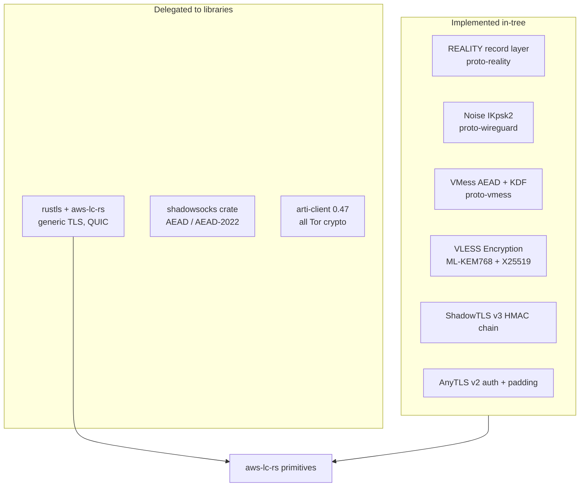
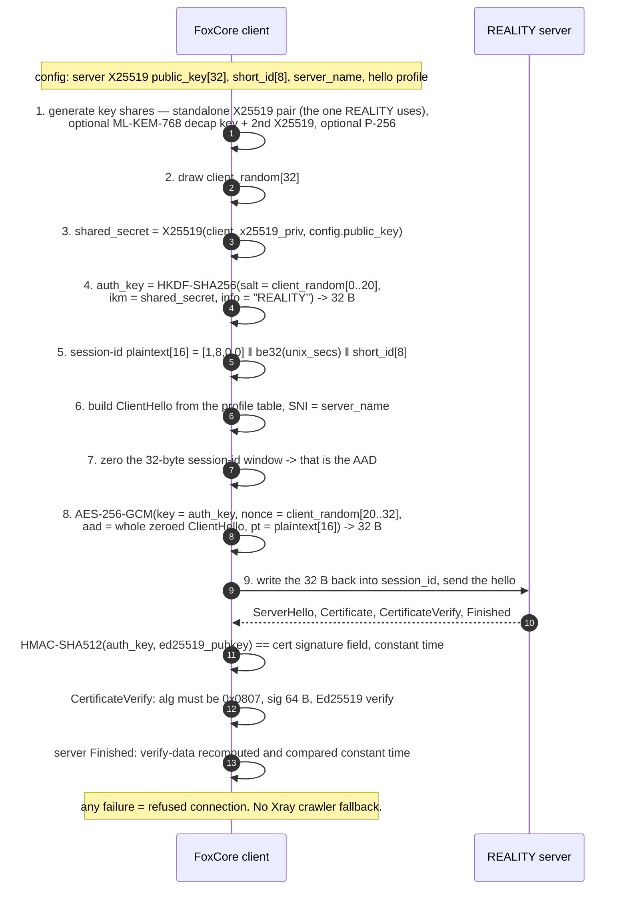
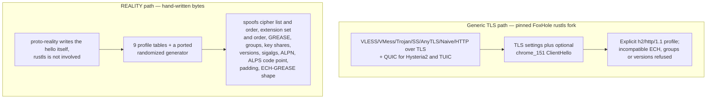
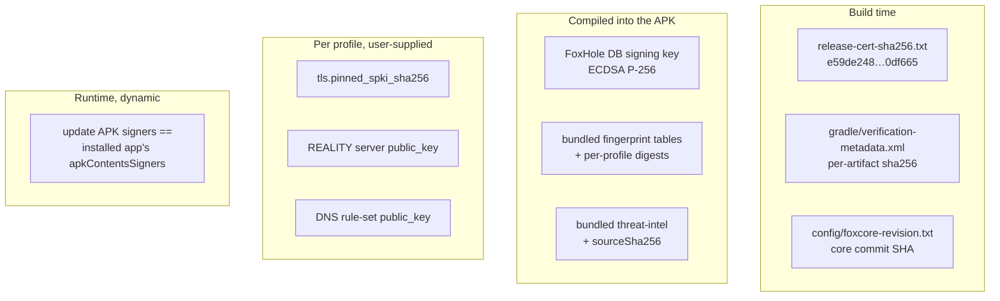

# 2. Cryptography

Per-protocol authentication, the post-quantum story, REALITY's derivation, and what is pinned.

---

## 2.1 Where the crypto lives

Fox-owned generic TLS explicitly builds rustls configurations with the `aws-lc-rs` provider because
`ring` has no ML-KEM (`crates/foxcore-transport/src/tls.rs:454-505`). The dependency graph still
contains `ring` through Arti, Shadowsocks compatibility and a negative ECH test; it is not the
provider selected by FoxCore's TLS builder.

Direct BoringSSL is deliberately not another backend. A rustls `CryptoProvider` controls suites,
groups, signatures, randomness and key loading, but not ClientHello extension order or layout. A
full BoringSSL `libssl` path would therefore be a separate unstable C++/FFI transport on Android; it
would not replace the hand-written REALITY record layer, Quinn, or Firefox/Safari profile shapes.
The BoringSSL-derived primitives needed here already arrive through `aws-lc-rs`.

---

## 2.2 Per-protocol authentication and key exchange

| Protocol | Authentication | Key exchange | Data AEAD |
|---|---|---|---|
| **VLESS** | plaintext UUID (16 B) in the header | none of its own — from the layer below | from the layer below |
| **VLESS Encryption** | suite `mlkem768x25519plus` | X25519 to the server long-term key **or** ML-KEM-768 encapsulation; PFS hop yields `mlkem_ss ‖ x25519_ss` (64 B) | AES-256-GCM or ChaCha20-Poly1305; keys via BLAKE3 `derive_key` |
| **VMess** | `cmdKey = MD5(uuid ‖ magic)`; AuthID = AES-128-ECB over `be64(secs) ‖ 3 rand ‖ be32(CRC32)`; header sealed AES-128-GCM | none — pre-shared UUID | AES-128-GCM or ChaCha20-Poly1305; length masking via SHAKE128 |
| **Trojan** | **SHA-224(password)**, lowercase hex, 56 ASCII bytes | none — from TLS/REALITY below | from TLS below |
| **Shadowsocks / SS-2022** | pre-shared key; method string → `CipherKind` | TCP subkey = `HKDF(key, salt)` | AEAD or AEAD-2022 (`2022-blake3-*`) |
| **Hysteria2** | HTTP/3 `POST /auth`, header `hysteria-auth: <password>` inside TLS; success is `:status 233` | TLS 1.3 inside QUIC | QUIC AEAD; optional Salamander XOR keystream = `BLAKE2b-256(key ‖ salt)` below QUIC |
| **TUIC v5** | UUID + **TLS exporter** token: `export_keying_material(32, label = uuid, context = password)`; zeroized after send | TLS 1.3 inside QUIC | QUIC AEAD |
| **AnyTLS v2** | **SHA-256(password)** ‖ `u16be(pad_len)` ‖ random padding; padding scheme id advertised as `padding-md5=<MD5 hex>` | TLS below | TLS below |
| **ShadowTLS v3** | **HMAC-SHA1** truncated to 4 bytes, written into the ClientHello session id at offset +28; server proof = chained `HMAC-SHA1(password, ServerRandom)`, constant-time compared | TLS 1.3 below | inner Shadowsocks; stage-2 unmask XORs with `SHA-256(password ‖ ServerRandom)` |
| **WireGuard** | Noise **IKpsk2**, `"Noise_IKpsk2_25519_ChaChaPoly_BLAKE2s"` | X25519; BLAKE2s-256, HMAC-BLAKE2s kdf1/2/3 | ChaCha20-Poly1305; XChaCha20-Poly1305 for cookie reply; `mac1 = BLAKE2s-128` |
| **AmneziaWG** | identical to WireGuard | identical | unchanged transport AEAD; optional IETF ChaCha20 outer obfuscation |
| **Naive** | `Proxy-Authorization: Basic` inside TLS | TLS below | TLS below; Variant1 zero padding on first 8 reads/writes |
| **SOCKS5** | RFC 1929 username/password **in the clear** | none | none |
| **HTTP proxy** | Basic auth | optional TLS | optional TLS |
| **REALITY** | see [2.4](#24-reality) | X25519 to the server REALITY key | AES-256-GCM for the auth blob; TLS 1.3 schedule for the session |
| **Tor** | delegated to `arti-client` 0.47.0 | delegated | delegated |
| **I2P** | none in-crate; optional RFC 1929 to the local i2pd | none | none |

Note that `SocksConfig` has no TLS field at all — a SOCKS5 outbound carries its credentials in
plaintext. It exists for loopback and LAN use.

---

## 2.3 Post-quantum

The handwritten REALITY and VLESS Encryption paths use **ML-KEM-768**. REALITY only advertises ML-DSA; the rustls provider has ML-DSA signature implementations (`vendor/rustls/src/crypto/aws_lc_rs/mod.rs:180-182`).

```mermaid
flowchart TD
    subgraph a["A. rustls path — generic TLS and QUIC"]
        A1["aws_lc_rs default_provider"] --> A2["group order:<br/>X25519MLKEM768, X25519,<br/>secp256r1, secp384r1"]
        A2 --> A3["a curve_preferences list that omits<br/>the hybrid gets it PREPENDED"]
        A3 --> A4["dropping it requires<br/>allow_classical_only_key_exchange"]
    end
    subgraph b["B. REALITY path — hand-written hello"]
        B1["own X25519MLKEM768, code point 0x11ec"] --> B2["client share ek(1184) + x25519(32) = 1216 B"]
        B2 --> B3["server share ct(1088) + x25519(32) = 1120 B"]
        B3 --> B4["secret mlkem_ss(32) + x25519_ss(32) = 64 B"]
    end
    subgraph c["C. VLESS Encryption — inner layer"]
        C1["ML-KEM-768 via aws-lc-rs"] --> C2["suite mlkem768x25519plus"]
        C2 --> C3["mlkem1024x448plus refused by name"]
    end
```

Config surface: `CurveGroup::X25519MlKem768`, serde name `x25519mlkem768`, alias `X25519MLKEM768`
(`config/tls.rs:124-130`). Hysteria2 and TUIC inherit the group order through
`rustls_client_config`.

### Which REALITY profiles offer the hybrid

| Profile | `X25519MLKEM768` group | ML-DSA sigalgs |
|---|---|---|
| `chrome_151` | yes | **`0x0904 mldsa44`, `0x0905 mldsa65`, `0x0906 mldsa87`** |
| `chrome_133`, `chrome_131` | yes | no |
| `firefox_153`, `firefox_148` | yes | no |
| `safari_26_3` | yes | no |
| `edge_85`, `ios_14`, `qq_11_1` | no | no |

Firefox reuses one classical scalar across the standalone and hybrid shares
(`reuse_classical_key_share`); Chrome uses two independent ones
(`reality_key_exchange.rs:171-209`).

**ML-DSA is a shape, not a capability.** The three FIPS 204 code points are prepended to Chrome's
eight classical schemes and the list length grows `0x0010 → 0x0016`
(`hello_profile.rs:788-815`). None is implemented: the certificate verifier accepts only Ed25519
(`reality_client_verify.rs:217-225`), and `reality_mldsa65` is declared unsupported in the
capability document. There is **no Kyber, Dilithium or ML-DSA verification code anywhere in either
repository** — every hit is a table entry or a comment.

---

## 2.4 REALITY

### Client derivation, in order

| Step | Primitive | Cite |
|---|---|---|
| ECDH | `aws_lc_rs::agreement::X25519` | `reality_auth.rs:54-84` |
| Auth key | HKDF-SHA256, salt exactly 20 B, info `b"REALITY"` | `reality_auth.rs:98-114` |
| Session-id seal | AES-256-GCM, nonce exactly 12 B, AAD = whole ClientHello | `reality_auth.rs:129-158` |
| Cert HMAC | HMAC-SHA512 over the 32-byte Ed25519 SPKI, `subtle::ct_eq` | `reality_client_verify.rs:84-146` |
| CertificateVerify | Ed25519 over `0x20 × 64 ‖ "TLS 1.3, server CertificateVerify" ‖ 0x00 ‖ transcript_hash` | `reality_client_verify.rs:214-290` |
| TLS 1.3 schedule | in-crate HKDF-Expand-Label / Derive-Secret, SHA-256 or SHA-384 per suite | `reality_tls13_keys.rs:24-140` |

`short_id` is hex, ≤16 chars, even length, **right-padded with zeros** to 8 bytes
(`reality_util.rs:34-54`). Handshake secrets and transcripts are zeroized with their state; the
connection also zeroizes its configured public key, short id, server name and I/O buffers on drop
(`reality_client_connection.rs:139-170`, `:195-205`).

Untrusted handshake plaintext is accumulated only up to 64 KiB and the limit is checked before the
buffer grows (`reality_client_connection.rs:56-68`, `:648`). After the handshake, pending encrypted
records plus buffered application plaintext share one 64 KiB budget; a blocked network therefore
backpressures the application rather than growing two independent queues
(`reality_client_connection.rs:931-936`; `reality_reader_writer.rs:65-70`).

`server_name` is the SNI written into the parroted hello and must be an ASCII DNS name — IP literals
are rejected. There is **no client-side "dest" or fallback-target concept**; that is server-side
REALITY. This client only writes the SNI and refuses anything that is not a REALITY-signed
certificate.

---

## 2.5 TLS fingerprinting — two disjoint mechanisms

Generic TLS can select `tls.fingerprint: "chrome_151"` through the pinned rustls fork
(`crates/foxcore-api/src/config/tls.rs:42-46`; `crates/foxcore-transport/src/tls.rs:382-387`).
The profile requires DNS SNI, explicit h2/http/1.1 ALPN, its TLS1.2..TLS1.3 offer and hybrid-first
curve order; incompatible settings are refused (`vendor/rustls/src/client/chrome_hello.rs:50-79`).
ClientHello shaping does not imply a complete Chromium network stack or remove protocol-specific
capability limits. REALITY writes its own ClientHello and does not use this rustls builder.

In secure mode, certificate paths still pass the configured verifier and any mandatory pin
(`crates/foxcore-transport/src/tls.rs:315-347`). The lock selects rustls-webpki 0.103.16 and
webpki-roots 1.0.10 for the emSign distrust fixes (`Cargo.lock`, rustls-webpki/webpki-roots entries).
Explicit insecure consent and configured pins remain separate; fingerprint selection does not
weaken certificate verification.

**REALITY profiles implemented** (`capabilities.rs:1102-1117`): `chrome_151`, `chrome_133`, `chrome_131`,
`edge_85`, `safari_26_3`, `ios_14`, `qq_11_1`, `firefox_153`, `firefox_148`, plus `random` (one
modern table chosen per process) and `randomized` (a fresh generated hello per connection). Seven
tables are transcribed from uTLS; `chrome_151` and `firefox_153` come from first-party captures.

**Refused rather than substituted**: `360` and `android` — both TLS 1.2 parrots that send no
`key_share`, and REALITY derives its auth key from the client's X25519 share, so no REALITY
handshake is possible with that hello (`capabilities.rs:1117`).

**REALITY offers do not imply implementation.** Its hello advertises TLS 1.2, secp256r1/384r1 without shares,
HelloRetryRequest, brotli certificate compression, PSK/0-RTT and (on `chrome_151`) ML-DSA. A server
that takes any of them up is refused, not downgraded to.

### Table feed

Only tables travel; the generator is compiled in. `install_fingerprint_tables`
(`runtime_tables.rs:39-70`) bounds the document; parsing requires schema 1, rejects duplicate names
and skips names this build does not implement (`:93-142`). Every `fingerprint_sha256` is re-derived
over canonical ASCII JSON (`:154-169`). Any failure refuses the whole document. See
[03 — Updates and data delivery](03-updates-and-data-delivery.md).

---

### Portable Android backups

The export checkbox defaults off: the resulting bounded JSON document requires no password.
Enabling encryption selects the version1 envelope, Argon2id13 (64 MiB, three operations,
parallelism1) and AES-256-GCM. Import detects the document bytes before asking for a password;
an unsupported KDF profile is refused before derivation. This choice does not change encrypted
local settings, profile secrets, keybox storage or APK signing
(Guard `app/src/main/kotlin/com/foxhole/guard/core/backup/BackupExportRequest.kt:12,33`;
`app/src/main/kotlin/com/foxhole/guard/core/backup/PortableBackupFormat.kt:41,73`;
`app/src/main/kotlin/com/foxhole/guard/core/backup/BackupEncryption.kt:24,26,47,143,146`).

Export captures one coherent settings/profile/secret snapshot. Restore stages parsing and identity
checks before taking the shared domain, secret and settings owners; database savepoints allow
ordinary per-profile refusal, while cancellation/fatal failure rolls back the whole admitted
restore. Independent NonCancellable cleanup attempts preserve the primary failure. Effects run
after owner release. This proves tested in-process rollback, not cross-store power-loss atomicity,
complete password String erasure or transactional SAF writes. Restore keeps a destination release
credential bound to its original source URL; an imported URL remains transferable when no current
credential exists. Copying a token onto an imported or empty source previously caused its later
normalization to discard it (`Guard app/src/main/kotlin/com/foxhole/guard/core/backup/BackupDocumentSupport.kt:148`)
(Guard `app/src/main/kotlin/com/foxhole/guard/core/backup/ProfileBackupCheckpointAccess.kt:30`;
`app/src/main/kotlin/com/foxhole/guard/core/backup/ProfileBackupSupport.kt:52,115,216`).

## 2.6 What is pinned, and where

| Pinned | Kind | Location |
|---|---|---|
| FoxHole DB manifest key | ECDSA P-256 SPKI, PEM literal | `app/src/main/kotlin/com/foxhole/guard/runtime/FoxholeDb.kt:47-53` |
| …its DER SHA-256 | `3acd123f…98d69` | `FoxholeDb.kt:55-56` |
| …base64 for the Rust core | derived from the PEM | `FoxholeDb.kt:58-64`; consumed at `DnsFilterAssetInstaller.kt:255` |
| TLS server SPKI pin | base64 SHA-256 of `subjectPublicKeyInfo`, must decode to 32 B; replaces WebPKI verification when set | field `config/tls.rs:18`; check `foxcore-transport/src/tls.rs:586` |
| TLS certificate fingerprint | `tls.pinned_certificate_sha256`: base64 SHA-256 of the exact leaf DER certificate; replaces WebPKI verification when set, with handshake signatures still checked | field `config/tls.rs:20`; verifier `foxcore-transport/src/tls.rs:575` |
| DNS rule-set signing key | per-source, from config; base64 SPKI or raw P-256 point, 1..4096 B; `ECDSA_P256_SHA256_ASN1` | `config/dns.rs:102-134`; `foxcore-route/src/ruleset.rs:13`, `:248-295` |
| Per-fingerprint-table digest | `fingerprint_sha256`, re-derived in the core before install | `runtime_tables.rs:137`, `:154-169` |
| Threat-intel source digest | `sourceSha256: 6052636f…4864e` | `app/src/main/assets/sentinel/threat-intel.source.json:7` |
| Third-party app identity | `KnownAppConfig.signing_digest` — hex SHA-256 of another app's signing cert, so a repackaged app fails closed | `config/policy.rs:212-217`; `AndroidApplicationIdentityResolver.kt:84-99` |
| Gradle dependencies | per-artifact SHA-256 | `gradle/verification-metadata.xml` |
| Release APK certificate | `e59de2486084c38f3c77e9df0eb5eff9a4559f3c68024f1208e0e9c04b0df665` | `config/release-cert-sha256.txt` — **build-time check only** |
| FoxCore revision | exact release commit in `config/foxcore-revision.txt` | local Gradle checks the sibling Git HEAD and refuses release mismatches (`app/build.gradle.kts:184-230`) |

**Not pinned:**

- **Tor directory authorities** — arti owns them; no key material in either repo.
- **APK signing certificate at runtime** — there is no literal. `AppUpdateApkVerifier` requires the
  candidate's `apkContentsSigners` digest set to equal the **currently installed app's**, fail-closed
  on an empty set (`AppUpdateApkVerifier.kt:49-80`). `signingCertificateHistory` is deliberately not
  used, so a rotated-away key is refused.
- **No OkHttp `CertificatePinner`** anywhere. Transport hardening is
  `android:usesCleartextTraffic="false"` plus the public-HTTPS URL policy.
- **No Ed25519, minisign or PGP** update signing. The only Ed25519 in the tree is REALITY's *server*
  certificate key, which is authenticated by HMAC-SHA512 under the derived `auth_key` — not pinned.

The Rust lockfile pins the transitive RNG dependency `chacha20` to 0.10.2, replacing
the yanked 0.10.1 release, and `event-listener` to 5.4.2, which fixes
RUSTSEC-2026-0221 (`Cargo.lock:611-620`, `:1458-1466`). Both generated SBOMs follow
that lockfile (`scripts/sbom.sh:64-71`). This dependency update does not change the
protocol algorithms or host TLS-consent contract.

The pinned PEM in `FoxholeDb.kt:47-53` was verified byte-for-byte against
`foxhole-db/manifest.public.pem`, and its DER SHA-256 against `manifest.json`'s `key_sha256`.

---

### TLS dependency validation

The workspace requires rustls 0.23.46; its exact version and required aws-lc-rs, aws-lc-sys and
rustls-webpki versions are recorded in the lockfile (`Cargo.toml:75`; `Cargo.lock:350,361,4052,4078`). The update
addresses TLS 1.3 handshake messages accepted across encryption-level boundaries in earlier
versions. The TLS transcript remains authenticated; the upstream advisory does not claim that
this defect lets an attacker complete a modified handshake. See the
[rustls advisory](https://github.com/rustls/rustls/security/advisories/GHSA-2mjx-qc3c-rqvc).
The generic TLS signature list now has thirteen entries, including ML-DSA from the updated
provider. Its measured JA4 is recorded in `crates/foxcore-transport/tests/ja_fingerprint.rs:1`.
QUIC remains TLS 1.3 only and no longer advertises the TLS 1.2 SessionTicket extension. Hysteria2
and TUIC capture eleven extensions: their JA4 prefix and cipher hash match the immutable Chromium
151 capture, while the extension/signature hash differs. This is a partial shape match, not a full
Chrome fingerprint (`crates/proto-hysteria2/src/quic_fingerprint.rs:1`;
`crates/proto-tuic/src/quic_fingerprint.rs:1`). Browser/REALITY tables are unchanged.
Both supply-chain graphs include all four shipping Android architectures (`deny.toml:270`;
`deny-all-features.toml:35`). The SBOMs retain the resolved provider graph.

### Amnezia authenticated headers and padding

MAC1 covers the actual sampled custom handshake header; MAC2 includes the corrected MAC1.
Incoming custom headers remain intact through MAC verification and are normalized only for Noise
parsing. Cookie AAD uses the MAC1 of the initiation actually sent. The existing vanilla/WARP
post-MAC reserved-byte compatibility remains separate
(`crates/proto-wireguard/src/tunnel.rs:891,1107,1119`).

Handshake candidates authenticate before transport fallback and operate on copies, preserving the
original AEAD payload when differently positioned padding/header ranges overlap. Failed candidates
cannot consume the current handshake/cookie or enlarge the authenticated peer packet window
(`crates/proto-wireguard/src/tunnel.rs:594,631,774,838`). Random data padding is authenticated as plaintext
padding under the existing ChaCha20-Poly1305 transport algorithm
(`crates/proto-wireguard/src/session.rs:141,157`).

Content-padding addition also appends zero plaintext before transport AEAD, including keepalives.
It replaces alignment/RandomTrailers only when its configured range is nonzero; it does not change
Noise, keys, nonces, MACs or the AEAD algorithm. Receive-window growth occurs after authentication
and replay validation (`crates/proto-wireguard/src/tunnel.rs:516,838`).

HPK adds an IETF ChaCha20 stream transform with counter zero and the first 12 prefix bytes as
nonce. It transforms the fixed initiation/response/cookie bodies (148/92/64 bytes) after MACs,
and only the 16-byte transport header after session AEAD. Prefixes, random handshake trailers,
encrypted transport payload and tags retain their existing form. It adds no authentication or
new Noise cipher (`crates/proto-wireguard/src/header_protection.rs:42`;
`crates/proto-wireguard/src/tunnel.rs:741,1125`).

Rust config uses redacted `SecretString`; decoded keys, the non-Copy runtime key and cipher state
clear owned secret buffers on drop. Receive derives one zeroizing 16-byte stream mask, keeps
failed handshake candidates on copies, then decrypts the selected transport header and AEAD in
the caller's mutable buffer. Failed authentication cannot consume a valid replay counter; final
transport selection does not promise ciphertext preservation
(`crates/foxcore-api/src/secret.rs:8`; `crates/proto-wireguard/src/header_protection.rs:10,47`;
`crates/proto-wireguard/src/tunnel.rs:631,704`).

### Read-only manual diagnostics key lookup

The About archive reads retained encrypted journal sessions with the existing Android Keystore
entry only. Missing or non-secret entries produce an ordinary unavailable journal read; this
manual path never generates, rotates or deletes a key. The AES-GCM envelope, alias and normal
background read/write contract are unchanged
(Guard `app/src/main/kotlin/com/foxhole/guard/core/sentinel/AndroidKeystoreFileCipher.kt:20,32,35,107`).

The manual session reader enumerates retained files without expired-file deletion, plaintext
migration or encrypted writes. It uses the known existing-key reader, or an explicitly supplied
read-only reader; an unknown cipher implementation cannot fall back to its potentially creating
read method. Cancellation and fatal errors escape without opening an archive; ordinary corrupt
entries keep the previous skip/failure-row fallback. Background journal append, migration and
cleanup remain separate
(Guard `app/src/main/kotlin/com/foxhole/guard/core/diagnostics/DiagnosticsSessionStore.kt:33,46,76`;
`app/src/main/kotlin/com/foxhole/guard/core/diagnostics/DiagnosticsLogger.kt:263,292`).

## 2.7 Inconsistencies found

- The detached fuzz lockfiles still resolved the older Rustls/aws-lc providers. They now
  use Rustls 0.23.46, webpki 0.103.15, aws-lc-rs 1.18.1 and aws-lc-sys 0.45.0; the
  harness stays separate from the product graph (`fuzz/Cargo.lock`;
  `fuzz/harness/Cargo.lock`). Both fuzz manifests declare MSRV 1.92
  (`fuzz/Cargo.toml:5`; `fuzz/harness/Cargo.toml:5`).

- Arti now resolves coherently to 0.47.0. Flow/congestion control is always compiled; the
  removed `flowctl-cc` feature is no longer requested. The workspace MSRV is 1.92; the
  Docker compiler remains 1.97.1 (`Cargo.toml:39`; `crates/proto-tor/Cargo.toml:41,48-54`).
  Public RSA certificate-signing APIs remain compiled but have no observed client/onion
  callers in the reviewed graph. Constructor callers are test/documentation or disabled
  relay code; the source scanner watches their aliases and keeps the existing advisory
  exception bounded to the reviewed graph (`fixtures/tor-rsa/arti-0.47.0-review.json:1`;
  `scripts/tor-rsa-gate.sh:113,180`). This is a source/feature audit, not a compiler call graph.

- The RSA reachability fixture still named aws-lc-rs 1.17.3 after the locked provider update.
  Three matched files are unchanged; the fourth only re-exports `KeyPairComponents`.
  The versioned fixture and pinned-source review now track 1.18.1 without changing the
  RSA advisory exception or scanner (`fixtures/tor-rsa/aws-lc-1.18.1-review.json:1`;
  `scripts/tor-rsa-gate.sh:113,180`).

- The maintenance inventory omitted transitive `bincode` 2.0.1 while it was
  present in the lockfile and Android SBOM. Both deny policies now list it
  alongside `paste`; the existing transitive-maintenance policy is unchanged
  (`deny.toml:25-38`, `deny-all-features.toml:22-36`). Lockfile/SBOM presence alone does not prove
  compiled reachability: the shipped `foxcore-android` feature graph on `aarch64-linux-android`
  has no reverse dependency path to `bincode`. The workspace-wide inventory also covers optional
  features (`scripts/sbom.sh:64`). Recheck with `cargo tree --locked -p foxcore-android
  --no-default-features --features shipped --target aarch64-linux-android -e features -i bincode`
  before changing the exception or replacing an upstream serializer.
- The previous text called `aws-lc-rs` the only primitive provider, while the actual dependency
  graph still contains `ring`. Fox-owned TLS selects aws-lc-rs; removing every transitive `ring`
  consumer is a separate supply-chain task and is not a reason to add BoringSSL.

- The former Amnezia transformation changed the header after computing MAC1/MAC2, and normalized
  a response before its MAC check. Symmetric local fixtures hid that difference from upstream.
  Independent MAC regressions and a pinned upstream packet exchange now verify the custom-header
  contract; the Noise key agreement and AEAD primitives are unchanged.

- Manual About export previously used the journal reader that could clean or migrate files and
  create a missing encryption key. It now uses an explicit read-only existing-key path; tests
  use synthetic keys and do not establish device AndroidKeyStore provider behavior.
