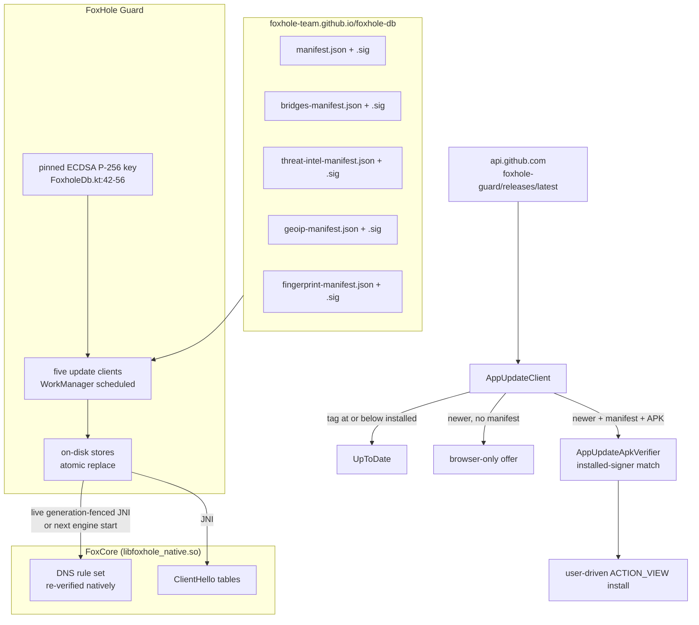
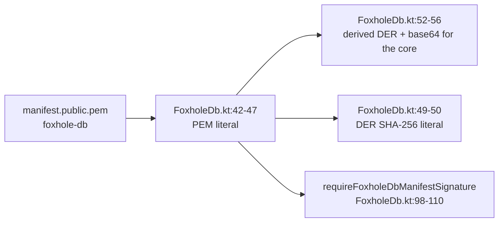
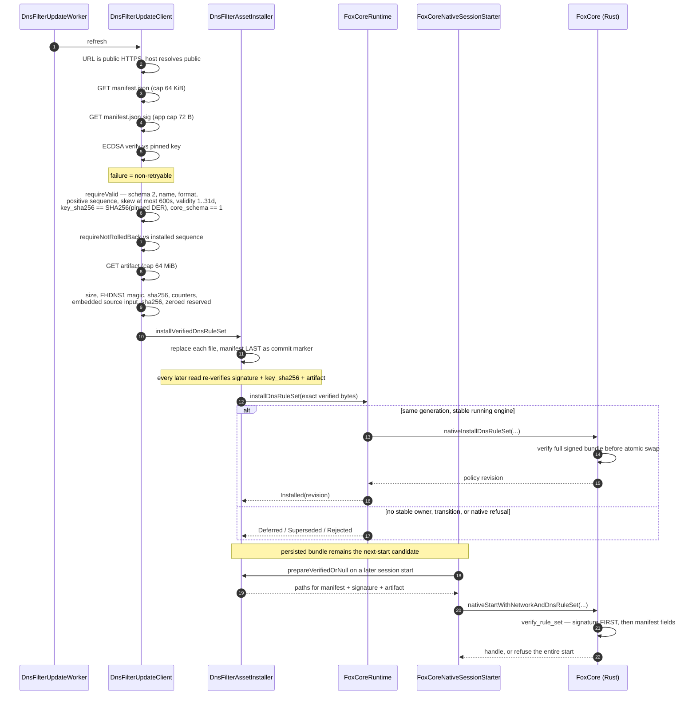
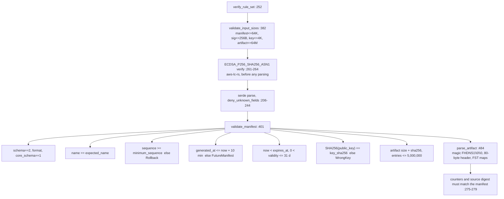
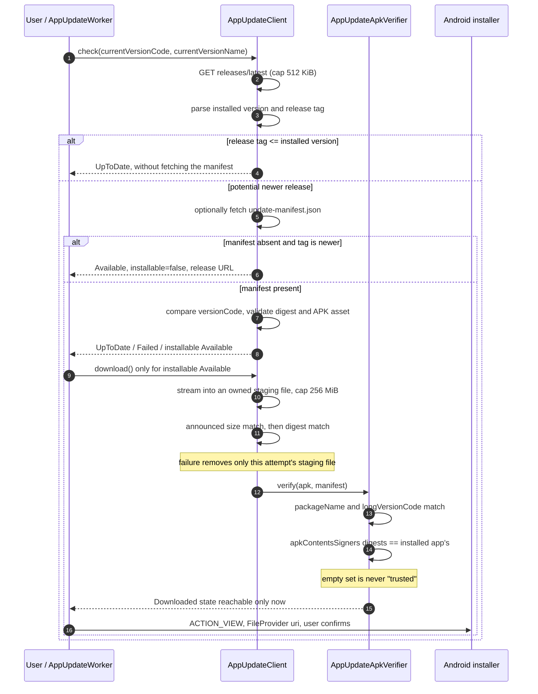

# 3. Updates and data delivery

Two independent channels deliver published artifacts: **five signed data feeds** published together from FoxHole DB, and
**APK updates** from each Android app's GitHub Releases. Data and APKs have separate trust anchors.

---

## 3.1 The whole picture

| Channel | Trust anchor | Signature over |
|---|---|---|
| Data feeds | ECDSA P-256 key pinned in the **app** (`FoxholeDb.kt`); the core takes it from engine-config JSON and pins nothing itself | the manifest bytes |
| APK | the certificate the **currently installed app** is signed with | the APK itself (Android signing scheme) |

APK update manifests are unsigned HTTPS metadata, not signed FoxHole DB feeds. Guard matches the
installed APK signer; VPN additionally requires its pinned release-certificate digest — see [3.6](#36-apk-update-channel).

---

### Guard delivery inventory and native dependencies

Guard 1.0.0 source pins i2pd to OpenSSL 3.5.8 and its Tor transport compiler to Go 1.26.10.
These source pins require matching fresh native outputs and delivery receipts; they do not establish a completed release build.
Go module versions are pinned separately from the upstream helper commits
(`foxhole_guard/scripts/native-deps.sh:6`; `foxhole_guard/scripts/native-deps.sh:21`;
`foxhole_guard/config/native/lyrebird/go.mod:1`;
`foxhole_guard/config/native/conjure/go.mod:1`). Conjure v0.9.1 is copied from verified module
sources, with two hash-checked imports migrated to STUN v3.1.5; the module cache remains intact
(`foxhole_guard/scripts/prepare-tor-dependency.py:11`).

The dependency gate resolves Maven runtime and build-tool graphs independently. The checksum
catalog is historical verification data, not the delivered dependency graph
(`foxhole_guard/scripts/resolved-maven-inventory.init.gradle:8`). Both Android ARM transport
package graphs are also resolved, and legacy STUN and OpenPGP imports are refused. The sole
Go advisory exception is bound to the exact x/crypto version, advisory, expiry and that package
proof (`foxhole_guard/scripts/verify-tor-package-boundary.py:24`;
`foxhole_guard/config/osv-exceptions.json:1`). Release aggregation connects each actual APK ELF
hash to its Core, Sentinel, Go or Maven inventory and refuses missing provenance or mismatched notices.
Sentinel requires its pinned revision and complete reachable Cargo graph from the exact embedded
SBOM; an absent scanner ELF or a mismatched revision is rejected
(`foxhole_guard/scripts/aggregate-delivery-sbom.py:1`).

Native page compatibility is checked separately from provenance and APK ZIP alignment.
The ELF gate requires valid LOAD segments and GNU_RELRO; 64-bit libraries must have
16 KiB LOAD alignment, matching file/virtual offsets and a 16 KiB-aligned RELRO end.
The 32-bit page check uses 4 KiB. These static checks do not establish Android runtime
compatibility (`foxhole-core/scripts/android-elf-gate.sh`;
`foxhole-core/scripts/android-native-pages.py`).

---

### OpenWrt engine legal provenance

A source archive digest and a source-content fingerprint identify different inputs. Engine legal
schema 1 retains the archive-origin contract. Schema 2 records the genuine producer's
`sourceContentSha256`, the exact source-manifest hash and Core commit/tree/signature-receipt/source-bank
references. It admits no archive-hash alias or approval boolean. Both branches keep the same exact
producer, binary, target, single-protocol, Core-notice and six-authority joins, and verify the two
original legal text bodies against externally pinned provenance
(`foxhole-openwrt-client/tools/engine-legal.py:20-45,59-90`).

Signature and source-bank admission establish those referenced source authorities; the legal parser
checks their bounded identifiers and their relationship to the native producer. It does not run a new
Git/GPG verification. Native production, capability observations, legal assembly and SDK packaging
remain separate receipts. The engine package requires the actual target and Linux capability
contract as well as exact original legal delivery; this does not establish authenticated routing,
physical-router compatibility or a formal minimum RAM requirement
(`foxhole-openwrt-client/tools/check-engine-package-input.py:39-72`).

---

## 3.2 The pinned key

| Item | Value / location |
|---|---|
| Algorithm | ECDSA P-256, `SHA256withECDSA`, DER signature |
| PEM literal | `app/src/main/kotlin/com/foxhole/guard/runtime/FoxholeDb.kt:42-47` |
| DER SHA-256 | `3acd123f1fd03f8aee97b2e71029ba1f6efdd9c17703419d7cda78a790198d69` — `FoxholeDb.kt:49-50` |
| Base64 DER handed to Rust | derived from the PEM at `FoxholeDb.kt:52-56`, consumed at `DnsFilterAssetInstaller.kt:252` |
| Failure mode | `check(...)` → `IllegalStateException`, treated as **non-retryable** |
| Derivation test | `app/src/test/kotlin/com/foxhole/guard/runtime/FoxholeDbSigningKeyContractTest.kt:13-28` |

The five root manifest URLs derive from **one** configurable base (`FoxholeDb.kt:12-40`); artifacts resolve
relative to their manifest URL. Redirecting the base moves every feed together. **The pin does not
move with it** — a mirror is only usable if it is published by the same tooling.
Categorized DNS resolves one of four variant paths only from the official legacy DNS URL;
an explicitly configured custom DNS URL is used directly
(`CategorizedDnsSelection.kt:24-29`).

Every request additionally passes `requirePublicHttpsUrl(resolveHost = true)`
(`core/network/src/main/kotlin/com/foxhole/core/network/PublicUrlPolicy.kt:67-85`): HTTPS only, and
the resolved addresses must be public or an explicitly recognized tunnel-synthesized address;
private and loopback destinations are refused (`PublicUrlPolicy.kt:67-85`).

FoxHole VPN separately consumes only `fingerprint-manifest.json`, its detached signature and
`fingerprints.json`. It uses the same pinned P-256 verification key, fixed official HTTPS paths,
64 KiB manifest / 72-byte signature / 4 MiB table bounds and cancellable response ownership.
The due foreground or scheduled 24-hour check may fetch tables to compare their semantic digests with the
pinned compiled baseline, but only the explicit card action applies a candidate. Native admission
must return a positive replaced-profile count before the signed envelope is committed; failure
or observed cancellation restores the previous registry/cache. New network candidates enforce
freshness and timestamp rollback rules. Availability has a separate owner-only signed candidate
envelope: startup authenticates the entire envelope, freshness and installed/baseline comparison before
restoring Available. Missing or invalid candidates force a due check. Previously installed, accepted
and reverified tables remain usable offline under the separate no-age-expiry policy. The complete independent ownership and privacy contract is documented in
[the VPN client architecture](06-vpn-client.md#signed-connection-table-updates)
(`foxhole-vpn/app/src/main/kotlin/com/foxhole/vpn/updates/FingerprintFeedVerifier.kt:28-100`;
`foxhole-vpn/app/src/main/kotlin/com/foxhole/vpn/updates/VpnDataUpdater.kt:36`, `:43-76`, `:78-95`, `:98-145`, `:180-196`;
`foxhole-vpn/app/src/main/kotlin/com/foxhole/vpn/DefaultVpnController.kt:369`;
`foxhole-vpn/app/src/main/kotlin/com/foxhole/vpn/refresh/VpnRefreshWork.kt:35`, `:76`).

---

Provider subscriptions are a separate user-selected import/refresh channel, not signed FoxHole DB feeds.
VPN accepts only public HTTPS subscription destinations and bounds their bodies to 1 MiB. A bounded
plain/base64 `profile-title` is untrusted display text; it does not change stable identity, TLS consent,
native capabilities or the DB verification key. The optional official v2rayTun wrapper unwraps once
before the existing URL/import policies apply
(`foxhole-vpn/vpn-profile/src/main/kotlin/com/foxhole/vpn/profile/SubscriptionFetcher.kt:21`, `:45`;
`foxhole-vpn/vpn-profile/src/main/kotlin/com/foxhole/vpn/profile/VpnProfileImporter.kt:58`;
`foxhole-vpn/vpn-profile/src/main/kotlin/com/foxhole/core/importer/ProfileImportParser.kt:18`).
The default 12-hour refresh deduplicates stored source URLs and records attempts/success in the encrypted
vault. Changed active selected or actor-owned configurations defer their entire source group; safe
other groups may publish without reconnecting. This TLS-authenticated provider channel does not gain
the DB feed's signature trust or permission to change routing silently
(`foxhole-vpn/app/src/main/kotlin/com/foxhole/vpn/refresh/VpnRefreshWork.kt:55`;
`foxhole-vpn/app/src/main/kotlin/com/foxhole/vpn/DefaultVpnController.kt:402`, `:496`;
`foxhole-vpn/app/src/main/kotlin/com/foxhole/vpn/refresh/RefreshLedger.kt:17`, `:33`).

Subscription requests now retain cancellation ownership through the bounded body read and response
closure. Optional `subscription-userinfo` expiry is converted to epoch milliseconds with the shared
Guard parser and used only as fallback after profile/body expiry; original URL expiry is the final
fallback. It is bounded display metadata, not a signed DB statement or a routing refusal
(`foxhole-vpn/vpn-profile/src/main/kotlin/com/foxhole/vpn/profile/SubscriptionHttp.kt:14`;
`foxhole-vpn/vpn-profile/src/main/kotlin/com/foxhole/vpn/profile/SubscriptionExpiry.kt:5`;
`foxhole-vpn/vpn-profile/src/main/kotlin/com/foxhole/vpn/profile/VpnProfileImporter.kt:58`).

## 3.3 Verification chain — DNS rule set (the strictest)

Client-side sites: `DnsFilterUpdateClient.kt:281-307` (signature), `:310-345` (manifest),
`:347-362` (rollback), `:365-384` (artifact); persistence
`DnsFilterAssetInstaller.kt:48-73,191-225`, re-verification on read `:104-136`; live hand-off
`DnsFilterUpdateRepository.kt:82-114,162-184`, graph wiring `FoxholeAppGraph.kt:171-181`, and the
generation-fenced call `FoxCoreRuntime.kt:856-892,1161-1172`. Start payload selection and dispatch are at
`FoxCoreNativeSessionStarter.kt:76-102,251-297`.

### The native half

The core re-does the whole check on bytes the app already validated —
`foxhole-core/crates/foxcore-route/src/ruleset.rs`:

`RuleSetError` variants are the refusal vocabulary: `WrongKey`, `InvalidSignature`,
`InvalidManifest`, `UnsupportedManifest`, `WrongIdentity`, `Rollback`, `FutureManifest`,
`ExpiredManifest`, `ArtifactMismatch`, `InvalidArtifact`, `Truncated`, `TooLarge`.

There is deliberately **no** unsigned network update entry point. APK-trusted bundled bytes use
`nativeStartWithNetworkAndTrustedDnsRuleSet`; persisted network bytes use the signed atomic start
(`crates/foxcore-android/src/lib.rs:310-336,340-366`). After persistence, the current app also sends the
exact signed bytes through `nativeInstallDnsRuleSet` (`:599-629`). A stable current generation
adopts the verified replacement live; a missing or transitioning owner defers it to the next
signed start, and every native refusal leaves the current rules active.

A clean replacement on the retained TUN can start through `nativeStartOnNetworkWithDnsContinuity`
with the same NONE/TRUSTED/SIGNED bootstrap choice. Retain/release bound the scoped continuation;
its signed payload is still verified before start (`FoxCoreNativeSessionStarter.kt:251-297`;
`crates/foxcore-android/src/lib.rs:370,396,417`). Cold start retains the original entry points.

---

## 3.4 Per-feed comparison

| Feed | Manifest schema | Rollback anchor | Expiry | `min_app_version` | Extra artifact check |
|---|---|---|---|---|---|
| DNS | 2 | **monotonic `sequence`**, equal sequence must carry the same sha256 | `expires_at_unix`, ≤31 d | n/a (uses `core_schema`) | FST header, counters, embedded input digest |
| Threat intel | 1 | `generated_at` strictly newer | device rejects age >45 d | **yes** | JSON parse + `supportsSchema` |
| TLS fingerprints | 1 | `generated_at` strictly newer | device rejects age >45 d | **yes** | per-profile digest re-derived, count must match |
| GeoIP | 1 | persisted `generated_at` floor | device rejects age >45 d | **yes** | range re-parse, `MIN_RANGES_PER_FAMILY` |
| Tor bridges | 1 | persisted `generated_at` floor | device rejects age >45 d | **yes** | bridge-line shape, `MIN_BRIDGE_LINES` |

> **Closed.** GeoIP and the bridges mirror had no ordering check: a validly signed *older*
> manifest read as "changed" and installed, and neither enforced `min_app_version`. Both now refuse
> a rollback and check the version. The bridge floor is persisted rather than process-scoped —
> a memory-only floor reopened the window on every cold start.

The threat-intel floor and exact signed payload bytes share `sentinel/threat-intel-committed.bin`
(`ThreatIntelDiskState.kt:38-64,69-107,149`). The old JSON/stamp pair remains a fallback when no regular committed record exists;
a malformed regular committed record cannot silently lower the installation floor. Other floors
remain beside their feeds: `fingerprints/fingerprints-remote.generated-at`
(`FileTlsFingerprintStore.kt:35-49`), the GeoIP stamp (`GeoIpUpdateClient.kt:204-219,373`) and the
Tor bridge stamp (`TorBridgeUpdateClient.kt:55-71,241`). The DNS floor is read from the on-disk
manifest (`DnsFilterAssetInstaller.kt:75-97`) and passed to the core as `minimum_sequence`.

DNS carries an explicit expiry and ≤31-day validity window. The other four are bounded on the phone
by `requireFreshFoxholeDbManifest` to at most 45 days old (`FoxholeDb.kt:60-82`).

---

## 3.5 When a document takes effect

```mermaid
flowchart TD
    subgraph dnsp["DNS rule set — persist first, then live or atomic-start activation"]
        D1["DnsFilterAssetInstaller<br/>per-file replace, manifest last"] --> D2["prepareVerifiedOrNull<br/>re-verify on read"]
        D1 --> D6["LiveActivatingDnsRuleSetStore<br/>exact verified bytes"]
        D6 --> D7["FoxCoreRuntime.installDnsRuleSet<br/>generation-fenced"]
        D7 -->|"same trust, stable engine"| D8["nativeInstallDnsRuleSet<br/>commit policy revision"]
        D2 --> D3["FoxCoreDnsRuleSetBootstrap<br/>signedUpdate paths"]
        D3 --> D4["FoxCoreNativeSessionStarter<br/>read bounded bytes"]
        D4 --> D5["nativeStartWithNetworkAndDnsRuleSet<br/>verify before first DNS query"]
        D7 -->|"deferred / superseded / refused"| D2
    end

    subgraph fpp["TLS fingerprint tables"]
        F1["FileTlsFingerprintStore<br/>temp + rename"] --> F2["TlsFingerprintProvider.documentInEffect"]
        F2 --> F3["TlsFingerprintTableInstaller.install"]
        F3 --> F4["nativeInstallTlsFingerprintTables"]
        F4 -->|"negative return"| F5["nativeClearTlsFingerprintTables<br/>fall back to compiled-in tables"]
    end

    subgraph other["The other three — never touch the data plane"]
        T1["threat-intel.json"] --> T2["ThreatIntelDiskState<br/>one payload + generation frame"] --> T3["FileThreatIntelStore<br/>read lazily by Sentinel"]
        G1["dbip CSVs"] --> G2["GeoIpDatabaseStore + TorGeoIpCountryResolver.invalidateShared"]
        B1["bridges.json"] --> B2["TorBridgeStore, applies at next Tor start"]
    end
```

The DNS immutable fingerprint includes only bootstrap presence, rule-set name and pinned public
key. Therefore enabling filtering or rotating trust replaces the engine atomically, while sequence,
artifact hash and file paths can change through live install without restarting the tunnel.

The DNS update repository wraps the durable store and invokes the runtime only after all three
exact verified byte arrays have been published, with the manifest last as the commit marker
(`DnsFilterUpdateRepository.kt:82-114,162-184`).
`FoxCoreRuntime.installDnsRuleSet` snapshots the handle and generation only in a stable `RUNNING`
state, invokes native verification, then commits the returned revision only if that owner is still
current (`FoxCoreRuntime.kt:856-892,1161-1172`). Deferred, superseded, or rejected live activation does not
discard the durable bundle: the next session re-reads it and uses the signed atomic start.

### Sentinel publication and bounded fallback reads

Sentinel refresh reuses the cancellable response owner: cancelling a suspended request calls
`Call.cancel`, and the response/body closes in that owner (`BoundedPublicHttpFetch.kt:158-205`).
Phase/progress callbacks and the path into installation check the Job; cancellation is rethrown
(`ThreatIntelUpdateClient.kt:92-161,241-258`).

The store uniquely stages one record containing generation, payload length, SHA-256 and the
unchanged verified JSON bytes. It syncs the staged file, rechecks monotonic generation under a
process-wide commit mutex and publishes the record with one atomic same-directory move
(`ThreatIntelDiskState.kt:69-107`). Reads bound lengths and verify the payload digest; the existing
manifest-signature and artifact checks remain the network trust boundary
(`ThreatIntelDiskState.kt:117-143`; `ThreatIntelUpdateClient.kt:176-238`). This establishes coherent
process-visible publication. Parent-directory power-loss durability is not established, and
cancellation cannot undo an already published record. Sentinel consumes the committed payload
lazily (`FileThreatIntelStore.kt:19-37`).

Public DoH A/AAAA and TXT responses share a 64 KiB body cap and monotonic 1500 ms budget checked
before and after reads (`PublicDohDnsFallback.kt:111,135,202-227`). The existing 750 ms read timeout
bounds an individual blocking read; the checked body budget is not a total multi-endpoint lookup,
header or connect deadline (`PublicDohDnsFallback.kt:190`).

What the core does with a fingerprint document (`proto-reality::install_fingerprint_tables`,
`crates/proto-reality/src/reality/runtime_tables.rs:52,105-153`): bounded size, JSON object, schema check,
no duplicate profile names, and a re-derived `fingerprint_sha256` for every supported profile.
Unknown names are ignored; at least one implemented profile must remain. Validation failure
refuses the whole document. A feed can change the table of a compiled profile but cannot introduce
a generator or alter frozen TLS/ALPN fields.
FoxHole VPN adds an app-side whole-document refusal for unknown names before availability or
installation; this does not change the shared native behavior
(`foxhole-vpn/app/src/main/kotlin/com/foxhole/vpn/updates/FingerprintFeedVerifier.kt:88-96`).

Validation creates owned vectors, serialized under the registry writer lock; only a fully valid
candidate is published as `Arc<OwnedProfile>`. Rejected candidates are freed, identical documents
reuse the current set, and replaced tables live only while connections still hold them. Each
connection pins its chosen table for the whole handshake. There is no permanent `Box::leak` or
lifetime update-count ceiling (`crates/proto-reality/src/reality/runtime_tables.rs:25-37,56-82,186`;
`crates/proto-reality/src/reality/reality_client_connection.rs:215`). ECH GREASE payload sizes are
limited to the generator's 224-byte buffer (`runtime_tables.rs:561-569,585`).

The bridge feed is also input, not authority to change the selected pluggable transport. At the
next Tor start, `AUTO` means Snowflake and an explicit choice stays that exact transport; the client
tries downloaded bridges first and the bundled inventory second **within the same transport**
(`core/runtime/src/main/kotlin/com/foxhole/core/runtime/TorBridgeTorrcLines.kt:36-67`). If neither
source has a compatible bridge and executable, startup fails closed. Only protocols actually named
by the final `Bridge` lines survive into the managed-transport plan
(`core/runtime/src/main/kotlin/com/foxhole/core/runtime/TorRuntimeInstaller.kt:158-187,278-286`).

> **Closed.** The installer's comment claimed it ran "after every successful feed update" while it
> had exactly one call site, `FoxholeVpnService.onCreate()` — so a table set downloaded into a live
> VPN process did nothing until the service was recreated. The hand-off now happens in
> `TlsFingerprintUpdateRepository.refreshNow()`, the single choke point all three refresh paths go
> through; app and service share one process, so the core picks it up in place.

---

## 3.6 APK update channel

The sequence and table below describe Guard. VPN uses its own release endpoint and stricter
manifest-required admission, described after the table.

| Fact | Value |
|---|---|
| Default endpoint | `https://api.github.com/repos/foxhole-team/foxhole-guard/releases/latest` — `AppUpdateClient.kt:450` |
| Overridable | yes, `updateSources.appReleasesUrl` + optional bearer token |
| Token scope | recreated per request, only for the configured HTTPS host and port; absent on a different CDN origin — `AppUpdateClient.kt:432` |
| Redirects | at most five hops for metadata and streamed APKs; each target must pass HTTPS/public-address validation, and the transport uses guarded DNS — `AppUpdateClient.kt:327`, `AppUpdateClient.kt:362` |
| Deadline and cancellation | one 600-second operation deadline covers redirects and body reads; external cancellation closes the owned call/response and propagates — `AppUpdateClient.kt:133`, `AppUpdateClient.kt:238`, `AppUpdateHttpCall.kt:13` |
| Manifest | `update-manifest.json` asset: `versionCode, versionName, apkName, apkSha256, notes` — `AppUpdateClient.kt:30` |
| Matching version | a parsable release tag at or below the installed version returns `UpToDate` before any manifest request — `AppUpdateClient.kt:179` |
| Newer release without manifest | returns `Available(installable=false)` with release notes/link rather than an update-check failure — `AppUpdateClient.kt:195` |
| Manifest signed? | **No.** No `.sig` is fetched anywhere in this client |
| Real anchor | package/version checks plus signer-certificate set equality with the installed app — `AppUpdateApkVerifier.kt:15-39` |
| Which signers | `apkContentsSigners`, deliberately **not** `signingCertificateHistory`, and empty sets never match — `AppUpdateApkVerifier.kt:49-80` |
| Static cert pin | none in the client. `foxhole_guard/config/release-cert-sha256.txt` (`e59de248…0df665`) is a **build-time** check, not a runtime one |
| Install | user-driven `ACTION_VIEW`, no `PackageInstaller` session, no silent install — `HomeViewModelAppUpdateSupport.kt:99-126` |
| Channel gate | `github` only; `fdroid` disables APK self-update and background release checks — `AppUpdatePolicy.kt:7-12`. Optional F-Droid support-floor/horizon values default to zero — `app/build.gradle.kts:266-270`. |

The repository accepts only APK basenames and gives each download its own candidate.
Hash-checked bytes are atomically promoted before archive verification; only a verified,
current operation can publish `Downloaded`. Cancellation/reset fences late progress,
cancels the owned child operation and retains earlier verified artifacts. An unchanged
available release preserves an already verified download instead of requesting it again
(`AppUpdateRepository.kt:61`, `:78`, `:90`, `:110`, `:152`, `:201`;
`AppUpdateClient.kt:249`, `:253`). These are source/ownership contracts; Android filesystem
and minified/device acceptance remain separate gates.

### Standalone VPN APK updates

VPN checks `foxhole-team/foxhole-vpn/releases/latest` through a unique network-constrained 24-hour
WorkManager job. Only the GitHub `com.foxhole.vpn` build enables this channel; Debug and F-Droid
cancel it. A missing first release is a quiet `NoRelease`. The release tag must match
`v{versionName}`, with exactly one `update-manifest.json` and matching APK asset. The unsigned
manifest supplies version, filename and SHA-256; it is not authenticated by the DB signing key
(`foxhole-vpn/app/src/main/kotlin/com/foxhole/vpn/appupdates/VpnAppUpdatePolicy.kt:6`, `:10`, `:13`;
`foxhole-vpn/app/src/main/kotlin/com/foxhole/vpn/appupdates/VpnAppUpdateWork.kt:19`, `:42`;
`foxhole-vpn/app/src/main/kotlin/com/foxhole/vpn/appupdates/VpnAppUpdateHttpSource.kt:43`, `:49`, `:54`, `:68`).

Downloads require user action and are bounded to 128 MiB. Before Android archive parsing, bounded
ZIP inspection checks entry names, sizes, CRCs, duplicate entries and required manifest/DEX/Core
ABI payload. Admission then requires the advertised digest, exact package/version, a code newer
than the actually installed app, compatible min SDK/native ABI, no splits, and both installed and
candidate signers equal to the canonical release pin. The private no-backup cache is reverified
before installation and again after staging. A narrow unexported FileProvider grants read access
only to the staged APK; Android's ordinary unknown-source permission and installer remain explicit.
No native update or JNI change is involved. Live delivery depends on a published higher-version
release and its manifest; local validation is not proof of that future GitHub installation
(`foxhole-vpn/app/src/main/kotlin/com/foxhole/vpn/appupdates/VpnAppUpdatePolicy.kt:7`, `:9`, `:35`;
`foxhole-vpn/app/src/main/kotlin/com/foxhole/vpn/appupdates/VpnAppApkArchivePolicy.kt:8`, `:20`, `:40`;
`foxhole-vpn/app/src/main/kotlin/com/foxhole/vpn/appupdates/VpnAppApkVerifier.kt:15`, `:28`, `:35`;
`foxhole-vpn/app/src/main/kotlin/com/foxhole/vpn/appupdates/VpnAppInstaller.kt:22`, `:37`, `:39`;
`foxhole-vpn/app/src/githubUpdater/AndroidManifest.xml:2`;
`foxhole-vpn/app/src/main/AndroidManifest.xml:44`).

Release preparation produces separate GitHub and F-Droid APKs with the same Android
signing certificate. The F-Droid variant omits `REQUEST_INSTALL_PACKAGES`; its recipe
uses `foxhole.updateChannel=fdroid` and the dedicated `-arm64-v8a-fdroid.apk` binary.
CI retains both outputs before AGP reuses the release output path, verifies their
source provenance and permissions, and packages a separate delivery SBOM for each
(`foxhole_guard/scripts/build-release-variants.sh`,
`foxhole_guard/scripts/package-release-candidate.sh`). The GitHub update manifest
continues to reference only the GitHub APK.

The manifest digest proves the bytes match what the source described; it does **not** prove the
source is ours, because the releases URL and token are user-editable settings. That is why the
verifier re-reads the archive through `PackageManager` before the installer is ever shown.

The redirect behavior above is prepared locally for the next client release. Published
0.1.1 and private build 128 disable automatic redirects without handling them manually;
GitHub's HTTP 302 asset responses therefore fail during manifest retrieval. The local
fix preserves size, SHA-256 and installed-certificate checks after following redirects.

---

## 3.7 Guard release provenance and F-Droid updates

Guard release publication requires a GitHub-verified `main` commit and an unexpired,
successful signed `dev` candidate with the same source tree. It verifies the candidate,
then builds both signed channel APKs from that exact `main` commit, or promotes the
candidate when its commit is exactly the same. Packaging compares each APK's root
AGP VCS revision with `CANDIDATE.json.sourceCommit`. Matching trees alone do not
authorize substituting candidate APKs for release APKs
(`foxhole_guard/.github/workflows/release.yml:26,213,231`;
`foxhole_guard/scripts/package-release-candidate.sh:362,564`;
`foxhole_guard/scripts/verify-apk-source.py:9-29`).

After signing, SBOM, native and package checks, the workflow creates a tag directly
at the built commit. Draft assets are downloaded and compared before publication;
existing tags and releases are refused, and a failed upload leaves its tag/draft for
owner recovery instead of deleting history
(`foxhole_guard/.github/workflows/release.yml:154,258,276`).

F-Droid's `AutoUpdateMode: Version` and tag check generate future build entries from
the latest recipe. F-Droid obtains `FoxHoleCore` as a srclib at a fixed bootstrap SHA.
Prebuild validates the checked-out app's `config/foxcore-revision.txt`, fetches that SHA
inside the srclib and verifies its detached HEAD before Cargo or Gradle runs. Changing
the app pin selects a different Core without changing the bootstrap srclib revision.
Pinned tools, the upstream binary URL and signer verification remain recipe inputs
(`foxhole_guard/metadata/com.foxhole.guard.yml:15-16,27-53`).
Before submitting a new recipe, match its version, version code and full app commit
SHA to the published release and verify that the dedicated F-Droid binary exists
(`foxhole_guard/metadata/com.foxhole.guard.yml:15-21`).

---

### Native categorized DNS capability

The legacy manifest2 verifier remains unchanged. Manifest3 is a separate closed contract:
the P-256 signature covers the exact bytes before typed parsing. All keys are sorted, JSON
is compact ASCII UTF-8 with one trailing LF, and reserialization must match every byte;
unknown or duplicate keys and inexact unsigned integers are refused
(`crates/foxcore-route/src/ruleset.rs:285`, `crates/foxcore-route/src/ruleset/categories.rs:347`).

| Contract | Native constraint |
|---|---|
| Variant | `foxhole-dns-categories-{normal,pro}-{medium,full}` agrees with the closed `tiers` object. |
| Categories | Ordered unique `malicious`, `telemetry`, `trackers`, `ads`; each available category has a contributing source and positive FST membership count. |
| Provenance | 1–16 bounded source descriptors, immutable 40-character lowercase commit, license, relative input paths and SHA-256 digests. Metadata does not establish that a provider is authoritative. |
| Artifact | Existing `FHDNS1` header and two FST maps; categorized block values contain suffix matching and known category bits only. Manifest size/hash/counts and tagged-input digest match the actual artifact. Category counts and suffix-only capability are collected in the mandatory FST validation pass and reused. |
| Rollback | Positive exact `u64` sequence and configured floor. Equal categorized sequences bind both artifact and complete signed-manifest identity. |
| Freshness | Existing 10-minute future skew and at most 31-day validity; checked at verification and policy construction/reload. No periodic active-expiry timer is introduced. |

`enabled_categories: None` retains legacy behavior only for a legacy artifact. Categorized
sources require an explicit bounded selection; `[]` means off, unavailable or repeated
categories are refused. The mask is applied to each FST match before verdict priorities are
combined (`crates/foxcore-api/src/config/dns.rs:109`,
`crates/foxcore-route/src/ruleset.rs:172`, `crates/foxcore-route/src/domain.rs:289`).

APK-trusted categorized seeds retain the separate artifact-only boundary. Their known
variant and category availability are derived from the FST and compiled app selection;
no manifest age is invented. Downloaded bytes still require the signed-manifest verifier
(`crates/foxcore-route/src/ruleset.rs:347`).

The core capability alone does not mean that the existing client or DB publisher delivers
independent categories. Their categorized builder, selection and owner-fenced activation
must be accepted together before that product behavior is claimed.

## 3.8 Smaller inconsistencies found

| Finding | Where |
|---|---|
| DNS and threat-intel re-implement signature verification inline (`DnsFilterUpdateClient.kt:281-307`, `ThreatIntelUpdateClient.kt:176-196`) instead of calling the shared `requireFoxholeDbManifestSignature`. GeoIP/bridges/fingerprints use the shared helper. | client |
| The Kotlin JSON parser uses `ignoreUnknownKeys = true` while the Rust core uses `deny_unknown_fields`. The DNS builder comment claims both consumers deny. | both |

> **Closed in this pass.** Earlier documentation said the DNS updater only persisted bundles and
> that the APK updater required a manifest before it could report `UpToDate`. Both claims
> contradicted current production paths and are corrected above.

> **Release channel correction.** The submitted 0.1.1 recipe reproduces the GitHub-channel
> binary. The locally prepared next-release workflow and recipe select a separate `fdroid`
> APK without self-update. The public recipe must change only after that binary is available.

> **Source-layout correction.** Core selection now happens inside the F-Droid srclib,
> following maintainer review. The previous claim that the app-tree scanner removes
> Core fuzz fixtures no longer describes this layout; no such scanner guarantee is made.

> **Storage and source-reference correction.** Sentinel formerly published payload and generation separately
> and could report success after a stamp failure. The committed frame now publishes them together.
> References to shifted JNI/runtime/feed methods are current; the former historical Build 117 sentence
> lacked support at its cited current recipe and has been removed.

The runtime/executor reorganization shifted the live DNS-install references above. The durable
bundle and handle/generation commit contracts are unchanged.
