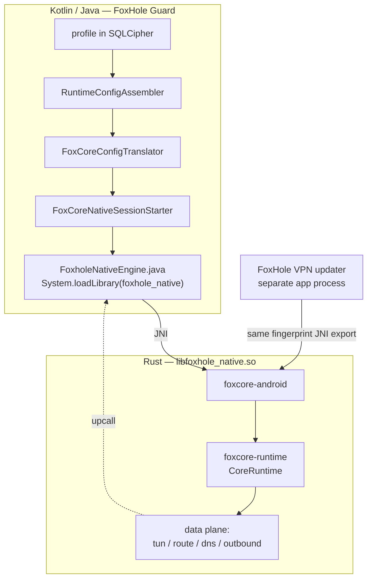
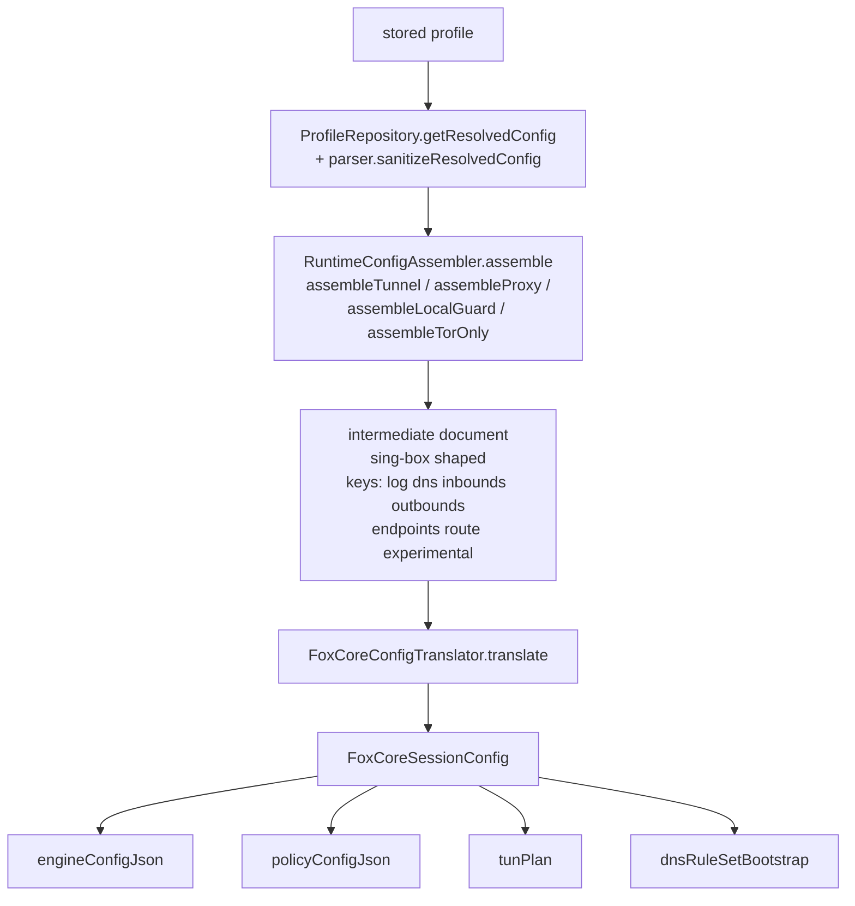
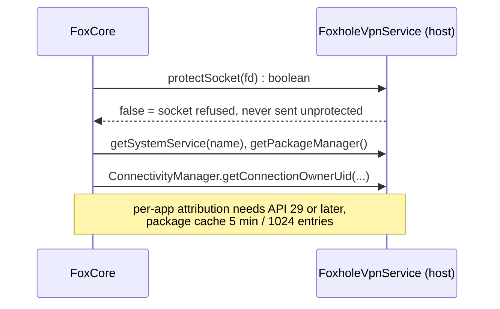
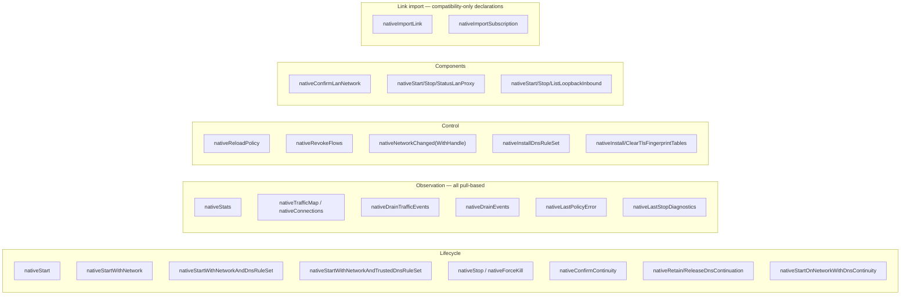
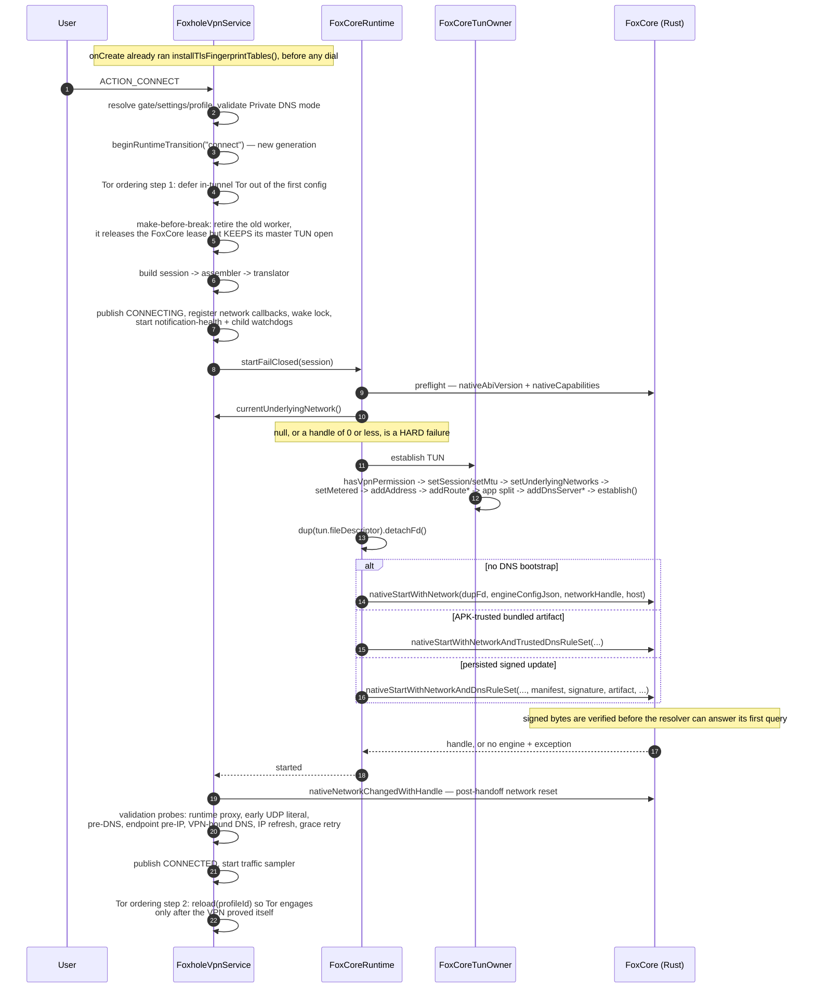
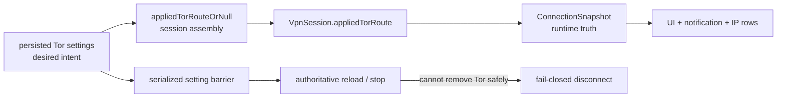
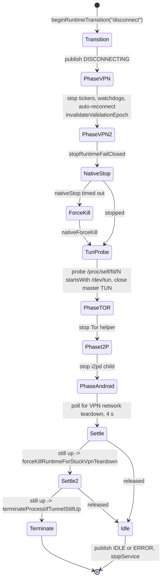
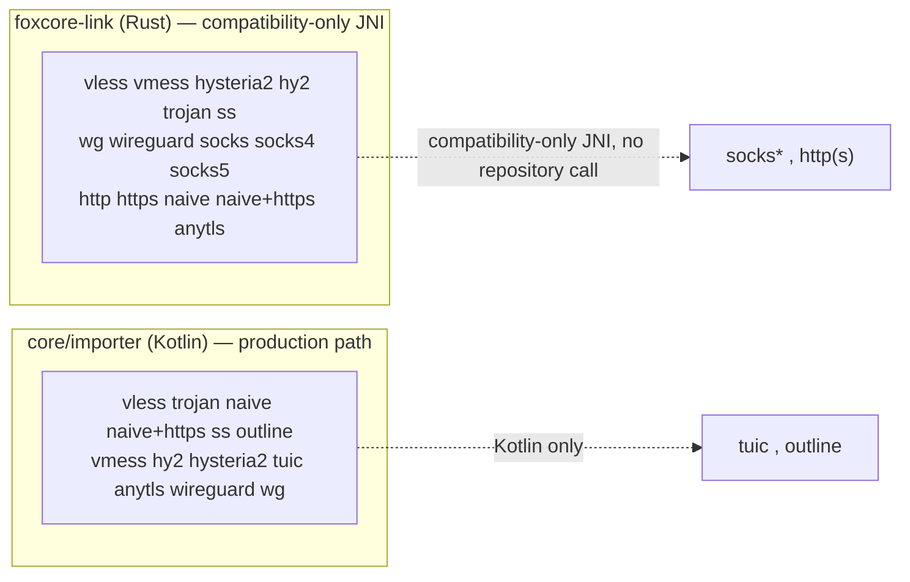
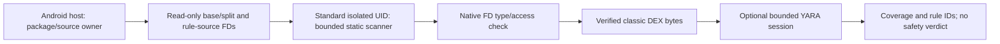

# 4. App ↔ core boundary

How a stored profile becomes a running engine, what crosses the FFI, and in what form.

HY2 certificate fingerprints now cross the JSON boundary as
`tls.pinned_certificate_sha256`, separately from `tls.pinned_spki_sha256`.
The Android normalized field is `certificate_sha256`; the runtime adapter
refuses mixed or multiple pins. The JNI function signatures are unchanged,
but emitting the new optional field requires rebuilt libraries and a fresh
matching Core revision pin before packaging
(`crates/foxcore-api/src/config/tls.rs:20`;
`foxhole-vpn/vpn-engine/src/main/kotlin/com/foxhole/core/runtime/FoxCoreTlsTransportTranslator.kt:53`).

---

## 4.1 The seam

| Fact | Value |
|---|---|
| Library | `libfoxhole_native.so` — `crate-type = ["cdylib"]`, lib name `foxhole_native` |
| Load site | `core/runtime/src/main/java/com/foxhole/core/runtime/FoxholeNativeEngine.java:51-53` — the only one |
| Shipped Engine seam | **36 Rust exports / 35 Java declarations** (`FoxholeNativeEngine.java:48-163`). Only legacy `nativeStart`, which has no Android `Network` handle, is intentionally absent from Java. |
| Kotlin wrapper | `interface FoxCoreNativeApi` + `object JniFoxCoreNativeApi` expose the product-reachable subset; link import and continuity stop at Java compatibility declarations |
| Cross-repository gate | The app compares every shipped Engine export with Java declarations and production Kotlin references (`scripts/verify-foxcore-jni-seam.sh`), then executes product-reachable calls against the packaged `.so` on Android (`FoxCoreNativeSeamAndroidTest.kt`). |
| Core release version | `1.0.0` comes from the workspace package (`Cargo.toml:38`). `CORE_VERSION` is `CARGO_PKG_VERSION` (`crates/foxcore-api/src/lib.rs:39`) and supplies JNI version and capabilities. A source version is not release qualification. |
| ABI version | `1`, frozen; class and package name are part of the ABI |
| Structured documents | JSON, with no protobuf. TUN/network handles and signed DNS/fingerprint payloads use their native scalar/byte-array forms. |
| Build-path contract | `scripts/android-build.sh:67-98` remaps the checkout, Cargo home and Rustup home before compiling. The ELF gate refuses build-host paths (`scripts/android-elf-gate.sh:138-166,222-225`), and the release reproducibility check compares bytes from different checkout and Cargo-home paths (`scripts/reproducible-build.sh:46-150`). |
| Release provenance | the publisher verifies the owner-signed source and immutable LAB handoff, selects the named archive and verifies required evidence, source/producer bindings, manifest and payload hashes (`scripts/verify-lab-release.py`; `scripts/lab-release-required-scope.json`). GitHub publishes and attests those exact LAB bytes without rebuilding (`.github/workflows/release.yml:46-74`). Source identity, native producer identity and per-ABI runtime acceptance remain distinct. |

Android delivery keeps original Maven Java artifacts separate from rebuilt native libraries.
The graphics API remains AndroidX graphics-path 1.0.1, rebuilt from its matching release sources.
Guard keeps lazysodium-android 5.2.0 Java and uses libsodium 1.0.20 with the explicit upstream
`ad3004ec8731730e93fcfbbc824e67eadc1c1bae` security backport. Source pins, patch, NDK 29/API 26,
producer receipts and notices identify these derived payloads independently. Merge and APK gates
reject original or foreign native bytes; static LOAD/RELRO checks remain separate from runtime
and encrypted database upgrade acceptance (`foxhole_guard/config/native/page-aligned-native.json`;
`foxhole_guard/scripts/build-page-aligned-native.sh`;
`foxhole_guard/scripts/verify-page-aligned-native.py`).

Guard also binds Maven notices to its actual application runtime graph and archive hashes.
Published licence assets use a portable view with explicit original-capture and projection hashes;
build-machine paths stay in private evidence. Missing notices, changed graph inputs or altered
files fail the generator and APK gate. Private builds need their own captured graph
(`foxhole_guard/scripts/copy-maven-runtime-licenses.py`).

FoxHole VPN is a second real consumer of the existing `nativeInstallTlsFingerprintTables([B)I`
export. Its separate Java declaration and R8 keep rule already preserve this ABI; no native symbol,
schema or Core pin change is needed. The application authenticates and bounds the signed table
bundle, requires a positive admission result and commits one private signed cache envelope.
Registry changes are global only within that application's process and affect future REALITY
handshakes; the updater does not reconnect the tunnel. Startup restores accepted cache before
profiles become ready. Checked availability has a separate signed candidate envelope, freshly
reverified and compared with installed/compiled tables at restart. Its 24-hour scheduled/foreground
check cannot install tables; only the manual card reaches native admission
(`foxhole-vpn/vpn-engine/src/main/java/com/foxhole/core/runtime/FoxholeNativeEngine.java:110-116`;
`foxhole-vpn/app/proguard-rules.pro:1-2`;
`foxhole-vpn/app/src/main/kotlin/com/foxhole/vpn/DefaultVpnController.kt:92-99`, `:150-165`;
`foxhole-vpn/app/src/main/kotlin/com/foxhole/vpn/updates/VpnDataUpdater.kt:43`, `:62`, `:78`, `:115-159`;
`foxhole-vpn/app/src/main/kotlin/com/foxhole/vpn/DefaultVpnController.kt:369`).

### Release trust and rotation

`config/release-signers.asc:1` contains public keys only;
`config/release-signing-fingerprints.txt:1` pins both the signing subkey and its primary key.
The verifier uses an isolated GnuPG home and requires one valid signature from an allowed pair.
GitHub's generic Verified flag or an unrelated trusted key cannot satisfy it. This proves key
identity, not whether a particular signing operation happened on hardware
(`scripts/verify-release-signature.py:15`).

For rotation, the owner reviews and signs the addition of the replacement public key and complete
fingerprint pair while the existing trust is still valid. After that change is accepted, release
commits can use the new key; removal of the old pair is a separate owner-reviewed change. A lost
or compromised sole trusted key requires an explicit out-of-band owner trust decision. Neither
key material nor trust configuration is downloaded by the release job.

The private LAN workflow keeps full checks and fresh dependency-advisory work separate from
GitHub's source-only checks (`.forgejo/workflows/ci.yml`; `.forgejo/scripts/ci-lan.py`;
`.github/workflows/ci.yml`). Advisory findings, incomplete coverage and skipped checks are not
release passes. Repository settings separately enforce branch/tag protection and permitted
publication; the publisher does not grant permission to push or rewrite tags.

### Loopback authentication in 0.0.5

An inbound requires either complete credentials or explicit `allow_anonymous: true`; omission,
partial credentials, and mixing credentials with anonymous mode are rejected
(`crates/foxcore-api/src/config/rt.rs:136,162`). Capabilities expose `mandatory_credentials: false` and
`anonymous_requires_explicit_opt_in: true` for loopback listeners; LAN proxy credentials remain
mandatory (`crates/foxcore-android/src/capabilities.rs:1173`). Runtime status reports `authentication` as
`credentials` or `anonymous` (`crates/foxcore-runtime/src/snapshot.rs:127`). Anonymous listeners are
reachable by other apps on the device. Guard sets consent only when the user explicitly disables
proxy authentication; a missing password never creates it (`foxhole_guard/core/runtime/src/main/kotlin/com/foxhole/core/runtime/LocalProxyRuntime.kt:24`).

The new optional field retains config schema and ABI v1, but legacy anonymous payloads now fail
validation. Ship Core 0.0.5 before a Guard release that sends the field, then update Guard's exact
revision pin; a client still built against 0.0.4 cannot use this new request contract.

---

## 4.2 Profile → engine config

Two documents, two shapes. The intermediate is sing-box-like and never crosses the FFI; the engine
config is FoxCore's own schema. `log` may only carry `{level, timestamp}` and is dropped;
`experimental` must be empty (`FoxCoreConfigTranslator.kt:260-289`).

Sub-translators, all in `core/runtime/src/main/kotlin/com/foxhole/core/runtime/`:

| File | Entry | Produces |
|---|---|---|
| `FoxCoreTunTranslator.kt:11` | `translateFoxCoreTun` | `FoxCoreTunPlan` — mtu, v4/v6 + prefix, routes, advertised DNS, app include/exclude |
| `FoxCoreTunTranslator.kt:54` | `translateFoxCoreControlProxy` | `runtime.control_proxy` |
| `FoxCoreOutboundTranslator.kt:23` | `translate` | `FoxCoreOutboundPlan` — primary, named, packet-tunnel flag, overlays |
| `FoxCoreProxyOutboundTranslator.kt:8` | `translateFoxCoreProxyOutbound` | per-protocol outbound object |
| `FoxCoreWireGuardTranslator.kt:27` | `translateFoxCoreWireGuard` | `type:"wireguard"` |
| `FoxCoreTorTranslator.kt:13,65` | `translateOverlay` / `translateOutbound` | named `tor` outbound |
| `FoxCoreTlsTransportTranslator.kt:18,211` | `translateFoxCoreTls` / `translateFoxCoreTransport` | `tls` / `transport` sub-objects |
| `FoxCorePolicyTranslator.kt:30` | `translate` | dns, routes, traffic, `dns.rule_sets[]` |

Rejections are a closed enum (`FoxCoreConfigRejection`); the exception never echoes document values.

Amnezia `ContentPaddingAddition` in Interface or an AWG URI is normalized to the optional
`amnezia.content_padding_addition` JSON field, as a uint32 number or inclusive N-M string. The
shared model and translator reject overflow, null, floats, inverted ranges and noncanonical stored
shapes before JNI, preserving the entire range without Int/uint16 narrowing
(`core/model/src/main/kotlin/com/foxhole/core/model/AmneziaContentPaddingRange.kt:19`;
`core/importer/src/main/kotlin/com/foxhole/core/importer/ProfileImportAmneziaSupport.kt:80`;
`core/runtime/src/main/kotlin/com/foxhole/core/runtime/FoxCoreWireGuardTranslator.kt:110`;
`crates/foxcore-api/src/config/wireguard.rs:87`). The matching core revision is required; older
cores may refuse the added field.

`amnezia.header_protection_key` is an optional canonical padded Base64 string, validated with
the four nonce-prefix sizes before JNI. Empty declarations are retained for refusal rather than
dropped during conf/URI import. The shared JVM model redacts `toString` and wipes temporary
decoded byte arrays; immutable serialized JVM strings are not claimed to zeroize. Rust owns the
key separately from Copy `AmneziaParams`, and this feature adds no JNI method
(`core/model/src/main/kotlin/com/foxhole/core/model/AmneziaHeaderProtectionKey.kt:15,21,32`;
`core/importer/src/main/kotlin/com/foxhole/core/importer/ProfileImportAmneziaSupport.kt:114,135,419`;
`core/runtime/src/main/kotlin/com/foxhole/core/runtime/FoxCoreWireGuardTranslator.kt:180`;
`crates/proto-wireguard/src/tunnel.rs:93,108`).

Tor bridge policy is resolved before translation. `AUTO` selects one Snowflake group; explicit
transports cannot cross-fallback, while downloaded-to-bundled fallback is allowed only for that
same transport (`core/runtime/src/main/kotlin/com/foxhole/core/runtime/TorBridgeTorrcLines.kt:50-81`).
The runtime derives the required protocol tokens from the resulting bridge lines, narrows and
coalesces the PT process declarations, and fails preflight if any selected protocol has no helper
(`core/runtime/src/main/kotlin/com/foxhole/core/runtime/TorRuntimeInstaller.kt:169-198,274-305`).
The translator therefore receives only the selected `bridges` and `pluggable_transports`, validates
their shape, and emits those values without reopening transport selection
(`core/runtime/src/main/kotlin/com/foxhole/core/runtime/FoxCoreTorTranslator.kt:65-125,163-193`).

### The engine config the core accepts

`EngineConfig` — `crates/foxcore-api/src/config/engine.rs:9-30`, `deny_unknown_fields`, ≤1 MiB:

| Field | Type | Constraint |
|---|---|---|
| `schema_version` | `u32` | must equal `1` |
| `outbound` | `OutboundConfig` | the primary; addressable as `default` / legacy `primary` |
| `outbounds` | `Vec<NamedOutboundConfig>` | ≤16; `default`/`primary`/`direct`/`block` reserved |
| `tun` | `TunConfig` | `{mtu ≥ 1280, ipv4, ipv6?}` |
| `dns` | `DnsConfig` | |
| `runtime` | `RuntimeConfig` | `local_guard` ⇔ primary is `direct` |
| `routes` | `Vec<RouteRule>` | ≤4096 incl. `traffic.applications` |
| `traffic` | `TrafficPolicyConfig` | the reloadable half |

There is **no `inbounds`, no `log`, no `route`** key in `EngineConfig` — those belong to the
intermediate document only.

`PolicyConfig`, the reload document (`config/policy.rs:11-22`, ≤256 KiB):
`expected_revision?`, `dns`, `routes`, `traffic`.

---

## 4.3 What crosses, and in what form

| Item | Direction | Type | Ownership / bound |
|---|---|---|---|
| TUN fd | Java → Rust | **`jint`**, a raw int — not a `ParcelFileDescriptor` | Kotlin does `dup(...).detachFd()`; **Rust owns it on every path including failure** and Kotlin must not close it. Validated: `S_IFCHR`, `O_RDWR`, and on Android `TUNGETIFF ⇒ IFF_TUN` |
| Engine config | Java → Rust | `JString` UTF-8 JSON | ≤1 MiB, `deny_unknown_fields` |
| Policy config | Java → Rust | `JString` UTF-8 JSON | ≤256 KiB |
| Network handle | Java → Rust | `jlong` from `Network.getNetworkHandle()` | negative rejected; drives `android_setsocknetwork` / `android_getaddrinfofornetwork` |
| Host object | Java → Rust | `JObject` → `GlobalRef` | retained for the runtime's life |
| Engine handle | Rust → Java | `jlong` > 0, opaque, never reused | `0` means failure **and** a thrown exception |
| Stats | Rust → Java | `jstring` JSON `RuntimeSnapshot` | `{}` if the handle is dead |
| Traffic map | Rust → Java | `jstring` JSON | `{generation, connections[], packages[], lanes[], omitted_rows, dropped_events, dns{...}}` |
| Events | Rust → Java | `jstring` `{"events":[...],"dropped":N}` | **pull-based, bounded, drop-on-overflow.** No push callbacks into Java |
| DNS rule set | Java → Rust | `JByteArray` ×3 + name `JString` | manifest ≤64 KiB, signature ≤256 B, artifact ≤64 MiB; name ASCII ≤128 B |
| Fingerprint tables | Java → Rust | `JByteArray` | ≤4 MiB; **never throws**, returns a code |
| Errors | Rust → Java | two channels | `IllegalStateException` for lifecycle/config (message walks the whole `source()` chain); numeric codes for anything switchable |
| **Logs** | — | **none** | There is no Java log callback. Rust writes to logcat directly (tag `FoxCore`), capped at `warn` because debug/trace records interpolate `NetworkTuple` — the user's connection list |

An ordinary `nativeStartWithNetwork` failure throws `IllegalStateException` before returning `0`;
the pending exception is the startup diagnostic channel. Its message may contain a complete source
chain and must not be copied raw into public logs. There is no last-start-error getter. Policy errors
belong to a live handle's policy reload, while stop diagnostics describe teardown timing
(`crates/foxcore-android/src/lib.rs:539`, `:558`, `:576`, `:1016`, `:1047`).

An ordinary outbound initialization failure can instead leave a positive runtime handle with a
deferred unavailable lane. `nativeStats` exposes its typed `unavailable.reason` and counts; its
free-form message, configured IDs, selectors and `last_error` are separate privacy surfaces.
Logcat is not a complete startup result channel
(`crates/foxcore-runtime/src/registry.rs:177`, `:248`;
`crates/foxcore-runtime/src/control.rs:923`;
`crates/foxcore-api/src/availability.rs:17`, `:100`, `:107`, `:113`, `:121`;
`crates/foxcore-android/src/logcat.rs:26`).

### Upcalls (Rust → Java)

Host contract: `RuntimeServiceHost` —
`core/runtime/src/main/kotlin/com/foxhole/core/runtime/RuntimeNativeSupport.kt:12-34`; implementation
`app/src/main/kotlin/com/foxhole/guard/runtime/FoxholeVpnService.kt:67,485-504`.

Panic containment: every JNI entry is wrapped in `catch_unwind(AssertUnwindSafe(...))`; a contained
panic becomes `IllegalStateException("panic inside FoxCore JNI boundary")` or a `-1`-family code.

---

## 4.4 JNI surface

### C ABI (4 symbols)

| Symbol | Signature | Purpose |
|---|---|---|
| `foxhole_core_abi_version` | `() -> u32` | `1` |
| `foxhole_core_config_schema_version` | `() -> u32` | `1` |
| `foxhole_core_capabilities_json_len` | `() -> usize` | length including NUL |
| `foxhole_core_capabilities_json_write` | `(*mut u8, usize) -> usize` | NULL/short buffer left untouched, returns required size |

Header: `crates/foxcore-android/include/foxhole_core.h`.

### `FoxholeNativeEngine` — 36 Rust exports

Key signatures:

| Function | Java signature | Returns |
|---|---|---|
| `nativeStartWithNetwork` | `(ILjava/lang/String;JLjava/lang/Object;)J` | handle > 0, or `0` + `IllegalStateException` |
| `nativeStartWithNetworkAndDnsRuleSet` | `(ILjava/lang/String;JLjava/lang/String;[B[B[BLjava/lang/Object;)J` | atomic signed bootstrap: handle > 0, or no engine + throw |
| `nativeStartWithNetworkAndTrustedDnsRuleSet` | `(ILjava/lang/String;JLjava/lang/String;[BLjava/lang/Object;)J` | APK-trusted artifact, no signature check |
| `nativeRetainDnsContinuation` | `(J)J` | positive opaque replacement lease, or refusal |
| `nativeReleaseDnsContinuation` | `(J)V` | idempotent release; no serialized DNS data |
| `nativeStartOnNetworkWithDnsContinuity` | `(ILjava/lang/String;JJLjava/lang/String;[B[B[BZLjava/lang/Object;)J` | handle > 0; `-1` quarantined / `-2` failed cleanup poison; ordinary refusal throws |
| `nativeInstallDnsRuleSet` | `(JLjava/lang/String;[B[B[B)J` | revision, or `0` + throw |
| `nativeTrafficMap` | `(J)Ljava/lang/String;` | canonical bounded traffic-map document |
| `nativeConfirmContinuity` | `(JJ)I` | typed `0..3` result, or `-1` panic |
| `nativeInstallTlsFingerprintTables` | `([B)I` | profiles replaced, or `-1` unreadable / `-2` refused / `-3` panic |
| `nativeStop` / `nativeForceKill` | `(J)I` | `0` stopped, `1` already, `2` timed out, `3` unknown handle, `-1` panic |
| `nativeReloadPolicy` | `(JLjava/lang/String;)J` | > 0 revision, `0` not running, `-1..-9` refusal |
| `nativeRevokeFlows` | `(JLjava/lang/String;)I` | count ≥ 0, or `-1` panic / `-2` no engine / `-3` bad target. Target JSON tagged on `kind`: `all\|lane\|uid\|package\|outbound\|flow` |
| `nativeLastStopDiagnostics` | `()Ljava/lang/String;` | **no handle** — the caller has just been told its stop timed out. `{phase, engine_ms, shutdown_ms, generation}` |

Release libraries also retain 19 component/share exports: ten `FoxholeNativeShares_*` and nine
`FoxholeNativeComponents_*`. v0.0.1 shipped them, and the frozen ABI-v1 fixture requires them
(`fixtures/abi/v1/exports.txt:1-19`; `scripts/abi-gate.sh:1-17`). The app has a nine-method Shares
facade but no production call site, and no Components facade. These symbols are outside the 36/35
Engine seam and remain solely for ABI compatibility.

---

## 4.5 Connect sequence

**The real order is: host registered by construction → establish TUN (Android) → dup fd → start
engine.** `protect()` is never called before the engine exists — it is a Rust→Java upcall made per
outbound socket.

Direct bridged Tor-only validation is one authenticated runtime-proxy request with an 80 s call cap
inside one monotonic 120 s validation deadline; 5 s is reserved for a classification-only control
probe after a strict failure (`RuntimeValidationProbePlan.kt:139-175`;
`RuntimeValidationRun.kt:331-360`; `RuntimeProxyEgressValidationSupport.kt:84-146,350-388`). The
core assigns that Tor CONNECT route 75 s to build its upstream while VPN and direct routes retain
30 s. The accepted session still owns a bounded permit, and listener cancellation races the whole
serve future, so stop does not wait for either connect ceiling
(`crates/foxcore-component/src/lan.rs:114-121,286-291,821-830,927-939,963-988`).

### Policy publication during a network handoff

`ActiveFoxCoreSession.sessionIdentity` remains stable when network metadata is copied
(`core/runtime/src/main/kotlin/com/foxhole/core/runtime/FoxCoreNativeSeam.kt:376`). Reload admission
checks that identity and its transition generation. Publication holds `stateLock` and retains the
latest network handle, so a successful native policy update cannot be discarded solely because a
network callback copied the session (`FoxCoreRuntime.kt:456-462,745-761,904-917`). A stopped or replaced
session cannot acquire ownership through a late completion. Native policy reload, DNS installation,
and network changes are serialized by Core's policy writer (`crates/foxcore-tun/src/flow/policy.rs:154,215,306`).

### Router connected-state publication

The OpenWrt runtime checks the current owned generation and authenticated proof before installing
policy. After installation it obtains the policy/kernel identity, performs one existing authenticated
probe, then fences the owner, generation, state, config digest and kernel identity again. It samples
the clock for proof freshness only after those observations, immediately before publishing the
connected status. Any failed fence keeps that publication closed
(`foxhole-openwrt-client/package/foxhole-openwrt-client/root/usr/libexec/foxhole-runtime:463-513`).

A probe crosses a live authentication boundary. The adapter clears its owner and kernel observation
caches at that boundary, so observations made before the probe cannot authorize the later connected
publication. This preserves the existing authenticated probe and its bounded execution; it grants no
new lifetime to a stale proof and adds no new JNI or Core ABI
(`foxhole-openwrt-client/package/foxhole-openwrt-client/root/usr/share/foxhole/core-adapter.uc:79-120`).

### DNS attribution on legacy Android

Without a platform UID API, global domain rules require an advertised active Fake-IP resolver.
Validated questions to that resolver on port 53 may bootstrap the trusted address pool without
identity; subsequent Fake-IP flows recover the promised domain. Unbound real IPs and foreign
resolvers retain the domain-hint guard. UID/package/quarantine routes still require identity.
DNS package-bypass configuration requires an available attribution API at start and before a
policy revision changes. Missing optional owner/package metadata keeps the global DNS filter
active and grants no bypass; required route identity continues to fail closed (`crates/foxcore-tun/src/flow/select.rs:275`;
`crates/foxcore-tun/src/flow/route.rs:118,190,254`;
`crates/foxcore-runtime/src/start.rs:156`; `crates/foxcore-runtime/src/control.rs:513`).

Existing TCP/UDP DNS flows bind newly required identity after a policy reload and refuse late
requirements without sufficient metadata. Invalid or over-capacity package lists are discarded
whole, including their signing digest, while trustworthy UID-only routing remains available
(`crates/foxcore-tun/src/flow/select.rs:300,373`;
`crates/foxcore-tun/src/flow/route.rs:254`). This is source/host packet evidence; it is not proof
of actual Android 26–28 or 32-bit device execution.

A failed optional package lookup does not invalidate an existing DNS flow's sufficient trusted
UID binding. Successful complete lookups replace UID, packages and signing digest together; the
current route audit judges the new owner. A UID alone cannot satisfy newly mandatory app or
quarantine metadata (`crates/foxcore-tun/src/flow/select.rs:300,313,337`;
`crates/foxcore-tun/src/flow/route.rs:257`).

JNI bounds the original package array before reading any element. Null entries, invalid names,
overflow and JNI/digest errors discard the entire package/signing identity while preserving the
resolved UID; incomplete results are not cached. A valid optional null signing digest remains
unavailable rather than malformed. The existing cache lifetime is five minutes and its cap is
1024 UIDs; this does not promise immediate package-list invalidation after an install
(`crates/foxcore-android/src/identity_metadata.rs:35,48`;
`crates/foxcore-android/src/lib.rs:114,2054`).

### Authorized profile commands and WebApp ownership

Notification actions carry a private, app-issued request bound to profile and protocol option,
with a ten-minute monotonic expiry and boot identity. The UI admits commands after App Lock and
consumes the request once before executing it. A caller-supplied profile ID alone cannot authorize
a switch (`app/src/main/kotlin/com/foxhole/guard/runtime/NetworkRuleCommandRequests.kt:8,25,38`;
`app/src/main/kotlin/com/foxhole/guard/ui/HomeViewModelNetworkRulesSupport.kt:204`).

WebApp foreground state binds the app and a proxy lease generation. Under the polling mutex, the
watchdog blocks and destroys the old view before changing the process-wide proxy; a late release
only applies to its own lease. Failed proxy cleanup keeps polling suspended
(`app/src/main/kotlin/com/foxhole/guard/core/webapps/WebAppsWatchdog.kt:194,224,237`). On WebView implementations supporting multiple profiles, named storage
profiles are required before loading a page, and the installed profile name is checked. There is no
fallback to shared storage after installation failure (`WebAppProfiles.kt:24`). Pending data
removals persist before the database row is removed and are retried before a later profile load;
a failed removal retains its record (`WebAppsDataCleaner.kt:29,38`; `WebAppProfiles.kt:29`).

### Desired Tor intent vs applied runtime

The persisted privacy-route block is intent, not proof that Tor is carrying traffic. Revoking
permission atomically clears the desired mode and enable timestamp
(`app/src/main/kotlin/com/foxhole/guard/core/settings/SettingsRepositoryPrivacyRoute.kt:36-63`).
Session assembly resolves that intent into an
`AppliedTorRoute` only when permission, mode, transport and scope are compatible
(`core/runtime/src/main/kotlin/com/foxhole/core/runtime/RuntimeRouteConfig.kt:189-213`), stores it in
the exact `VpnSession` being built
(`app/src/main/kotlin/com/foxhole/guard/core/data/ProfileSessionFactory.kt:135-144`), and publishes it
with the connection snapshot (`core/model/src/main/kotlin/com/foxhole/core/model/Models.kt:176-190,359-383`).
Dashboard identity, Tor IP and notification route labels consume this applied descriptor rather
than rereading settings (`app/src/main/kotlin/com/foxhole/guard/ui/HomeStateProducer.kt:432-438`;
`app/src/main/kotlin/com/foxhole/guard/runtime/FoxholeVpnServiceRuntimePolicies.kt:96-125`).

Runtime-affecting writes are serialized. An authoritative Tor change commits the setting, then
dispatches reload or stop even if an older reconnect warning is pending; cancellation cannot split
those two synchronous steps
(`app/src/main/kotlin/com/foxhole/guard/ui/HomeViewModelRuntimeSupport.kt:116-218`). If the
replacement session cannot be built while its desired Tor route differs from the active one, the
service tears the runtime down instead of keeping stale Tor live
(`app/src/main/kotlin/com/foxhole/guard/runtime/FoxholeVpnServiceReloadSupport.kt:350-449`). VPN+Tor
stop/mode choices revalidate the applied descriptor before acting; the Tor-only handoff disconnects
VPN before starting the standalone session, so interruption leaves the device disconnected rather
than on the old route
(`app/src/main/kotlin/com/foxhole/guard/ui/HomeViewModelVpnTorTransitionSupport.kt:15-115`).

---

## 4.6 Disconnect sequence

The last resort kills the process so Android revokes every descriptor, including FoxCore's dup.
This is the self-kill path recorded in the teardown notes.

The Kotlin JNI fence lets `nativeStop` use the full graceful budget plus a 750 ms return-settlement
margin (`FoxCoreNativeEngineOperations.kt:108-137`; `RuntimeStopSupport.kt:20-23,576-584`). With the
production 3,000 ms policy, the native call therefore has 3,750 ms; its outer fail-closed supervisor
has 5,750 ms, covering that complete window, the 1,500 ms `nativeForceKill` fence and 500 ms of
scheduling overhead (`RuntimeStopSupport.kt:540-590`). Timeout arithmetic saturates at `Long.MAX_VALUE`
instead of wrapping to an immediate timeout.

### States

| Layer | Enum | Values |
|---|---|---|
| UI / bridge | `ConnectionState` | `IDLE, CONNECTING, CONNECTED, RECONNECTING, DISCONNECTING, ERROR` |
| Teardown phase | `RuntimeTeardownPhase` | `VPN, TOR, I2P, ANDROID_TUNNEL` |
| Native FSM | `RuntimeState` | `IDLE, PREPARING, STARTING, VALIDATING, RUNNING, RELOADING, STOPPING, KILLING, RESTARTING, ERROR` |
| Supervisor | `RuntimePhase` | `Idle, Preparing, StartingNative, WaitingVpnNetwork, ValidatingTunnel, Connected, Reconnecting, Reloading, Stopping, Killing, Error` |

### Watchdogs

| Watchdog | Behaviour |
|---|---|
| Notification connectivity health | 1 s probe; 3 consecutive failures ⇒ reconnect |
| Child process (i2pd) | event-first via `setUnexpectedExitListener`, slow poll fallback; a child that ran and is later killed ⇒ **full runtime rebuild**, fail-closed |
| Stop / teardown | the 3-stage escalation above |
| Session ticker | one timer, tasks: `traffic`, `app_traffic`, `dns_guard_window`, `notification_health`, `child_watchdog`, `lan_proxy`, `i2p_traffic` |
| Local guard heal | bounded self-heal; deliberately survives an error teardown |
| Native stop reaper (Rust) | 40 attempts × `STOP_TIMEOUT` |

`CoreRuntime::start` acquires a **process-wide worker lease** — only one data-plane worker per
process (`crates/foxcore-runtime/src/start.rs:174`).

---

### Expert core settings and local native builds

Guard persists eight fields under `ExpertSettings.core` and carries them in
`VpnSession.coreTuning`, including ordinary, Tor and local-guard sessions. Invalid stored values
are clamped at hydration; invalid prepared sessions are refused. Defaults preserve the existing
engine document (`core/model/src/main/kotlin/com/foxhole/core/model/CoreTuningSettings.kt:8,19,33`;
`core/model/src/main/kotlin/com/foxhole/core/model/Models.kt:382`;
`app/src/main/kotlin/com/foxhole/guard/core/data/ProfileSessionFactory.kt:153,232`;
`app/src/main/kotlin/com/foxhole/guard/runtime/FoxholeVpnServiceLocalGuardSupport.kt:565`).

| App setting | Native field | Default | Accepted range |
|---|---|---:|---|
| Worker threads | `runtime.worker_threads` | 4 | 1–4 |
| Connect timeout (ms) | `runtime.connect_timeout_ms` | 10000 | 100–120000 |
| Handshake timeout (ms) | `runtime.handshake_timeout_ms` | 15000 | 100–300000 |
| Relay buffer (bytes) | `runtime.relay_buffer_bytes` | 16384 | 4096–262144 |
| TCP flows | `runtime.max_tcp_flows` | 1024 | 1–32768 |
| UDP flows | `runtime.max_udp_flows` | 512 | 1–32768 |
| DNS timeout (ms) | `dns.timeout_ms` | 5000 | 100–30000 |
| DNS cache entries | `dns.cache_size` | 4096 | 1–65536 |

Runtime resource fields change the immutable engine fingerprint and use replacement start;
DNS values enter both engine and reloadable policy documents
(`core/runtime/src/main/kotlin/com/foxhole/core/runtime/FoxCoreConfigTranslator.kt:65,104,136`;
`core/runtime/src/main/kotlin/com/foxhole/core/runtime/FoxCoreTuningTranslation.kt:16,24`). MTU is at
least 1280, matching the native TUN contract
(`app/src/main/kotlin/com/foxhole/guard/core/settings/SettingsNormalizationSupport.kt:37,75`).
Replacement on the same live master TUN captures one opaque DNS continuation before stopping
the predecessor, then imports it only after a clean worker join. Fake-IP addresses, allocator
state and original expiry survive; upstream responses and attributed route hints are discarded.
The successor uses its own routes, outbounds, DNS policy and bootstrap. Ordinary constructors
remain fresh; a flow continuation cannot enter an L3 packet tunnel
(`crates/foxcore-runtime/src/dns_continuation.rs:59,80,107`;
`crates/foxcore-tun/src/flow/policy.rs:97,110,148`).
JNI owns at most one continuation lease, revokes borrowed clones on force-kill and retires a
successor that loses ownership before publication. Cleanup first attempts bounded cooperative
stop, escalating only on timeout; quarantined/failed cleanup reaches the Kotlin poison latch
before rollback. Kotlin releases the lease in non-cancellable cleanup; a release/diagnostic
exception cannot hide the original poison or lose an owned successor result
(`crates/foxcore-android/src/lib.rs:370,417,759,1759`;
Guard `core/runtime/src/main/kotlin/com/foxhole/core/runtime/FoxCoreDnsContinuation.kt:13,37`;
`core/runtime/src/main/kotlin/com/foxhole/core/runtime/FoxCoreRuntime.kt:487-542,930-970`).
The settings decoder distinguishes explicit flat legacy data from nested data. Malformed documents
and unsupported future schemas preserve the original encrypted file and follow the corruption
and forensic-copy path
(`app/src/main/kotlin/com/foxhole/guard/core/settings/SettingsPayloadDecoder.kt:12`). Rate intervals
use a monotonic clock while history timestamps remain wall-clock time
(`core/runtime/src/main/kotlin/com/foxhole/core/runtime/TrafficStatsSampler.kt:22,80`).

The local I2P SOCKS credential gate claims capacity before starting a handshake worker,
limits accepted clients to 128, and closes the listener plus owned client/upstream sockets on
stop. Credentials validate before listener acquisition; retries retain replacement-socket
ownership until transfer. Directional EOF allows the remaining upload to finish while explicit
stop releases both sockets
(`core/runtime/src/main/kotlin/com/foxhole/core/runtime/I2pdSocksCredentialGate.kt:40,141,193,320,356`).

Typed user Stop cancels an active NORMAL command and gives the mailbox a 500 ms cooperative
cleanup window. A cancelled FoxCore reload independently waits at most 250 ms for its actual
native-call result in `NonCancellable`; the native thread's completion, not the cancelled parent
Job, permits graceful teardown (`RuntimeStopSupport.kt:222-280,440-536`). The existing generation
guard remains active while that result settles. Only afterward does cleanup fence and stop the
still-owned pending or active generation, so a successor cannot be stopped by its predecessor
(`FoxCoreRuntime.kt:629-663`).

Settlement, bounded `tryLock` polling and native stop share the remaining monotonic 500 ms
cooperative budget. Successful lock acquisition enters direct `try/finally` unlock without
returning a held resource through a timeout boundary. Only this definitely-settled cancellation
path supplies the remaining native-call timeout; ordinary stop keeps its normal completion
margin (`FoxCoreRuntime.kt:629-663`; `FoxCoreNativeEngineOperations.kt:108-137`). An unsettled JNI
frame, exhausted cooperative window or genuine native-stop failure retains generation-checked
force teardown and the poisoned-process latch. Forced fault escalation is not promised to finish
within 500 ms, and poison interpretation preserves the original cancellation cause inside
`NonCancellable` (`RuntimeStopSupport.kt:496-536`).

The mailbox retains cleanup ownership until the next priority command claims it, so replacing a
queued user Stop cannot bypass the join. Explicit Kill, raw STOP and preemption of executing
SWITCH/STOP retain immediate escalation. Existing TUN and poisoned-process guarantees remain
(Guard `core/runtime/src/main/kotlin/com/foxhole/core/runtime/RuntimeSupervisorMailbox.kt:450,463,466,513`;
`core/runtime/src/test/kotlin/com/foxhole/core/runtime/RuntimeSupervisorCooperativePreemptionTest.kt:24`).

The foreground service schedules fingerprint installation on IO and awaits completion before native
start (`app/src/main/kotlin/com/foxhole/guard/runtime/TlsFingerprintInstallGate.kt:20`). On macOS, the core, i2pd and Go preparation tasks use
pinned Linux Docker builders. Rust target/cache directories and native source/build caches live in
named volumes; explicit JNI/helper output directories remain available for APK packaging
(`scripts/docker-rust.sh:1`; `scripts/docker-android.sh:1`; Guard `scripts/docker-native.sh:1`).
The Android wrapper forwards `RUSTUP_TOOLCHAIN` with default `1.97.1` and
`CARGO_NET_OFFLINE` with default `false`; supplied overrides apply to both `build` and
explicit commands (`scripts/docker-android.sh:42-43`). Native compilation still uses
`--locked --offline` (`scripts/android-build.sh:139-142`).
The native source snapshot preserves tracked vendor changes and applies reviewed patches without
writing into the host vendor tree. Default packaging covers ARM64, ARMv7, x86 and x86_64 at API 26;
ELF checks retain export, platform-library, non-executable-stack, RELRO and 16 KiB alignment gates
(`scripts/android-build.sh:1`; `scripts/android-elf-gate.sh:1`).
Guard's 64-bit router and Go helpers link with both maximum and common page size 16384;
32-bit companions retain their platform alignment. The helper verifier checks LOAD congruence and
RELRO ends before packaging (Guard `scripts/build-i2pd.sh:205,235`;
`scripts/build-tor-transports.sh:90,118`; `scripts/verify-native-pages.py:10`).
The CMake cache identity covers source content and path, actual dependency trees, toolchain,
ABI/API and compile arguments. Link-only flags remain outside that identity so CMake can relink
without recompiling objects. Dependency caches require matching completion markers and include
version/checksum and ABI/API/toolchain inputs; unmarked old directories are retained rather than
adopted (Guard `scripts/build-i2pd.sh:153,163,178,222,227,237`;
`scripts/i2pd-build-cache.py:24,64,77,93`).

Reproducibility builds use separate cold target directories regardless of inherited
`CARGO_TARGET_DIR`, remap those paths, and omit local instructions at every source depth
(`scripts/reproducible-build.sh:62,83`).

## 4.7 Reachability and remaining gaps

The release surface and the product call graph are different questions:

| Surface | Boundary status | Product reachability |
|---|---|---|
| Engine lifecycle | 36 Rust exports, 35 Java declarations | Complete by design: only legacy `nativeStart` is omitted; every production start passes an Android `Network` handle. |
| Signed DNS bootstrap | Java declaration, `FoxCoreNativeApi` methods and JNI calls are present (`FoxCoreNativeSeam.kt:69-105,207-265`); start dispatch is at `FoxCoreNativeSessionStarter.kt:251-298` | A persisted signed update is verified as part of `nativeStartWithNetworkAndDnsRuleSet`, before the engine is published; the same boundary also supports generation-fenced live signed install. |
| Traffic map | `nativeTrafficMap` is declared and called by `JniFoxCoreNativeApi` (`FoxCoreNativeSeam.kt:297`) | `FoxCoreRuntime.runtimeTrafficMapJson` uses the canonical call (`FoxCoreRuntime.kt:820-823`); `nativeConnections` remains a compatibility alias. |
| Link import | The two Rust exports and Java declarations are retained as compatibility-only ABI and classified by `verify-foxcore-jni-seam.sh` | **No Kotlin product wrapper or importer/data-layer call site.** `ProfileImportParser` remains the app's parser. The native DTO is not a drop-in replacement for the app's normalized profile contract. |
| Continuity | The Rust export and Java declaration are retained as compatibility-only ABI | Audit events are parsed and journalled, but the translator keeps automatic continuity defaults and no service/UI action exposes a confirmation token. |
| Live DNS install | `nativeInstallDnsRuleSet` is called through a generation-fenced runtime method after the exact verified bytes are persisted | A stable engine with the same trust adopts the update live and commits the returned revision. Enable or trust rotation changes the immutable fingerprint and uses signed replacement start; no active engine defers to the next start. |
| Native Rust build paths | Release compilation remaps checkout, Cargo-home and Rustup-home variants; the ELF gate rejects detected host roots (`scripts/android-build.sh:67-98`; `scripts/android-elf-gate.sh:138-166,222-225`) | The release proof builds from a second checkout and Cargo home, requires byte-identical `.so` files, and checks both for path leaks (`scripts/reproducible-build.sh:46-150`). The Rust library requires no fixed builder directory. |
| Component/share JNI | 19 exports are frozen in ABI v1 and remain in release ELF files | Guard has no product call site. They do not count toward the separate 36/35 Engine seam. |

### Validation-failure audit ownership

Normal connection validation runs before the connected traffic/audit collector. A completed
`DNS_FAILURE` result may collect one count-bounded audit observation before failure teardown when
its captured runtime owner is still current, without starting that collector early (`RuntimeValidationRun.kt:60-80,101-141`;
`RuntimeValidationAudit.kt:59-104,185`). Validation captures an available runtime object, native generation
and validation epoch. The Kotlin overload checks a stable running owner and captures its actual
old handle under `stateLock`, then releases that publication lock before calling existing JNI on
that handle. This binding does not partition the queue by logical policy generation when a reload
retains the same native handle. The old method remains available; other runtimes default unsupported
(`FoxCoreRuntime.kt:838-854`; `FoxholeRuntime.kt:35-37`).

The observation requests at most 128 existing events on owned IO. Receiver and registry mutexes
still protect native access; draining uses bounded `try_recv` after acquisition, so this is not a
hard wall-time deadline or an asynchronous JNI abandonment mechanism
(`RuntimeValidationAudit.kt:59-104,117-152,185`;
`crates/foxcore-android/src/lib.rs:894-910,2209-2214`;
`crates/foxcore-runtime/src/events.rs:93-111`). Superseded validation/native ownership suppresses
new aggregates after the read. Drained semantic events still follow the normal encrypted journal
policy, including dropped-event gaps; a rejected append is counted as `journal_not_retained` and
neither creates a key nor establishes durable retention
(`RuntimeValidationAudit.kt:68-102,117-183`). New aggregates contain only canonical
reason/transport/count and technical read/loss fields. They carry no UID, package, host or config;
existing semantic journal payloads retain their normal protected identities.

A blocked-transport aggregate does not establish whether upstream DNS timed out, mismatched or
succeeded. Observation does not relax routing, DNS/TLS policy, tunnel validation or connected-state
acceptance (`RuntimeValidationAudit.kt:63,133-152`). Ordinary snapshot, drain, parse, journal or
diagnostic errors do not replace the original completed validation failure. Cancellation and
fatal errors still propagate at both the guarded native read and observation boundary. Ordinary
native exceptions retain the nullable read contract (`FoxCoreRuntime.kt:847-853`;
`RuntimeValidationAudit.kt:39-58,193-196`).

### Two link parsers, two answers

`foxcore-link/src/lib.rs:636-650` exposes the partial subscription import intended for applications.
The JNI exports remain frozen, but the repository calls the Kotlin parser and the two disagree on
four schemes. A product switch requires a shared DTO and policy/secret-handling corpus first.

---

### App profile interoperability and selection

The Kotlin product parser now accepts bounded normalized FoxHole JSON documents, including complete
whitespace-concatenated values, and the official v2rayTun import wrapper with one decode layer.
Canonical alternatives retain the full configuration and change only an explicit selector default.
Public outbound/DNS/transport hosts, allowed inbounds and insecure-TLS consent are still checked.
This does not call the frozen native link parser or add a JNI symbol
(`foxhole_guard/core/importer/src/main/kotlin/com/foxhole/core/importer/ProfileImportParser.kt:18`;
`foxhole_guard/core/importer/src/main/kotlin/com/foxhole/core/importer/CanonicalProfileInterop.kt:22`, `:50`, `:119`, `:146`;
`foxhole_guard/core/importer/src/main/kotlin/com/foxhole/core/importer/ProfileImportEngine.kt:586`).

The canonical path rejects retired TLS aliases such as `allowInsecure` before normalization,
even with an insecure-TLS override. The Xray `protocol` branch remains distinct and preserves its
existing alias conversion plus consent. Canonical `insecure` remains the emitted spelling
(`foxhole_guard/core/importer/src/main/kotlin/com/foxhole/core/importer/CanonicalProfileInterop.kt:50`, `:101`;
`foxhole_guard/core/importer/src/main/kotlin/com/foxhole/core/importer/ProfileImportXraySupport.kt:23`).

Plain direct-link groups instead receive independent per-node configurations and a first selected
option; they do not retain incompatible proxy/packet members in every alternative. This fixes runtime
preparation after whole-group reimport without rebuilding explicit canonical routing or DNS policy.
Public-host admission also validates outbound/DNS IP overrides. Reserved private WG DNS metadata is
exempt only for the actual single selected WG packet endpoint with intended UDP/proxy resolver fields
(`foxhole_guard/core/importer/src/main/kotlin/com/foxhole/core/importer/ProfileImportEngine.kt:219`, `:245`;
`foxhole_guard/core/importer/src/main/kotlin/com/foxhole/core/importer/ProfileImportCoreSupport.kt:468`, `:517`;
`foxhole_guard/core/importer/src/main/kotlin/com/foxhole/core/importer/ProfileImportTunnelDnsPolicy.kt:8`, `:25`).

Guard and VPN clipboard export share a bounded standard-link writer. It reparses each candidate and
requires complete security/policy equivalence after narrow topology-label and unselected-alternative
normalization. Unknown or unrepresentable fields, custom DNS/routing and unsupported native extensions
cause a fixed export failure. No copy occurs before all requested conversions succeed; Guard's file
and QR exports retain their existing document format
(`foxhole_guard/core/importer/src/main/kotlin/com/foxhole/core/importer/PortableProfileExport.kt:16`, `:34`, `:68`, `:94`;
`foxhole_guard/core/profile/src/main/kotlin/com/foxhole/core/profile/PortableProfileExport.kt:5`;
`foxhole_guard/app/src/main/kotlin/com/foxhole/guard/ui/cli/profiles/CliProfileConfigExport.kt:70`, `:94`;
`foxhole-vpn/app/src/main/kotlin/com/foxhole/vpn/ui/VpnApp.kt:365`).

Guard's Android clipboard bridge performs serialization on Default and accesses/commits the
clipboard only on Main.immediate. This changes no profile/security contract and retains failure
selection/clipboard state (`foxhole_guard/app/src/main/kotlin/com/foxhole/guard/ui/cli/profiles/CliProfileConfigExport.kt:94`, `:104`).

VPN long-press Copy exports the whole saved profile: subscriptions return the exact stored source
URL; non-subscriptions use the existing verified portable writer. A normal row tap reveals protocol
options directly; per-option copy buttons are absent. Refresh/delete retain their existing admission
and revision-bound deletion confirmation. This product interaction changes no JNI contract
(`foxhole-vpn/vpn-profile/src/main/kotlin/com/foxhole/vpn/profile/VpnPortableProfile.kt:37`;
`foxhole-vpn/app/src/main/kotlin/com/foxhole/vpn/DefaultVpnController.kt:600`;
`foxhole-vpn/app/src/main/kotlin/com/foxhole/vpn/ui/VpnProfilesSheet.kt:128`, `:149`;
`foxhole-vpn/app/src/main/kotlin/com/foxhole/vpn/ui/VpnApp.kt:383`, `:391`).

VPN persists nullable selected-option identity and selects the exact option config without granting
TLS consent. Idle command ownership is rechecked during the store transaction; NonCancellable
settlement publishes while current or rolls back if a newer start raced the write. Metadata titles
change human naming without changing legacy profile IDs, and refresh retains an existing selected
option when still offered (`foxhole-vpn/vpn-profile/src/main/kotlin/com/foxhole/vpn/profile/VpnPortableProfile.kt:8`;
`foxhole-vpn/vpn-profile/src/main/kotlin/com/foxhole/vpn/profile/VpnProfileImporter.kt:58`;
`foxhole-vpn/app/src/main/kotlin/com/foxhole/vpn/DefaultVpnController.kt:528`, `:654`;
`foxhole-vpn/app/src/main/kotlin/com/foxhole/vpn/ProfileChoiceTransaction.kt:6`).

Generated known subscription labels are normalized only for display; stored IDs and exported
configurations stay intact
(`foxhole-vpn/app/src/main/kotlin/com/foxhole/vpn/ui/VpnProtocolOptionDisplayName.kt:7`;
`foxhole-vpn/app/src/main/kotlin/com/foxhole/vpn/ui/VpnProfilesSheet.kt:161`).
Enum-derived validation failure codes are logged in release/debug without addresses or credentials.
The HTTPS proof additionally records only fixed stage, exception class, errno, address family and elapsed time;
it propagates cancellation and retains owned-VPN DNS/socket binding plus strict HTTPS 204 admission.
These diagnostics do not establish that DNS/provider failures are fixed
(`foxhole-vpn/app/src/main/kotlin/com/foxhole/vpn/DefaultVpnController.kt:134`;
`foxhole-vpn/vpn-engine/src/main/kotlin/com/foxhole/vpn/engine/VpnNetworkProof.kt:25`, `:38`, `:54`, `:61`, `:101`;
`foxhole-vpn/vpn-engine/src/main/kotlin/com/foxhole/vpn/engine/AndroidEngineDriver.kt:83`, `:159`).
Network discovery waits for a no-traffic socket bind on the owned VPN within five seconds; validation
then uses bounded 30-second request and 25-second read budgets, allowing native upstream setup after
local TUN TCP acknowledgement. Exit geography keeps the separate six/three-second budgets.

An active VPN protocol change uses a separate confirmed transaction. UI and the actual actor must
agree on owned profile/ticket, the current command generation and profile revision, with no pending
start or Stop cleanup fault. The exact selected config is schema-checked before a fenced durable
write; command reservation, stale-geography removal and publication precede the existing serial
reconnect. Nested Cancel/Back only returns to the previous lower-sheet page; root Close or Back to an
empty history resets profile expansion/scroll UI state. Deletion has its own revision-bound confirmation. These are Kotlin control-plane fields, not a native ABI change
(`foxhole-vpn/app/src/main/kotlin/com/foxhole/vpn/ProtocolChoice.kt:9`, `:28`, `:33`;
`foxhole-vpn/app/src/main/kotlin/com/foxhole/vpn/DefaultVpnController.kt:562`, `:586`, `:700`;
`foxhole-vpn/app/src/main/kotlin/com/foxhole/vpn/ui/VpnApp.kt:124`, `:128`, `:131`, `:326`, `:373`, `:382`;
`foxhole-vpn/app/src/main/kotlin/com/foxhole/vpn/ui/VpnSheetNavigation.kt:45`, `:56`).

General profile mutation publication is command-owner fenced and settles an accepted durable write
or rollback even if the UI caller is cancelled. The runtime actor reports the accepted command ticket;
stale snapshots cannot relabel a pending start or expose another generation's location. Rollback
failure remains a visible store fault with owned Stop available. None of these fields extend the JNI
schema (`foxhole-vpn/app/src/main/kotlin/com/foxhole/vpn/ProfileMutationTransaction.kt:54`;
`foxhole-vpn/app/src/main/kotlin/com/foxhole/vpn/PendingRuntimeUiFailure.kt:9`;
`foxhole-vpn/vpn-engine/src/main/kotlin/com/foxhole/vpn/engine/VpnRuntimeOwner.kt:97`, `:309`).

VPN Home can reserve a replacement Start during ordinary Stop cleanup. The UI exposes pending-start
and restart-admission flags; Stop can still cancel the replacement. The actor serializes teardown
and opening, and starts the desired request only after successful release. Failed cleanup clears
the desired request and stays Error, while UI projection prioritizes an actual owned error over
pending presentation and never exposes another ticket's Connected geography. No parallel TUN or
new JNI field is introduced
(`foxhole-vpn/app/src/main/kotlin/com/foxhole/vpn/VpnContracts.kt:73`;
`foxhole-vpn/app/src/main/kotlin/com/foxhole/vpn/ui/VpnPresentation.kt:9`;
`foxhole-vpn/app/src/main/kotlin/com/foxhole/vpn/DefaultVpnController.kt:229`, `:286`;
`foxhole-vpn/app/src/main/kotlin/com/foxhole/vpn/PendingRuntimeUiFailure.kt:21`, `:45`, `:48`;
`foxhole-vpn/vpn-engine/src/main/kotlin/com/foxhole/vpn/engine/VpnRuntimeOwner.kt:97`, `:143`, `:237`).

Optional expiry remains epoch-millisecond display metadata, following Guard's profile/body-first,
HTTP/URL-fallback precedence. Missing or invalid data produces no date row and never blocks routing
(`foxhole-vpn/vpn-profile/src/main/kotlin/com/foxhole/vpn/profile/SubscriptionExpiry.kt:5`;
`foxhole-vpn/vpn-profile/src/main/kotlin/com/foxhole/vpn/profile/VpnProfileImporter.kt:58`;
`foxhole-vpn/app/src/main/kotlin/com/foxhole/vpn/ui/VpnHome.kt:191`, `:209`).

VPN ordinary import can add profiles while connected without changing the active route. Its
import-only fence requires unchanged selected ID and resolved JSON under owned/pending/transitional
runtime ownership, checked before I/O, inside the store fence and under the final command lock.
Metadata-only/other-profile additions use KEEP publication; a conflicting active replacement rejects
the batch without a partial write. Selection, explicit refresh and deletion retain separate admission
and consent rules; no JNI/native ownership contract changes
(`foxhole-vpn/app/src/main/kotlin/com/foxhole/vpn/DefaultVpnController.kt:654`, `:734`, `:745`, `:747`, `:752`, `:923`;
`foxhole-vpn/app/src/main/kotlin/com/foxhole/vpn/ui/VpnApp.kt:116`, `:348`;
`foxhole-vpn/app/src/main/kotlin/com/foxhole/vpn/ui/VpnProfilesSheet.kt:76`).

VPN automatic refresh is app-owned: two unique network-constrained WorkManager jobs check signed
data every 24 hours and all deduplicated subscription sources every 12 hours by default. Encrypted
attempt/success/outcome metadata and a bounded retry floor survive restart; WorkData contains no
URLs or credentials. Automatic source updates preserve protocol selection/consent and recheck
captured group and command ownership after I/O. A changed selected or actual actor-owned configuration
is deferred as one whole source group; safe metadata/other-group publication never reconnects.
Foreground/event-owned IP lookup has one 30-minute job which is cancelled in the background. None
of these jobs starts a TUN or extends JNI. A separate app-owned GitHub APK updater has its own
24-hour job and Android package-signing/installer boundary, described in
[updates and data delivery](03-updates-and-data-delivery.md#standalone-vpn-apk-updates)
(`foxhole-vpn/app/src/main/kotlin/com/foxhole/vpn/refresh/VpnRefreshWork.kt:19`, `:35`, `:55`;
`foxhole-vpn/app/src/main/kotlin/com/foxhole/vpn/refresh/RefreshLedger.kt:17`, `:26`, `:33`;
`foxhole-vpn/app/src/main/kotlin/com/foxhole/vpn/refresh/SubscriptionRefreshProposal.kt:18`, `:65`;
`foxhole-vpn/app/src/main/kotlin/com/foxhole/vpn/DefaultVpnController.kt:369`, `:402`, `:496`;
`foxhole-vpn/app/src/main/kotlin/com/foxhole/vpn/refresh/ForegroundIpRefresh.kt:9`).

VPN keeps flat gray Vector land with a subtle static neutral edge glow/shade. FoxHole uses a muted
blue home point and green validated server/route; Light uses light blue and white; System uses
a gray home point and its palette server/route color; Night uses neutral gray and white.
Gray edge depth uses two cached radial gradients with continuous inward/outward falloff,
keeping central land flat. The static layer sits below markers/routes and adds no animation job.
An opaque 2.8 dp underlay supports the 1.8 dp route; both markers carry outer/inner contrast outlines.
Near-coincident projected points get a visual-only server offset/short Bézier; actual coordinates
and route center remain unchanged, and absent geography creates no marker. Moving and settled
buffers share land-only geometry. Direct 180-degrees/width yaw/pitch drag retains bounded
160-degree/s, 52-degree release inertia, clipped reveal and connection-once haptics.
The Home status dot pulses at most eight times per second while Resumed with animations enabled.
These are Kotlin presentation changes, with no Core polling or new JNI contract
(`foxhole-vpn/app/src/main/kotlin/com/foxhole/vpn/ui/GlobeAppearance.kt:19`, `:26`, `:62`, `:70`, `:97`;
`foxhole-vpn/app/src/main/kotlin/com/foxhole/vpn/ui/VpnUiTheme.kt:102`, `:109`;
`foxhole-vpn/app/src/main/kotlin/com/foxhole/vpn/ui/VpnPlanet.kt:249`, `:423`;
`foxhole-vpn/app/src/main/kotlin/com/foxhole/vpn/ui/GlobeRouteGeometry.kt:26`, `:37`, `:52`, `:61`, `:99`;
`foxhole-vpn/app/src/main/kotlin/com/foxhole/vpn/ui/GlobeDragMotion.kt:3`;
`foxhole-vpn/app/src/main/kotlin/com/foxhole/vpn/ui/GlobeProjection.kt:25`;
`foxhole-vpn/app/src/main/kotlin/com/foxhole/vpn/ui/GlobeInertia.kt:9`, `:17`;
`foxhole-vpn/app/src/main/kotlin/com/foxhole/vpn/ui/VpnStatusDot.kt:47`, `:53`, `:64`, `:76`).

VPN themes are app preferences: SYSTEM stays the default, follows light/ordinary dark and uses
Material dynamic colors on API 31+; the legacy DARK token keeps the warm Guard palette under the
visible name FoxHole. LIGHT remains unchanged. NIGHT explicitly selects Guard monochrome black,
white and gray, including neutral Material controls and the globe. Existing saved selections are
not migrated, and a theme change grants no routing/security consent
(`foxhole-vpn/app/src/main/kotlin/com/foxhole/vpn/VpnContracts.kt:9`, `:19`;
`foxhole-vpn/app/src/main/kotlin/com/foxhole/vpn/ui/VpnUiTheme.kt:39`, `:47`, `:65`, `:83`, `:90`;
`foxhole-vpn/app/src/main/kotlin/com/foxhole/vpn/ui/VpnSettingsScreen.kt:77`, `:146`;
`foxhole-vpn/app/src/main/res/values/theme_strings.xml:3`).

VPN Home places the globe/status beside scrollable controls when width exceeds 1.25 times height.
Portrait retains controls below the globe, with whole-content scrolling for short viewports or large
text. Globe size accounts for both available dimensions and optional expiry/status text. This is
responsive presentation, not a connection-state or JNI change
(`foxhole-vpn/app/src/main/kotlin/com/foxhole/vpn/ui/VpnHome.kt:76`, `:81`, `:89`, `:95`, `:105`).

Home passes the runtime phase to the globe. CONNECTING/VALIDATING/STOPPING suppress home callouts;
returning to IDLE opens the real home point once coordinates exist. This does not manufacture a
location or change tunnel ownership
(`foxhole-vpn/app/src/main/kotlin/com/foxhole/vpn/ui/VpnHome.kt:84`, `:102`, `:109`;
`foxhole-vpn/app/src/main/kotlin/com/foxhole/vpn/ui/VpnPlanet.kt:108`, `:147`, `:204`;
`foxhole-vpn/app/src/main/kotlin/com/foxhole/vpn/ui/GlobeCalloutCue.kt:22`, `:28`).

Server-card dismissal is app presentation state tied to the actual connection ticket. Health refresh
and same-process restoration retain it; a new connection or explicit point/accessibility action
reopens the card. Versioned, process-tagged saved state contains visual flags and ticket identity,
not profile credentials or native ownership. Empty-space recenter hides both cards and emits one
GestureEnd; the device point remains accessible while connected, and nearest-front-point/tie
selection avoids an overlapping server target monopolizing the device card. The front-facing
server callout incorporates the rendered exit offset; its anchor follows the VPN marker even
when GeoIP projects both points together. If the visible home point is above and the measured
card fits below the server, the card uses the lower side with an upward triangle, preserving the
line/home view. Device/rear/missing/cramped cases retain upper placement and viewport clamping
(`foxhole-vpn/app/src/main/kotlin/com/foxhole/vpn/ui/VpnGlobeCallout.kt:47`, `:61`, `:119`, `:124`;
`foxhole-vpn/app/src/main/kotlin/com/foxhole/vpn/ui/GlobeCalloutCue.kt:38`, `:39`, `:45`, `:46`, `:49`, `:56`;
`foxhole-vpn/app/src/main/kotlin/com/foxhole/vpn/ui/VpnPlanet.kt:122`, `:147`, `:337`, `:444`, `:446`, `:462`, `:472`, `:474`, `:490`;
`foxhole-vpn/app/src/main/kotlin/com/foxhole/vpn/ui/GlobeMotion.kt:27`).

Saved connection-cue tickets are tagged with the app process identity. Same-process Activity
restoration retains visual deduplication; legacy or previous-process values reset it. These visual
tickets neither restore native ownership nor alter runtime command admission
(`foxhole-vpn/app/src/main/kotlin/com/foxhole/vpn/ui/GlobeMotion.kt:95`;
`foxhole-vpn/app/src/main/kotlin/com/foxhole/vpn/ui/VpnPlanet.kt:497`).

VPN direct clipboard Paste is a Kotlin UI import path: it captures bounded text after actual dialog
focus and calls the existing importer with secure defaults, without an extra editor. Entry/token/input
ownership prevents late consent attaching to a closed or replaced request. Explicit TLS Continue
uses the captured text rather than rereading the clipboard; Cancel returns to Sources. Empty clipboard
feedback uses the foremost top notice. Manual/file/QR editing and active-profile/runtime mutation
fences remain separate and unchanged; this flow adds no native import or reconnect action
(`foxhole-vpn/app/src/main/kotlin/com/foxhole/vpn/ui/VpnApp.kt:177`, `:199`, `:212`, `:392`, `:429`, `:458`;
`foxhole-vpn/app/src/main/kotlin/com/foxhole/vpn/ProfileClipboard.kt:18`;
`foxhole-vpn/app/src/main/kotlin/com/foxhole/vpn/DefaultVpnController.kt:734`, `:923`).

The private QR Activity returns one current bounded local decode into the same confirmation flow.
It does not import/connect automatically or alter TLS/VPN consent. Camera permission, lifecycle and
callback generations are owned in the app; raw scanned text is not saved in instance state
(`foxhole-vpn/app/src/main/AndroidManifest.xml:24`;
`foxhole-vpn/app/src/main/kotlin/com/foxhole/vpn/qr/QrScanActivity.kt:94`, `:121`, `:141`;
`foxhole-vpn/app/src/main/kotlin/com/foxhole/vpn/qr/QrScanSession.kt:63`;
`foxhole-vpn/app/src/main/kotlin/com/foxhole/vpn/MainActivity.kt:91`).

### Manual About native aggregate snapshot

The About archive optionally captures a `RuntimeNativeStatsSource` lease from the current runtime
object before writing its sanitized document. FoxCore binds the old handle, session identity and
generation under immediate transition-lock acquisition followed by the state publication lock;
it rejects busy transitions, pending replacement, cleanup, quiescence and non-running states.
Both locks are released before existing `nativeStats` runs on the About caller's
cancellable `Dispatchers.IO` coroutine. The capability is synchronous and adds no dedicated or serialized
native dispatcher. Pre/post lease and runtime store identity checks suppress obsolete results and never redirect a read to the successor
(Guard `core/runtime/src/main/kotlin/com/foxhole/core/runtime/RuntimeNativeStatsSource.kt:3`;
`core/runtime/src/main/kotlin/com/foxhole/core/runtime/FoxCoreRuntime.kt:771,773,795,801`;
`app/src/main/kotlin/com/foxhole/guard/core/diagnostics/NativeAggregateCounterExport.kt:88,97,102`).

This read drains no events and changes no native policy, cache or network state. It still acquires
native registry/runtime locks; owned IO is not a hard completion deadline. Unsupported runtimes,
busy/obsolete owners and ordinary read failures are explicitly unavailable rather than zero.
Cancellation and fatal errors propagate across capture, providers, journal decode, file writing
and the system chooser; the UI preparation flag is reset in `finally`
(Guard `app/src/main/kotlin/com/foxhole/guard/core/diagnostics/NativeAggregateCounterExport.kt:108,123,149,158,183`;
`app/src/main/kotlin/com/foxhole/guard/ui/cli/settings/CliAboutSubScreen.kt:135,143`).

Only twelve closed, flattened unsigned counter keys enter the export: DNS queries, blocked,
allowed, encrypted bypass and truncation; blocked flows and attribution, dial and flow errors;
UDP opened, unsupported and queue-dropped counts. Exact JSON integer tokens are required; absent
or invalid values are unavailable, partial snapshots remain partial, and unknown fields are
ignored. Input is capped at 65,536 UTF-16 code units before parsing. No UID, package, hostname,
configuration or native pointer is added by this snapshot
(Guard `app/src/main/kotlin/com/foxhole/guard/core/diagnostics/NativeAggregateCounterExport.kt:16,18,57,75`).
These relaxed cumulative native loads are not one coherent transaction. Core derives `dns_allowed`
by saturating subtraction of `dns_blocked` from `dns_queries`; it is not a successful-resolution
count. `dns_blocked` also counts unsupported UDP upstream attempts, including attempts followed
by a successful fallback, so the counters need not have a one-to-one per-query relation
(`crates/foxcore-runtime/src/snapshot.rs:55`; `crates/foxcore-tun/src/metrics.rs:524,548`;
`crates/foxcore-tun/src/dns/proxy.rs:194,215,481`).

The strict sanitized document and metadata are prepared before the GZIP target is opened.
Cancellation before writing creates no archive; failures during writing best-effort delete only
the owned partial file while preserving the original error. The manual journal read neither
cleans retained sessions nor migrates plaintext or creates a missing key; export-cache expiry
cleanup remains separate from journal retention. Archives older than the five-minute cutoff
are removed opportunistically at startup or the next export; no hard deletion time is promised
(Guard `app/src/main/kotlin/com/foxhole/guard/core/diagnostics/DiagnosticsLogger.kt:263,292,352,360,580`;
`app/src/main/kotlin/com/foxhole/guard/FoxholeApplication.kt:128`;
`app/src/main/kotlin/com/foxhole/guard/core/diagnostics/DiagnosticsSessionStore.kt:33`;
`app/src/main/kotlin/com/foxhole/guard/core/diagnostics/NativeAggregateCounterExport.kt:158`).

### Sentinel IO and certificate inspection boundary

Lifecycle journal producers admit work to one process-owned IO lane. START admission reserves
its terminal capacity; the lane has 128 ordinary pending entries and 16 host reservations, plus
one executing operation. Admission is not persistence acknowledgement. Refusals/append failures
update health and coalesced diagnostics; arbitrary-load losslessness and OS-kill durability are
not promised. Final detach does not depend on the service caller's job. Clear/privacy epochs
fence pending writes; the predicate is checked inside the journal append lock. The direct
synchronous journalEvent Boolean and exceptional crash evidence retain their existing contract
(Guard `app/src/main/kotlin/com/foxhole/guard/guardian/GuardOrderedLifecycleIo.kt:26,28,29`;
`app/src/main/kotlin/com/foxhole/guard/guardian/GuardJournal.kt:40,50`;
`app/src/main/kotlin/com/foxhole/guard/guardian/GuardSentinel.kt:20,64,84`).

Inventory enumeration/snapshot writes and awaited UI security-setting journals execute on IO.
The guarded lifecycle writer rethrows cancellation/fatal errors and invalidates its cached head;
legacy synchronous append behavior, encryption/hash-chain/checkpoint formats are unchanged
(Guard `app/src/main/kotlin/com/foxhole/guard/guardian/GuardSentinel.kt:90,96,160`;
`app/src/main/kotlin/com/foxhole/guard/ui/HomeViewModelSecuritySupport.kt:327`;
`app/src/main/kotlin/com/foxhole/guard/guardian/GuardJournal.kt:50,67`).

Mandatory installed-app package/signature/encoded-byte/digest ordinary failures remain failed
analysis, eligible for retry. Optional installer ordinary failure remains absent metadata;
cancellation/fatal errors escape both boundaries. SHA256/SHA1 share one signer-byte snapshot,
without claiming atomicity of every PackageManager fact or widening quarantine/permission policy
(Guard `app/src/main/kotlin/com/foxhole/guard/core/sentinel/InstalledAppSecurityAnalyzer.kt:84,90,129,225`;
`app/src/main/kotlin/com/foxhole/guard/core/sentinel/SentinelAttempt.kt:5`).

### Sentinel transient network observation

Sentinel enables transient IOC observation independently of full network-history logging.
Only the logging setting permits complete event-history persistence; existing app statistics
and usage-access consent boundaries remain separate. Settings demand changes do not reload
the tunnel. A disabled control clears per-app cursors, replayed stale samples are ignored, and
resumption primes current counters so disabled-interval bytes are not counted as new history
(Guard `app/src/main/kotlin/com/foxhole/guard/runtime/FoxholeVpnServiceRuntimePolicies.kt:134`;
`app/src/main/kotlin/com/foxhole/guard/runtime/FoxholeVpnServiceTrafficSupport.kt:178,344`;
`app/src/main/kotlin/com/foxhole/guard/traffic/FoxCoreRuntimeStatsTracker.kt:42,457`;
`app/src/main/kotlin/com/foxhole/guard/core/sentinel/anomaly/AnomalyRepository.kt:434,443`).

The current native schema supplies one host and separate port; IPv6 destinations are bracketed
at the Kotlin boundary. Exact ownership can arrive after the last byte and supplies one
observation without invented byte increments. Unknown/shared UID has no exact app identity;
per-app network IOC is not claimed for API<29 or short flows never exposing an owner.
There is no independent IP/domain alias field in this schema
(Guard `app/src/main/kotlin/com/foxhole/guard/traffic/FoxCoreRuntimeConnectionObserver.kt:384,387,424`;
`app/src/main/kotlin/com/foxhole/guard/traffic/FoxCoreRuntimeStatsTracker.kt:438,460`;
`crates/foxcore-android/src/lib.rs:1940,1948`).

Protocol metrics and quarantine/heartbeat suspend boundaries preserve cancellation/fatal
propagation; ordinary retry/deferred-analysis behavior and quarantine consent remain intact
(Guard `app/src/main/kotlin/com/foxhole/guard/InstalledAppChangeReceiver.kt:334,352,375`;
`app/src/main/kotlin/com/foxhole/guard/guardian/GuardHeartbeatWorker.kt:22`;
`app/src/main/kotlin/com/foxhole/guard/guardian/PendingQuarantineAnalysisWorker.kt:23`).

### Automatic Android worker selection

The app stores zero for Auto and resolves it from available processors, bounded to 1–4, before
emitting an explicit native `worker_threads` value. Native schema remains 1–4; zero and manual
eight never reach native configuration. Existing explicit manual values remain valid, including
legacy three; new defaults and reset choose Auto. Older JSON omitting the field adopts the new
default because it carries no explicit manual choice
(Guard `core/model/src/main/kotlin/com/foxhole/core/model/CoreTuningSettings.kt:9,19,36,41`;
`core/runtime/src/main/kotlin/com/foxhole/core/runtime/FoxCoreTuningTranslation.kt:13,18,26-30`;
`app/src/main/kotlin/com/foxhole/guard/core/settings/CoreTuningParameter.kt:7,30`).

Relay-buffer and timeout defaults remain unchanged. The relay owns two buffers per active TCP
flow, so 1024 flows account for 32 MiB at 16 KiB per buffer and 128 MiB at 64 KiB, before other
flow/stack state. The buffer is for bidirectional copying rather than a socket SO_SNDBUF setting;
changing its default requires workload-specific CPU/latency/memory evidence
(`crates/foxcore-relay/src/lib.rs:168,177-178`;
`crates/foxcore-api/src/config/rt.rs:519-528`).

The production copy path leases buffers fallibly before polling either stream: failed allocation
returns `OutOfMemory`, and a zero-sized pool returns `InvalidInput`. Returning a buffer may skip
the idle cache if its metadata cannot grow; it does not allocate infallibly inside Drop. These
bounds cover relay buffers, not all process allocations or Android low-memory termination.
The compatibility `lease()` helper still panics on failure; production copying uses `try_lease()`
(`crates/foxcore-relay/src/lib.rs:80-112,129-135,177-178`). TCP flow-limit refusal resets the
application-facing stream; UDP refusal drops the datagram flow. Both increment the rejection
counter and emit the typed `FlowLimit` reason when event collection is enabled
(`crates/foxcore-tun/src/flow/engine.rs:91-105,356-363`;
`crates/foxcore-tun/src/flow/select.rs:56-62`).

### Anomaly notification submission

Anomaly notifications use stable type IDs 8400–8409. A true Boolean means app/permission/channel
checks allowed the request and the platform notify call returned; it does not guarantee visible
OS delivery or remove the race with changing notification policy. Disabled app notifications,
denied API33 permission, absent/disabled channels and ordinary submission failures return false.
The durable anomaly row is marked notified only after true; six-hour type/package cooldown and
forty-five-minute ongoing-event coalescing remain unchanged
(Guard `app/src/main/kotlin/com/foxhole/guard/core/sentinel/anomaly/AnomalyNotifier.kt:15,35`;
`app/src/main/kotlin/com/foxhole/guard/core/sentinel/anomaly/AnomalyNotificationDelivery.kt:35,45`;
`app/src/main/kotlin/com/foxhole/guard/core/sentinel/anomaly/AnomalyRepository.kt:499,609,681,685`).

Cancellation and fatal errors propagate, including optional package-label lookup; ordinary label
failures retain the existing fallback. A tap launches the existing app activity through an immutable
PendingIntent; this boundary adds no anomaly-detail route or blanket only-alert-once policy
(Guard `app/src/main/kotlin/com/foxhole/guard/core/sentinel/anomaly/AnomalyNotificationDelivery.kt:90`;
`app/src/main/kotlin/com/foxhole/guard/core/sentinel/anomaly/AnomalyUserText.kt:93`).

### DNS alias filtering and policy selection

The native rule-set trust policy includes optional `enabled_categories`; the existing JNI
bundle surface is unchanged (`crates/foxcore-api/src/config/dns.rs:109`,
`crates/foxcore-tun/src/flow/policy.rs:486`). Explicit all-off skips the categorized map;
legacy merged artifacts cannot impersonate independent categories.

For resolver responses, the gateway validates the matching transaction/question and follows
only the question-connected CNAME chain in answer records, bounded to 32 aliases. Unrelated
answer/additional records do not cause a block. Loops, duplicate alias owners and malformed
names are refused. A valid alias carried with the truncated flag is still checked; an empty
truncated answer remains available for client retry (`crates/foxcore-dns/src/wire.rs:144`).

Enabled-category matches produce NXDOMAIN before cache insertion or attributed route-hint
learning. Cached and stale answers are checked too. The existing all-attributed-packages
bypass and overlay gates stay authoritative. Empty filtering skips the extra alias parser
(`crates/foxcore-tun/src/dns/proxy.rs:797`). Fake-IP itself remains checked by the original
question before allocation; this is not a claim of resolving aliases through a fake-IP reply.

### Categorized DNS application ownership

The app emits one categorized bootstrap with explicit categories; it does not create independent
route rule sets for the four switches. Downloaded ACTIVE and PENDING floors and equal-sequence
identity are checked before admission. A signed bundle stays staged until the exact current
native runtime admits it and disk promotion succeeds; a staged download is not an applied update
(Guard `app/src/main/kotlin/com/foxhole/guard/runtime/CategorizedDnsNativeActivation.kt:12`;
`app/src/main/kotlin/com/foxhole/guard/runtime/DnsFilterAssetInstaller.kt:114,192`).

Cold start acquires an immutable directory reader immediately before native loading and settles
it with NonCancellable cleanup. The lease pins token, variant, name, manifest/artifact digests,
sequence, regular files and bounded sizes; native start verifies signatures, hashes and FST facts.
Live installation captures the runtime handle, generation, session identity and service owner
once, releases the transition lock before IO/JNI, and refuses obsolete completions. The post-start
promotion callback likewise runs outside runtime locks
(Guard `core/runtime/src/main/kotlin/com/foxhole/core/runtime/FoxCoreRuntime.kt:281,1049,1138`;
`core/runtime/src/main/kotlin/com/foxhole/core/runtime/DnsBootstrapReaderSettlement.kt:7`;
`core/runtime/src/main/kotlin/com/foxhole/core/runtime/RuntimeNativeSupport.kt:34`).

APK seeds use a closed four-variant catalog at the application-signing boundary, with fixed paths,
artifact sizes/digests/counts and source attribution. They make no downloaded sequence or expiry
claim. Present invalid downloaded state is unavailable and cannot silently fall back to APK data;
missing requested categories are refused. Native admission derives the actual category masks and
counts rather than trusting catalog claims
(Guard `app/src/main/kotlin/com/foxhole/guard/runtime/CategorizedDnsApkCatalog.kt:30,65`;
`app/src/main/kotlin/com/foxhole/guard/runtime/DnsFilterAssetInstaller.kt:33,53`;
`crates/foxcore-route/src/ruleset.rs:347`).

### User-initiated WebApp entry

Notification and widget activity PendingIntents target an unexported, no-display entry Activity.
Each trusted tap issues a fresh process-local, ten-minute command bound to the saved WebApp ID.
The exported launcher requires the exact action/component and consumes that command once;
raw IDs, altered targets, replay and commands from an earlier process are refused. Widget
PendingIntents use distinct data identities per WebApp and remain reusable through the private
entry (Guard `app/src/main/kotlin/com/foxhole/guard/core/webapps/WebAppOpenIntents.kt:12`;
`app/src/main/kotlin/com/foxhole/guard/core/webapps/WebAppOpenCommandRequests.kt:22`;
`app/src/main/kotlin/com/foxhole/guard/ui/cli/WebAppLaunchActivity.kt:7`).

Opening waits for the application unlock gate. Foreground timeout is checked before waiting;
request generation and lock state fence proxy acquisition/publication, and relocking closes an
open foreground WebApp. Existing explicit profile/config import intents are unchanged
(Guard `app/src/main/kotlin/com/foxhole/guard/ui/HomeViewModelWebAppsSupport.kt:191,253,276`).

## User and Expert presentation modes

`UiSettings.interfaceMode` is independent of routing, scanner policy and `safeMode`.
Missing fields in installed settings and older backups default to Expert; unknown string
values also fall back to Expert without discarding other settings. New installations
explicitly select User (Guard `core/model/src/main/kotlin/com/foxhole/core/model/SettingsModels.kt:90`;
`core/model/src/main/kotlin/com/foxhole/core/model/InterfaceMode.kt:19`;
`app/src/main/kotlin/com/foxhole/guard/core/settings/InstallationSettingsDefaults.kt:8`).

Mode changes copy only the UI preference; they do not reset advanced options or reconnect
the runtime. An old or unrecognized fast-cache mode forces an encrypted-settings fallback
instead of replacing the saved mode (Guard
`app/src/main/kotlin/com/foxhole/guard/core/settings/SettingsRepositoryAppearanceUi.kt:8`;
`app/src/main/kotlin/com/foxhole/guard/core/settings/SettingsFastUiStore.kt:24`).

User mode has a geographical map with the existing download/consent boundary and a shared
expandable profile selector. It opens the map from Home instead of a separate dock icon. Start
remains disabled without a selected profile; active Stop/Cancel remains available. Optional
Mode and I2P actions share a row above the full-width main action; manual IP refresh/copy
buttons are absent. Settings retain a shorter list. It hides the terminal and advanced
controls while retaining stop actions for active I2P/local proxy sessions. Critical notices
stay visible until acknowledged; a background success cannot erase an unacknowledged error.
Action confirmations remain separate (Guard
`app/src/main/kotlin/com/foxhole/guard/ui/cli/home/CliUserHomeContent.kt:54`;
`app/src/main/kotlin/com/foxhole/guard/ui/cli/UserNoticePolicy.kt:6`).

User Home respects the stored MAP/ROUTE category. MAP is the default large view; the overview stays
present regardless of Expert's hide preference and retains the existing map download/consent gate.
The hide toggle and terminal-clear controls are Expert-only; the category remains selectable in User
(`foxhole_guard/app/src/main/kotlin/com/foxhole/guard/ui/cli/home/CliUserHomeContent.kt:85`, `:238`;
`foxhole_guard/app/src/main/kotlin/com/foxhole/guard/ui/cli/settings/CliSettingsScreen.kt:600`, `:648`, `:665`;
`foxhole_guard/core/model/src/main/kotlin/com/foxhole/core/model/SettingsModels.kt:63`).

Guard Home and profile rows share a compact raised protocol badge. Home resolves the selected
option through the existing profile label helper; individual protocol rows use the option's actual
protocol hint. The obsolete configured-rules Home caption is removed without changing stored rules,
editors or diagnostics (`foxhole_guard/app/src/main/kotlin/com/foxhole/guard/ui/cli/components/CliProtocolBadge.kt:24`, `:51`;
`foxhole_guard/app/src/main/kotlin/com/foxhole/guard/ui/cli/home/CliUserHomeContent.kt:128`, `:168`;
`foxhole_guard/app/src/main/kotlin/com/foxhole/guard/ui/cli/home/CliProfileQuickSelector.kt:283`;
`foxhole_guard/app/src/main/kotlin/com/foxhole/guard/ui/cli/profiles/CliProfileListItem.kt:245`, `:302`;
`foxhole_guard/app/src/main/kotlin/com/foxhole/guard/ui/cli/profiles/CliProtocolDropdown.kt:238`, `:379`).

Guard Home uses a static monochrome fox asset in its header. Collapsible settings headings use
foreground text color while icons retain their existing colors; both changes are UI-only
(`foxhole_guard/app/src/main/kotlin/com/foxhole/guard/ui/cli/home/CliHomeTerminal.kt:549`;
`foxhole_guard/app/src/main/kotlin/com/foxhole/guard/ui/cli/settings/CliSettingsScreen.kt:389`, `:467`, `:538`;
`foxhole_guard/app/src/main/kotlin/com/foxhole/guard/ui/cli/settings/CliModulesSection.kt:57`).

User Home reserves font-scaled IP, city, country and flag slots. A shared draw-only loading phase is
used only during an actual IP lookup and is disabled in Error; absent geography remains static.
Latency appears only for a connected route
(`foxhole_guard/app/src/main/kotlin/com/foxhole/guard/ui/cli/home/CliUserHomeContent.kt:113`;
`foxhole_guard/app/src/main/kotlin/com/foxhole/guard/ui/cli/home/CliUserHomeNetworkSummary.kt:44`, `:68`, `:114`, `:138`).

Changing an active protocol opens a lower confirmation sheet. The accepted prompt carries the
expected profile and authoritative connection snapshot; its single-use acceptance rechecks both
under the existing profile mutation lease before selecting and requesting reconnect. A cancelled,
stale or duplicate prompt cannot reconnect a newer selection. Existing UDP/Tor consent remains
separate. Profile deletion also has its own lower confirmation
(`foxhole_guard/app/src/main/kotlin/com/foxhole/guard/ui/ProtocolSwitchConfirmation.kt:8`, `:43`, `:50`, `:54`;
`foxhole_guard/app/src/main/kotlin/com/foxhole/guard/ui/HomeViewModelProfileSwitchSupport.kt:51`, `:78`, `:85`, `:102`;
`foxhole_guard/app/src/main/kotlin/com/foxhole/guard/ui/cli/profiles/CliProfileConfirmations.kt:18`, `:28`, `:44`).

Top notices retain their semantic green/blue/orange/red colors independently of the
monochrome UI preference. Routine routing-mode selection is recorded in the Expert terminal
without a top popup; warnings and errors cannot be hidden by this presentation flag.
Existing onboarding and app notices keep their own surfaces
(`foxhole_guard/app/src/main/kotlin/com/foxhole/guard/ui/cli/CliNoticeColor.kt:7-14`;
`foxhole_guard/app/src/main/kotlin/com/foxhole/guard/ui/cli/UserNoticePolicy.kt:6-17`;
`foxhole_guard/app/src/main/kotlin/com/foxhole/guard/ui/HomeViewModelRuntimeSupport.kt:423-432`).

### Standalone VPN status widgets

FoxHole VPN status widgets show a phone, flag and city from validated VPN-exit data while
connected and home geography while disconnected, without a last-known prefix. CONNECTING/VALIDATING
and explicit IDLE home LOADING show “Determining…”; other unavailable states retain the dash.
Transition/error states hide stale VPN geography. One optional country/city/finite-coordinate place remains in the
existing AES-GCM, no-backup profile store; no IP/history is retained. Cached restoration does not
invent a fresh check time
(`foxhole-vpn/app/src/main/kotlin/com/foxhole/vpn/widget/WidgetPolicy.kt:15`, `:28`;
`foxhole-vpn/app/src/main/kotlin/com/foxhole/vpn/widget/WidgetRendering.kt:60`;
`foxhole-vpn/app/src/main/kotlin/com/foxhole/vpn/storage/StoredDevicePlace.kt:22`;
`foxhole-vpn/app/src/main/res/values/widget_strings.xml:6`, `:8`, `:20`, `:21`).

Widget add/update and actual tunnel teardown request one network-constrained, replaceable worker
with a 12-second execution bound. It runs only with an installed status widget, Main in background,
ready storage and no owned/pending/busy tunnel. The lookup requires a positive non-VPN default
Network and binds DNS/sockets to it. Generation, network/address/foreground-epoch and current
location checks fence cache-only publication; stale/cancelled writes roll back only that cache field.
It does not alter profile revision, subscription ownership or connection commands. No periodic
poller, GPS or location permission is added; Android controls widget/background delivery
(`foxhole-vpn/app/src/main/kotlin/com/foxhole/vpn/widget/StatusWidgetReceiver.kt:10`, `:17`;
`foxhole-vpn/app/src/main/kotlin/com/foxhole/vpn/widget/WidgetHomeRefreshWork.kt:20`, `:36`;
`foxhole-vpn/app/src/main/kotlin/com/foxhole/vpn/widget/WidgetHomeLocationRefresh.kt:9`, `:13`;
`foxhole-vpn/app/src/main/kotlin/com/foxhole/vpn/DefaultVpnController.kt:187`, `:205`;
`foxhole-vpn/app/src/main/kotlin/com/foxhole/vpn/DeviceNetworkLocationTracker.kt:84`, `:118`).

Only the status-widget logo opens Main. Ordinary Start/Stop taps use immutable explicit
PendingIntents targeting an unexported receiver and the existing command controller. Start
is bound to the shown profile and waits at most two seconds for encrypted storage readiness;
Stop does not wait for storage and remains available for an owned tunnel. Missing Android
VPN consent uses a separate private Activity; cancellation does not open Main. A stale
permission/profile decision cannot silently start another profile. Android remains the
foreground-service admission boundary, and the existing controller records denied starts
as a connection error rather than weakening platform policy
(`foxhole-vpn/app/src/main/kotlin/com/foxhole/vpn/widget/WidgetActionIntents.kt:12-54`;
`foxhole-vpn/app/src/main/kotlin/com/foxhole/vpn/widget/WidgetActionReceiver.kt:13-35`;
`foxhole-vpn/app/src/main/kotlin/com/foxhole/vpn/widget/WidgetRendering.kt:95-104`;
`foxhole-vpn/app/src/main/kotlin/com/foxhole/vpn/DefaultVpnController.kt:240`, `:258`, `:294`).

### Sentinel journal and inventory presentation

Sentinel settings contain configuration and management. Installed-app monitoring and static checks
retain their existing actions; Expert groups the existing anomaly controls as Network security and
history retention as Statistics, without changing callbacks or the mode gate. APK checks
are the final settings block and use a short APK checks title
(`foxhole_guard/app/src/main/kotlin/com/foxhole/guard/ui/cli/settings/CliAnomalySubScreen.kt:99`, `:113`, `:116`, `:153`, `:171`;
`foxhole_guard/app/src/main/res/values/cli_sentinel_categories.xml:3-4`;
`foxhole_guard/app/src/main/res/values/sentinel_static.xml:3`).

The manual baseline action says Check installed apps while retaining Android's package-visibility
and bounded static APK/DEX coverage limits. Module and journal share progress only in RUNNING:
current installed-app label (or actual package fallback), completed/requested count fraction and
integer floor percentage using clamped Long arithmetic. Unknown totals are indeterminate. Terminal
Partial/Unavailable/Cancelled/Complete status remains the original state without a progress bar or
an invented completion/safety percentage. This uses existing scan-state fields; no native progress
API, new scanner work, polling or consent grant is added
(`foxhole_guard/app/src/main/kotlin/com/foxhole/guard/ui/cli/settings/CliSentinelScanProgress.kt:24`, `:31`, `:35`, `:39`, `:48`, `:55`, `:85`;
`foxhole_guard/app/src/main/kotlin/com/foxhole/guard/ui/cli/settings/CliSentinelScanSettings.kt:61`, `:76`;
`foxhole_guard/app/src/main/kotlin/com/foxhole/guard/ui/cli/logs/CliSentinelJournalContent.kt:175`, `:183`;
`foxhole_guard/app/src/main/kotlin/com/foxhole/guard/core/sentinel/scanner/SentinelScanControls.kt:49-56`;
`foxhole_guard/app/src/main/res/values/sentinel_static.xml:8`, `:19`).

Journals expose the current PackageManager inventory independently of the retained detected install/removal audit, observed
activity and anomalies. The inventory is sorted by actual `firstInstallTime`; it is not an all-ever-
installed history. Detail rows distinguish installation from update time. The complete original
pending quarantine-decision queue remains independent of audit retention and inventory previews
(`foxhole_guard/app/src/main/kotlin/com/foxhole/guard/ui/cli/settings/CliAnomalySubScreen.kt:76`, `:294`, `:325`, `:330`;
`foxhole_guard/app/src/main/kotlin/com/foxhole/guard/ui/cli/logs/SentinelInstallations.kt:8`, `:18`;
`foxhole_guard/app/src/main/kotlin/com/foxhole/guard/ui/cli/logs/CliSentinelJournalContent.kt:57`, `:63`, `:84`, `:96`, `:113`;
`foxhole_guard/app/src/main/kotlin/com/foxhole/guard/ui/cli/logs/CliLogsScreen.kt:742`, `:765`, `:774`).

Stats retains six recent non-system applications and opens a full lazy sheet from the same
non-system inventory. Journals use the full current inventory instead; neither list creates a
new scanner queue or verdict. Bounded OnResume requests reuse the existing installed-app loader,
without polling. User mode admits Journals in both its settings entry and screen gate. Night/OLED
chooses the existing monochrome launcher alias without changing theme/security state
(`foxhole_guard/app/src/main/kotlin/com/foxhole/guard/ui/cli/logs/SentinelInstallations.kt:15`;
`foxhole_guard/app/src/main/kotlin/com/foxhole/guard/ui/cli/logs/CliSentinelInstallations.kt:37`, `:75`;
`foxhole_guard/app/src/main/kotlin/com/foxhole/guard/ui/cli/logs/CliSentinelInventory.kt:12`, `:16`;
`foxhole_guard/app/src/main/kotlin/com/foxhole/guard/ui/cli/stats/CliStatsScreen.kt:76`, `:276`;
`foxhole_guard/app/src/main/kotlin/com/foxhole/guard/ui/cli/settings/CliSettingsScreen.kt:707`, `:897`;
`foxhole_guard/app/src/main/kotlin/com/foxhole/guard/core/settings/LauncherAppearance.kt:8`, `:11`).

## Isolated static scanner native module

The optional `native/sentinel-yara` crate is a separate workspace and does not change the VPN engine ABI or its MSRV (`native/sentinel-yara/Cargo.toml:1`, `Cargo.toml:36`). It pins YARA-X 1.21.0 and Wasmtime 49.0.3, removes unused crypto/RSA, and selects Pulley execution; the transitive Cranelift dependency is still present (`native/sentinel-yara/Cargo.toml:19`).

The Android library refuses `JNI_OnLoad` outside standard isolated UIDs (`native/sentinel-yara/src/ffi.rs:208`). `nativeIsReadonlyRegularFd` duplicates a borrowed FD, checks regular-file type and read-only access with API26-compatible syscalls, then closes only its duplicate. It reads no bytes, changes no file position and creates no rule session (`native/sentinel-yara/jni/bridge.c:54`, `native/sentinel-yara/src/ffi.rs:273`).

Rule source is bounded to 256 KiB. Includes and unsupported modules are refused, one session is consumed per process, and serialized rules are accepted only when they match that session's own compiled bytes (`native/sentinel-yara/src/engine.rs:16`, `native/sentinel-yara/src/engine.rs:230`, `native/sentinel-yara/src/engine.rs:282`, `native/sentinel-yara/src/ffi.rs:63`). Cancellation requests settlement; the Android process owner must enforce the final hard watchdog and terminate its child. The native engine timeout alone is not a hard wall-clock bound (`native/sentinel-yara/src/engine.rs:327`, `native/sentinel-yara/src/ffi.rs:161`).

`bash scripts/docker-sentinel-yara.sh build` builds the selected Android ABIs under API26 with a separate locked dependency graph, read-only source/cache, and remapped build paths. Fetching dependencies is an explicit separate mode (`scripts/docker-sentinel-yara.sh:1`). The parent host must prove package/source identity, rule provenance and policy ownership before publishing results; FD access mode and a negative rule match do not prove an app is safe.

Android release delivery uses the explicit android4 profile for ARM64, ARMv7, x86 and x86_64. Each artifact requires current source, capabilities and native origins. Source builds establish compilation and ELF contracts; FD/JNI, verified-DEX YARA and cancellation paths require matching device checks for each supported environment. Remote rule delivery, watchdog stress and final app release acceptance remain separate requirements.

The standalone scanner's MSRV is 1.96. Its vendored upstream patches and the original crate hash are recorded in `native/sentinel-yara/vendor/PROVENANCE.json:1`; the published registry cache is unchanged. Iterator lengths use actual private/global matching bitmaps, with the regression in `native/sentinel-yara/tests/engine.rs:1`. Dependency notice coverage is recorded in `native/sentinel-yara/third-party/licenses.json:1`; the debug-only `ascii_tree` dependency has been removed. The vendored parser uses an original BSD-3-Clause formatter (`native/sentinel-yara/vendor/yara-x-parser/src/ast/tree.rs:1`), preserving the published AST fixtures (`native/sentinel-yara/tests/parser_debug.rs:6`). Its crate checksum and patch are recorded under `parser` in the same provenance file.

The Android APK parser validates central-directory referenced local entries, their CRCs and disjoint ranges. Local zero alignment tails and unreferenced incremental gaps are accepted; a signing block is located from its footer and its size envelope is checked. Signature verification and unreferenced container bytes remain explicit limitations (`Guard app/src/main/kotlin/com/foxhole/guard/core/sentinel/apk/BoundedZipArchive.kt:194`, `ApkInspection.kt:38`). The engine identity is `bounded-apk-dex-2` (`BoundedApkInspector.kt:189`). These parser contracts do not interpret arbitrary embedded DEX assets or lift resource ceilings.

The portable Linux CI/F-Droid counterpart is `scripts/sentinel-android-build.sh:1`. It uses the same locked standalone workspace, selected ABI list and API26/16-KiB linker settings; the Mac continues to use Docker. Local source builds do not certify an unexecuted LAN CI job.

### Android scanner ownership and persistence

The host captures a complete current signer set and base/split identity, including regular-file device,
inode and change time. Policy revision, rule epoch and scan budget form the cache owner. A live settings
check fences imported policy changes before the observer handles them; cancellation advances the
owner before cancelling its job. Only complete current results enter the bounded cache
(Guard `app/src/main/kotlin/com/foxhole/guard/core/sentinel/scanner/InstalledScannerSource.kt:56`;
`SentinelScanController.kt:47,132,183`; `SentinelScanGateway.kt:29`).

IPC version2 admits closed request keys and read-only regular descriptors. The child declares a15s
process watchdog and waits for terminal acknowledgement before settling; this is an implementation
contract, not a claim that every watchdog stress case has been accepted on a device
(Guard `app/src/main/kotlin/com/foxhole/guard/core/sentinel/scanner/ScannerDescriptorClaims.kt:28,31`;
`IsolatedSentinelScannerService.kt:111,131,177`; `IsolatedScannerClient.kt:95`).

Static reference rows are neutral observations. A captured journal epoch and pre/post transaction
owner checks prevent late results reappearing after reset. Locked journals defer publication. Automatic
work uses constrained bounded chunks and a persisted exact epoch/offset/package claim; replaying a
completed claim cannot advance another chunk. DEX/YARA/automatic checks default off, with charging
and low-battery constraints enabled. Manual checks still refuse critical/unknown battery and low storage
(Guard `app/src/main/kotlin/com/foxhole/guard/core/sentinel/anomaly/AnomalyRepository.kt:498,512`;
`core/sentinel/scanner/ScannerBaselineCursorStore.kt:36`;
`core/sentinel/scanner/SentinelScanGateway.kt:66,126`;
`core/model/src/main/kotlin/com/foxhole/core/model/ApkScanSettings.kt:23`).

The controller rechecks storage and critical battery before each package. Automatic work also
rechecks charging and battery constraints before publishing and inside the journal transaction
lease. Clearing traffic statistics advances the static-scan journal epoch under the record lock
before deleting rows, so even a failed deletion cannot admit an old scan result or notification
(`AnomalyRepository.kt:520`). Constraint loss leaves the queue waiting so its worker retries rather than acknowledging
an obsolete scan (Guard `app/src/main/kotlin/com/foxhole/guard/core/sentinel/scanner/SentinelScanController.kt:109`;
`app/src/test/kotlin/com/foxhole/guard/core/sentinel/scanner/SentinelScanControllerTest.kt:218`).

### Quarantine command and unsupported platform outcomes

Queued quarantine enforcement rechecks the applied policy receipt when the command executes.
A start that has already applied that revision under the current owner and generation satisfies
it; a newer revision or changed owner/generation still requires enforcement. This avoids a
redundant reload racing an immediate Stop without weakening native cleanup or poison handling
(Guard `app/src/main/kotlin/com/foxhole/guard/runtime/QuarantineRuntimeEnforcement.kt:115`;
`app/src/main/kotlin/com/foxhole/guard/runtime/FoxholeVpnServiceReloadSupport.kt:37`).

The Android boundary preserves `flow_attribution_unavailable` as a typed failure. Per-app
routing still requires API29+; older devices keep the saved rules, close failed-start resources,
show the platform requirement and do not schedule LocalGuard healing for that deterministic
refusal. JNI signatures and native configuration schemas are unchanged
(Guard `core/runtime/src/main/kotlin/com/foxhole/core/runtime/FoxCoreNativeStartFailure.kt:3`;
`core/runtime/src/main/kotlin/com/foxhole/core/runtime/FoxCoreRuntime.kt:302`;
`app/src/main/kotlin/com/foxhole/guard/runtime/FoxholeVpnServiceLocalGuardHealSupport.kt:34`).

Ordinary and extended terminal status describe configured Sentinel notification categories and
Android application/channel access, not delivery success. Access reads run off the UI thread
and refresh on resume; unknown or uncreated channels remain explicit. Extended journal rows
preserve neutral observations and high-severity alerts
(Guard `app/src/main/kotlin/com/foxhole/guard/ui/cli/home/CliSentinelNoticeStatus.kt:49,123`;
`app/src/main/kotlin/com/foxhole/guard/ui/cli/home/CliStatusExtendedRows.kt:140`).

## 4.8 Inconsistencies found

The app's direct bridged-Tor proof budget had outgrown the core component's route-agnostic 30 s
CONNECT ceiling, so the authenticated loopback proxy could return `502` before a fresh managed-
bridge circuit was usable. FoxCore 0.0.4 makes only that internal policy route-aware (Tor 75 s,
VPN/direct 30 s); ABI v1, configuration schema v1 and capabilities schema v1 are unchanged
(`Cargo.toml:36-41`; `crates/foxcore-component/src/lan.rs:114-121,286-291`;
`docs/abi.md:7-17`).

Core 0.0.5 and Guard 0.1.1 repair the separate native policy-writer and Kotlin session-copy races.
The loopback capability document previously claimed mandatory credentials while configuration
could enable anonymous access. It now reports the explicit opt-in requirement and preserves the
LAN credential requirement (`crates/foxcore-android/src/capabilities.rs:1173`). GitHub branch/tag
settings remain an owner-controlled prerequisite, independent of the checked-in signer gate.

The local upgrade found that the Kotlin runtime translator exposed no core tuning fields, MTU
normalization accepted values rejected by native IPv6, and blind legacy fallback could rewrite
malformed nested settings as defaults. These contracts are now explicit. Existing release artifacts
containing only ARM remain valid for requested ARM subsets; x86/x86_64 packaging requires rebuilt
artifacts containing their exact ABI bytes. Local Docker validation does not replace Git LAN CI
for a future public export.

The earlier 500 ms user-Stop description omitted cancellation cleanup inside an executing native
reload: that path immediately forced an otherwise short operation into quarantine. Actual JNI
settlement now gates ownership-checked cooperative stop. A local timeout also cannot transfer a
held transition lock as a boolean; acquisition now uses `tryLock` with direct cleanup ownership
(`RuntimeStopSupport.kt:222-280,496-536`; `FoxCoreRuntime.kt:629-663`).

Failed pre-connected validation previously drained no current native audit events. The single
bounded observation above can expose current reasons without treating missing historical rows
as proof of no blocking. Generation binding, ordinary exception/cancellation propagation and
normal journal policy remain required; no hard JNI-read deadline or key-creation guarantee is
introduced (`RuntimeValidationRun.kt:101-141`; `RuntimeValidationAudit.kt:59-196`).

The first guarded native audit implementation swallowed cancellation and fatal errors in a broad
result wrapper before the observation boundary. The guarded read now rethrows cancellation and
catches only ordinary exceptions; errors propagate unchanged (`FoxCoreRuntime.kt:847-853`).

- About previously exported the journal without a current owned native-counter snapshot.
  The added aggregate read is diagnostic evidence, not a DNS-health fix or connectivity proof.

- An aligned installed APK was initially refused because local zero padding, incremental entry gaps
  and pre-signing-block padding were treated as malformed ZIP. The bounded parser now locates the
  signing envelope from its footer and preserves CRC/header/overlap checks; unreferenced bytes remain
  explicitly outside coverage. The verified own APK fixture completes; oversized/nonstandard DEX
  fixture containers remain honestly partial.
- A preserved destination release token was copied onto an imported URL and could be discarded by
  normalization. Restore now retains its original URL/token pair; owner-free source URLs remain
  transferable (Guard `app/src/main/kotlin/com/foxhole/guard/core/backup/BackupDocumentSupport.kt:148`).
- The initial expert scanner controls depended on a global flag without a current CLI entry point.
  Their page now has a local disclosure which changes visibility only
  (Guard `app/src/main/kotlin/com/foxhole/guard/ui/cli/settings/CliSentinelScanSettings.kt:45,90`).
- Old-Android/ARM32/x86 runtime acceptance, full watchdog/background-work stress and physical
  connection/battery acceptance remain open. Compilation and one owned ARM64/16KiB VM are not
  substitutes for those checks.

- Guard clipboard previously emitted normalized outbound `type` JSON, while raw app import recognized
  Xray `protocol` only. The app codec/export changes close that specific mismatch; Kotlin/Rust parser
  DTOs and scheme support still differ, and universal external-provider interoperability is unproven.

- The first portable group implementation preserved incompatible mixed selectors across protocol
  choices. Per-node direct normalization now fixes runtime preparation, while explicit canonical
  policies stay intact. Explicit-IP admission and the reserved WG resolver exemption were also
  tightened at the app boundary without changing the native ABI or adding blanket private-host access.
