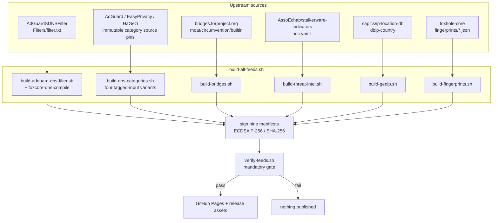
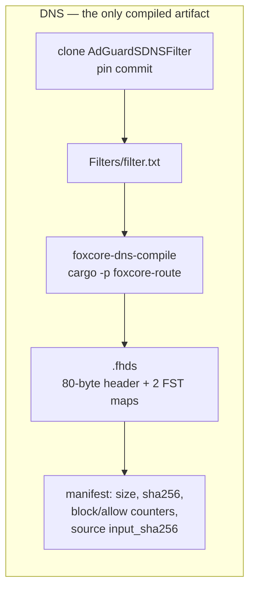
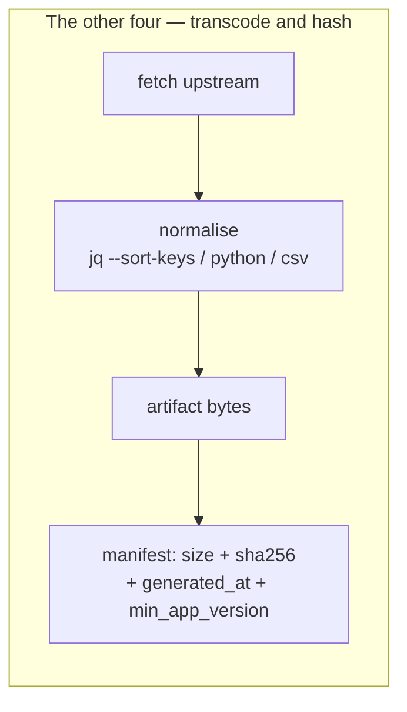
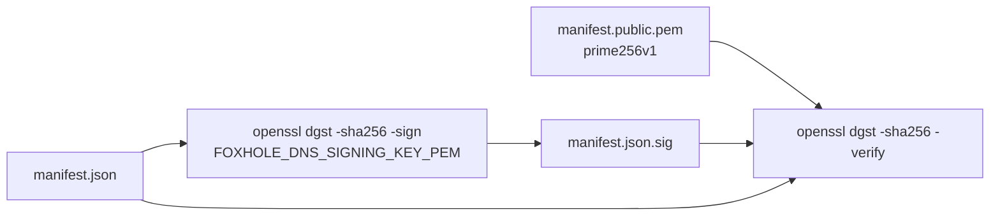
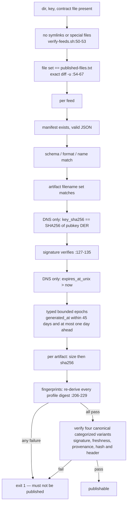
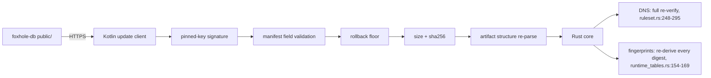

# 5. Data repository — FoxHole DB

Repo: `foxhole-team/foxhole-db` (public).
Five independent feeds, one signing key, one publication set.

---

## 5.1 Build model

One scheduled GitHub Actions job builds all five feeds together and publishes them as one set.

`build-all-feeds.sh:8-22` builds every feed and always ends with `verify-feeds.sh`. CI runs the same
gate at `.github/workflows/feeds.yml:160`, after signing and before the Pages deploy.

---

## 5.2 Feeds

| Feed | Artifact | Format | Built by | Upstream | Client consumer |
|---|---|---|---|---|---|
| DNS rules | `adguard-dns-filter.fhds` | `foxhole-dns-fst-v1` | `build-adguard-dns-filter.sh:152-179` | AdGuardSDNSFilter (commit pinned) | `DnsFilterUpdateClient` → core |
| Categorized DNS | four `dns-categories/<variant>/dns-categories.fhds` artifacts | `foxhole-dns-fst-v1`, manifest schema3 | `build-dns-categories.sh:51-78` | pinned AdGuard, EasyPrivacy and HaGezi inputs | `DnsFilterUpdateClient.downloadCategorized` → staged store → core (`foxhole_guard/app/src/main/kotlin/com/foxhole/guard/runtime/DnsFilterUpdateClient.kt:260`) |
| Tor bridges | `bridges.json` | `tor-bridges-json` | `build-bridges.sh:44-71` | Tor Moat builtin bridges | `TorBridgeUpdateClient` → `TorBridgeStore` |
| Sentinel threat intel | `threat-intel.json` | `sentinel-threat-intel-json`, doc `schema: 3` | `build-threat-intel.sh:99-276` | stalkerware-indicators (commit pinned) | `ThreatIntelUpdateClient` → `FileThreatIntelStore` |
| GeoIP | `dbip-country-ipv4.csv`, `dbip-country-ipv6.csv` | `dbip-country-csv` | `build-geoip.sh:60-119` | DB-IP Lite via ip-location-db | `GeoIpUpdateClient` → `GeoIpDatabaseStore` |
| TLS fingerprints | `fingerprints.json` | `tls-fingerprint-tables-json` | `build-fingerprints.sh:146-168` | `foxhole-core/fingerprints/` (revision pinned) | `TlsFingerprintUpdateClient` → core |

The five root feeds emit manifests, signatures, artifact checksums and provenance files.
Each categorized DNS variant adds a manifest, signature, artifact and checksum; its source
descriptors are bound inside the canonical manifest. The exact 43-file set is the contract
`.github/published-files.txt`, diffed by `verify-feeds.sh:54-67`.

---

## 5.3 What each builder does

Notable per-builder detail:

| Script | Detail |
|---|---|
| `build-adguard-dns-filter.sh:204-224`, `build-dns-categories.sh:34-44` | both DNS builders derive the public-key DER SHA-256 and refuse a signing-key mismatch before signing |
| `build-adguard-dns-filter.sh:225-250` | binds `key_sha256` into the manifest |
| `build-bridges.sh:44-71` | `curl --max-filesize 262144`, re-emitted with `jq --sort-keys --indent 2`. **Not byte-reproducible:** `--sort-keys` orders object keys, not array elements, so two builds of an unchanged upstream can emit the same bridge set in a different order and hash differently |
| `build-threat-intel.sh:99-276` | embedded Python/PyYAML converter, emits document `schema: 3` (`:243-250`) |
| `build-geoip.sh:121-150` | only manifest with an `artifacts` **array** and a top-level `version` copied from upstream `package.json` |
| `build-fingerprints.sh:80-122` | derives per-profile `fingerprint_sha256` via `jq -cSa` over the `fingerprint` object |

The DNS fallback compiler preserves the Core lockfile (`foxhole-db/build-adguard-dns-filter.sh:70`). Each builder treats `WORK_DIR` as a parent and owns a unique temporary child; EXIT cleanup removes only that child unless `KEEP_WORK_DIR=true` (`foxhole-db/build-threat-intel.sh:8-11`, `:27-32`). Numeric indicators are validated with Python `ipaddress`, scoped addresses are excluded, and IPv6 is canonicalized without DNS (`foxhole-db/build-threat-intel.sh:147-158`).

---

## 5.4 Signing

One ECDSA **P-256** key signs all nine manifests. Detached `.sig`, DER ASN.1, `SHA256withECDSA`.

| Fact | Value |
|---|---|
| Algorithm | ECDSA P-256 / SHA-256 — **not** Ed25519 |
| Public key, committed | `foxhole-db/manifest.public.pem` |
| Key DER SHA-256 | `3acd123f1fd03f8aee97b2e71029ba1f6efdd9c17703419d7cda78a790198d69` |
| Bound into DNS manifest | `manifest.json` → `key_sha256` (same value) |
| Signing secret | repo secret `FOXHOLE_DNS_SIGNING_KEY_PEM`, `main` publication only |
| Publication signing | `.github/workflows/feeds.yml:142-160` verifies the supplied key, signs five root and four categorized manifests, then verifies the whole candidate |

All six builders accept a private-key file or the common `FOXHOLE_DNS_SIGNING_KEY_PEM` input.
Materialized temporary PEM keys are removed on EXIT even when `KEEP_WORK_DIR=true` retains
other build work. Caller-supplied key files remain owned by the caller
(`foxhole-db/build-adguard-dns-filter.sh:30-41`; `foxhole-db/build-dns-categories.sh:11-26`).

The `.sig` files are produced only into `public/`; they are never committed. `feeds.yml:35` asserts
`test ! -e manifest.json.sig` on the tree. The committed root snapshots therefore **cannot** be
signature-checked locally — by design.

---

## 5.5 `verify-feeds.sh` — the publication gate

`./verify-feeds.sh <dir>`; no secrets needed, uses the committed public key.

Feed order: DNS → bridges → threat-intel → geoip → fingerprints, followed by all four
categorized variants (`verify-feeds.sh:185-203`, `:239-245`).

Structural checks intentionally run before signature verification so the local publisher gate can
aggregate candidate diagnostics (`verify-feeds.sh:108-135`). A publishable run still requires every
detached signature to verify; none of the parsed fields is accepted by a consumer on the strength
of this diagnostic ordering.
Untrusted epoch fields are validated as bounded integral JSON numbers before Bash arithmetic;
strings cannot be interpreted as shell expressions. Generation more than one day in the future
also fails the publisher gate (`foxhole-db/verify-feeds.sh:72-91`, `:140-160`).

---

## 5.6 What the client re-checks on receipt

Nothing the repository asserts is taken on trust. The receipt-side checks live in the client and,
for DNS and TLS fingerprints, again inside the Rust core.

---

### Categorized compiler input

`foxcore-dns-compile --tagged-input INPUT.json --output OUTPUT.fhds` is separate from the
legacy input/category/allowlist mode. It accepts canonical closed schema1 tagged input:
unique sorted lowercase suffixes and category memberships, source descriptors, tier identity
and curated global allow suffixes. The tagged-input file is bounded to 256 MiB; legacy list input and native artifacts stay bounded to 64 MiB. Canonical bytes are compared during serialization without materializing a second JSON tree. Header `source_sha256` binds the exact input bytes
(`crates/foxcore-route/src/ruleset.rs:390`,
`crates/foxcore-route/src/ruleset/categories.rs:134`).

Source-specific exceptions must be applied by the producer to that source before union.
They cannot become global exceptions that unblock another source's malicious membership.
Only explicitly curated compatibility or user exceptions belong in the global allow map.
The native compiler validates representation and provenance shape; it does not fetch or
classify upstream domains. Actual provider commits, licenses and category coverage remain
builder inputs requiring verification.

The legacy schema2 producer and four schema3 category producers are separate delivery paths.
The category builder resolves one source-built pinned compiler, verifies immutable original
input digests, applies source-specific exceptions before union and emits canonical signed
variants. Publication comparison includes their semantic identity and expiry, while the release
archive contains their nested paths (`foxhole-db/build-all-feeds.sh:9`;
`foxhole-db/build-dns-categories.sh:51`; `foxhole-db/dns-categories-manifest.py:67`;
`foxhole-db/should-publish-feeds.py:18`; `foxhole-db/.github/workflows/feeds.yml:155,179`).

Ads uses named AdGuard Base/Mobile adserver sections. Normal trackers combines unconditional
EasyPrivacy and AdGuard third-party tracking servers; Pro adds first-party/mobile sections.
Telemetry is limited to the named Huawei, Samsung, OPPO/Realme, Vivo and Xiaomi OEM inputs.
Malicious medium/full selects the corresponding HaGezi TIF input. Unsupported rule forms are
skipped rather than widened; no new global vendor whitelist is inserted. AdGuard and HaGezi
are GPL-3.0; EasyPrivacy is used under GPL-3.0-or-later with EasyList author attribution
(`foxhole-db/dns-category-sources/normal-medium.json:1`;
`foxhole-db/dns-category-sources/pro-full.json:1`; `foxhole-db/LICENSES.md:14`).

The legacy local builder now defaults to the official tracked generated gh-pages filter, with
explicit reference overrides retained. Existing CI already used that branch. Local unsigned
artifacts and temporary-key verification do not establish owner-signed publication, current
upstream freshness after a pin ages, or Android runtime acceptance
(`foxhole-db/build-adguard-dns-filter.sh:11`; `foxhole-db/.github/workflows/feeds.yml:95`).

## 5.7 Inconsistencies found

The former 27-file/five-manifest description omitted categorized DNS. The publication contract
contains 43 files and nine signed manifests (`foxhole-db/.github/published-files.txt:1-43`).
Guard packages four categorized seeds with APK-signing trust; these do not claim downloaded
manifest expiry or sequence (`foxhole_guard/app/src/main/kotlin/com/foxhole/guard/runtime/DnsFilterAssetInstaller.kt:54-82`).

The old publication comparison removed timestamps only from manifests, while the fingerprint
artifact digest still changed with its own build timestamp. The comparison now verifies current
manifest signatures and fingerprint bytes, compares semantic table/provenance content, and
requires renewal after 21 days or within seven days of DNS expiry
(`foxhole-db/should-publish-feeds.py:62`). CI caches the immutable feed compiler inputs without
changing which source revision builds the format (`foxhole-db/.github/workflows/feeds.yml:83`). `*-source-info.json` files are
publication audit artifacts by design; the client consumes the signed manifests and artifacts,
not these provenance companions.

The prior numeric-IP converter accepted malformed IPv6 through a character-only regular expression. The current converter validates the address grammar and normalizes equivalent spellings (`foxhole-db/build-threat-intel.sh:147-158`). Caller-owned working directories are no longer removed by cleanup (`foxhole-db/build-threat-intel.sh:8-11`, `:27-32`).
