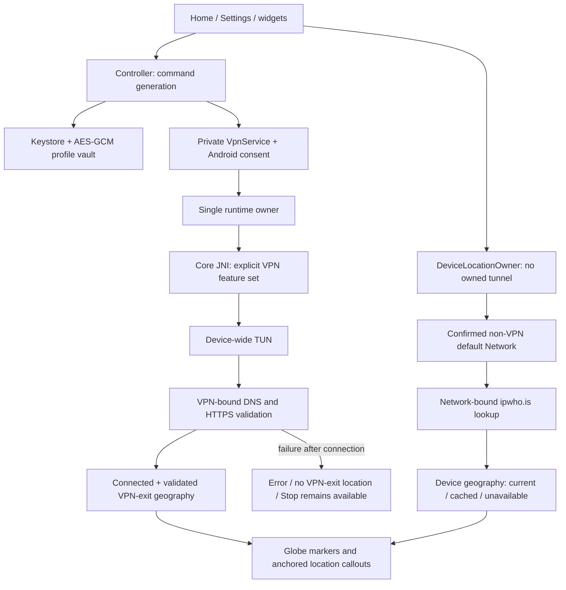
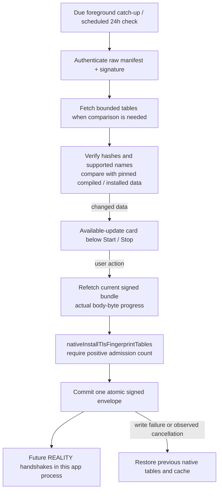

# VPN-only Android client

FoxHole VPN is a separate consumer in `foxhole-vpn`, using the existing Core ABI and explicit
VPN feature selection. ABI and compiled protocol checks precede TUN creation
(`foxhole-vpn/vpn-engine/src/main/kotlin/com/foxhole/vpn/engine/AndroidEngineDriver.kt:36`).

Start reserves a command generation before service dispatch; Stop invalidates it synchronously.
The Rust TUN descriptor has a separate `TunFdOwner`. Dropping that owner revokes
the reactor registration under the same lock used for nonblocking I/O, deregisters
before closing the descriptor, and wakes pending reads and writes. Retained device
wrappers then return `BrokenPipe`; they cannot keep the descriptor open or access
a reused descriptor (`crates/foxcore-tun/src/device.rs`). Runtime shutdown still
uses its existing bounded cleanup and reports retained wrappers separately.

Only the current pending command can be admitted or revoked. A released service cannot clear a
terminal connection error (`foxhole-vpn/app/src/main/kotlin/com/foxhole/vpn/ConnectionCommandFence.kt:24`;
`foxhole-vpn/app/src/main/kotlin/com/foxhole/vpn/DefaultVpnController.kt:229`, `:286`, `:829`, `:863`).
The Kotlin runtime actor owns accepted command tickets as well as runtime generation. Duplicate
delivery of the same accepted ticket cannot restart an active or terminally failed request.
Snapshots carry the owning ticket; the controller keeps a delivered start pending until the actor
acknowledges it. UI projection exposes Connected geography only for the matching owner and preserves
Stop/error when a tunnel or profile-store fault remains. This ticket is app state, not a new JNI field
(`foxhole-vpn/vpn-engine/src/main/kotlin/com/foxhole/vpn/engine/VpnRuntimeOwner.kt:26`, `:90`, `:97`, `:309`;
`foxhole-vpn/app/src/main/kotlin/com/foxhole/vpn/DefaultVpnController.kt:140`, `:835`;
`foxhole-vpn/app/src/main/kotlin/com/foxhole/vpn/PendingRuntimeUiFailure.kt:9`).

Home can reserve the next Start during ordinary Stop cleanup, without opening a second TUN.
`hasPendingStart` keeps that replacement cancellable through Stop, while `canRestartDuringStop`
admits Start only before another replacement is pending and without a visible cleanup/storage fault.
The actor keeps the desired request separate from the old active/pending session; it starts the
replacement only after successful release. A failed release clears the desired request and publishes
Error. UI projection prioritizes an actually owned Error over pending-start presentation and exposes
Connected geography only for the current acknowledged ticket. This queues intent, not a validated
connection (`foxhole-vpn/app/src/main/kotlin/com/foxhole/vpn/VpnContracts.kt:73`;
`foxhole-vpn/app/src/main/kotlin/com/foxhole/vpn/ui/VpnPresentation.kt:9`;
`foxhole-vpn/app/src/main/kotlin/com/foxhole/vpn/DefaultVpnController.kt:229`, `:286`;
`foxhole-vpn/app/src/main/kotlin/com/foxhole/vpn/PendingRuntimeUiFailure.kt:21`, `:30`, `:45`, `:48`;
`foxhole-vpn/vpn-engine/src/main/kotlin/com/foxhole/vpn/engine/VpnRuntimeOwner.kt:97`, `:118`, `:143`, `:237`).

The translator requires full-device routes and refuses per-app allow/disallow lists
(`foxhole-vpn/vpn-engine/src/main/kotlin/com/foxhole/core/runtime/VpnEngineConfig.kt:21`).
Before creating the TUN, the driver prefers Android's active physical default when it has Internet
and unrestricted capabilities. Otherwise it ranks eligible non-VPN networks by validation, Wi-Fi,
Ethernet, unmetered access and cellular transport; absence is a failed start. The same selected handle
is supplied to Android's TUN builder and Core's protected DNS/socket binding, including rebinding
(`foxhole-vpn/vpn-engine/src/main/kotlin/com/foxhole/vpn/engine/EngineNetworkPolicy.kt:3`, `:24`;
`foxhole-vpn/vpn-engine/src/main/kotlin/com/foxhole/vpn/engine/AndroidEngineDriver.kt:52`, `:75`, `:112`, `:203`).

On API 30 and newer, a VPN Network must report this app's UID. Discovery prefers a newly observed
owned handle but can accept the single owned NetworkAgent when Android reuses its handle. Older APIs
retain the newly observed VPN-handle fallback. The system's VPN `VALIDATED` bit is not a prerequisite;
the app performs its own bound proof before publishing Connected. Discovery also waits up to five
seconds for an unconnected socket to bind to that owned Network: owner capabilities can appear
before netd UID access is ready. The candidate is rechecked on each cancellable 50 ms retry; no
traffic is sent by the readiness check and no underlying network can substitute for the VPN
(`foxhole-vpn/vpn-engine/src/main/kotlin/com/foxhole/vpn/engine/EngineNetworkPolicy.kt:9`, `:12`;
`foxhole-vpn/vpn-engine/src/main/kotlin/com/foxhole/vpn/engine/AndroidEngineDriver.kt:83`, `:124`, `:144`, `:159`;
`foxhole-vpn/vpn-engine/src/main/kotlin/com/foxhole/vpn/engine/EngineNetworkReadiness.kt:6`).

VPN validation binds DNS and sockets to the owned Android VPN Network and requires the HTTPS
endpoint's 204 before Connected. Its 30-second total request and 25-second read budgets allow
upstream protocol setup after TUN-local TCP acknowledgement; they remain finite product limits,
not a guarantee for every provider or transport. The separate exit-location lookup retains its
six-second request and three-second read budgets and may remain unavailable
(`foxhole-vpn/vpn-engine/src/main/kotlin/com/foxhole/vpn/engine/VpnNetworkProof.kt:25`, `:33`, `:38`, `:54`, `:70`;
`foxhole-vpn/vpn-engine/src/main/kotlin/com/foxhole/vpn/engine/AndroidEngineDriver.kt:159`).
The actor exports enum-derived validation failure codes. Both build variants log a changed code
without profile IDs, addresses, credentials or exception messages
(`foxhole-vpn/vpn-engine/src/main/kotlin/com/foxhole/vpn/engine/VpnRuntimeOwner.kt:324`;
`foxhole-vpn/app/src/main/kotlin/com/foxhole/vpn/DefaultVpnController.kt:134`).
The failed HTTPS request also records only its fixed REQUEST/DNS/CONNECT/TLS/HTTP stage,
exception class, numeric errno, address family and elapsed milliseconds from a bounded cause-chain inspection. Cancellation remains
propagated and closes the outstanding Call; the diagnostic path never logs the hostname, profile
or exception message. It does not weaken proof or establish that a provider/DNS failure is resolved
(`foxhole-vpn/vpn-engine/src/main/kotlin/com/foxhole/vpn/engine/VpnNetworkProof.kt:38`, `:61`, `:101`).

## Profile import, selection and transfer

Hysteria2 `pinSHA256` names the leaf certificate fingerprint, not its public key.
Android stores it as `certificate_sha256` and translates it to the native
`pinned_certificate_sha256`; SPKI pins retain their separate existing field. Mixing pin
kinds or multiple leaf pins is refused. Portable HY2 export emits the standard camel-case
`pinSHA256` query with a hexadecimal fingerprint. A matching pin remains mandatory even
when an insecure flag is present; TLS handshake signatures are still checked
(`foxhole-vpn/vpn-profile/src/main/kotlin/com/foxhole/core/importer/ProfileImportNodeSupport.kt:346`;
`foxhole-vpn/vpn-engine/src/main/kotlin/com/foxhole/core/runtime/FoxCoreTlsTransportTranslator.kt:53`;
`crates/foxcore-link/src/lib.rs:2942`; `crates/foxcore-transport/src/tls.rs:575`).
Corrected Android mappings require a fresh matching native build and Core pin before
packaging. Previously saved direct profiles lack their original import text: their
ambiguous old pin cannot be rewritten safely. Subscription refresh or reimport reconstructs
the corrected certificate meaning from the authoritative provider input.

Clash/mihomo YAML imports proxy nodes for Shadowsocks, VLESS, VMess, Trojan,
Hysteria2 and AnyTLS through the existing protocol parsers. Unsupported node types and
client policy are reported; external proxy providers are refused and never fetched.
Low-level YAML events retain scalar spelling and reject duplicate keys, references,
unsafe tags and multiple documents. Bounds are 1 MiB, 16,384 events, 32 levels and
16,384 characters per scalar. Known settings cannot be silently discarded: conflicting
SNI/Host aliases, malformed REALITY, unsupported transports and inappropriate TLS options
are refused. Android retains its public-host and explicit insecure-TLS policies
(`foxhole-vpn/vpn-profile/src/main/kotlin/com/foxhole/core/importer/BoundedProfileYaml.kt:24`;
`foxhole-vpn/vpn-profile/src/main/kotlin/com/foxhole/core/importer/ProfileImportClashSupport.kt:14`;
`crates/foxcore-link/src/clash.rs:45`, `:402`). The native strict import rejects a document
with unapplied entries/policy; partial import returns separate closed rejection reports.
Both Android apps enable Java API desugaring for the YAML parser on API 26–32
(`foxhole-vpn/app/build.gradle.kts:75`; `foxhole_guard_dev/app/build.gradle.kts:1265`).

Outline `ssconf://` sources are converted to public HTTPS only for download. The encrypted
profile retains the original dynamic key for refresh/share, and a single profile can retain
its decoded fragment title. Redirect, body, cancellation and public-host policies remain
owned by the existing downloaders. Standard four-field Shadowsocks JSON becomes an Outline
node; unsupported transports/plugins and server fields are refused. URLs inside JSON,
WireGuard or recognized YAML documents are not treated as subscription sources
(`foxhole-vpn/vpn-profile/src/main/kotlin/com/foxhole/core/network/SubscriptionAccessUrl.kt:5`;
`foxhole-vpn/vpn-profile/src/main/kotlin/com/foxhole/core/importer/ProfileImportEngine.kt:75`;
`foxhole-vpn/vpn-profile/src/main/kotlin/com/foxhole/core/importer/ProfileImportSip008Support.kt:57`;
`foxhole-vpn/vpn-profile/src/main/kotlin/com/foxhole/vpn/profile/SubscriptionFetcher.kt:46`;
`foxhole-vpn/vpn-profile/src/main/kotlin/com/foxhole/vpn/profile/VpnProfileImporter.kt:67`).
Native `foxcore-link` separately parses bounded SIP008/Outline JSON with duplicate-field
refusal and exposes a secret-typed HTTPS source normalizer without networking. Callers
still validate actual DNS, redirects and TLS at their IO boundary; the link JNI ABI has no
new fetch operation (`crates/foxcore-link/src/structured.rs:43`;
`crates/foxcore-link/src/subscription_source.rs:6`; `crates/foxcore-link/src/lib.rs:572`).

Direct SIP008 JSON paste uses the shared server parser before link-list parsing. The canonical
JSON codec yields single `servers` documents to that parser; it does not consume them as
FoxHole configuration. Root fields/version, count and plugin options are checked, and normal
public-host admission still applies. Each accepted server becomes an isolated option
(`foxhole-vpn/vpn-profile/src/main/kotlin/com/foxhole/core/importer/CanonicalProfileInterop.kt:59`;
`foxhole-vpn/vpn-profile/src/main/kotlin/com/foxhole/core/importer/ProfileImportEngine.kt:219`;
`foxhole-vpn/vpn-profile/src/main/kotlin/com/foxhole/core/importer/ProfileImportSip008Support.kt:16`).

Text/file imports retain the 1 MiB UTF-8 bound. Supported normalized FoxHole JSON configurations
are also accepted as complete objects, arrays or whitespace-concatenated documents. The shared
codec uses a JSON value stream, with at most 256 documents/choices, depth 64 and a 4 MiB aggregate
materialized-choice budget. A canonical choice retains the complete configuration, DNS and routing; it changes
only the explicit selector default. Existing remote-host, local-inbound and recursive insecure-TLS
checks still apply (`foxhole-vpn/vpn-profile/src/main/kotlin/com/foxhole/vpn/profile/VpnProfileImporter.kt:28`, `:58`;
`foxhole-vpn/vpn-profile/src/main/kotlin/com/foxhole/core/importer/CanonicalProfileInterop.kt:50`, `:119`, `:146`;
`foxhole-vpn/vpn-profile/src/main/kotlin/com/foxhole/core/importer/ProfileImportEngine.kt:586`).

Canonical JSON must use the emitted TLS field names. Retired `allowInsecure`, `allow_insecure`
and case aliases are refused even with an insecure-TLS override. Canonical `insecure` still requires
ordinary consent; the distinct Xray `protocol` branch retains its established alias conversion and
consent checks (`foxhole-vpn/vpn-profile/src/main/kotlin/com/foxhole/core/importer/CanonicalProfileInterop.kt:50`, `:101`;
`foxhole-vpn/vpn-profile/src/main/kotlin/com/foxhole/core/importer/ProfileImportXraySupport.kt:23`).

Direct share-link lists are normalized one node at a time before constructing saved options.
Each option has the exact standalone configuration for its protocol, including WireGuard's private
tunnel DNS; the first option is the initial selection. Mixed proxy/packet members are not left inside
every option. Canonical JSON with explicit policies follows its separate preservation path
(`foxhole-vpn/vpn-profile/src/main/kotlin/com/foxhole/core/importer/ProfileImportEngine.kt:219`, `:245`;
`foxhole-vpn/vpn-profile/src/main/kotlin/com/foxhole/core/importer/CanonicalProfileInterop.kt:50`).

Public-host admission checks actual outbound/DNS `server_ip` overrides as well as hostnames. The
reserved `dns-wireguard` tag exempts a private resolver only for a genuine single selected WireGuard
endpoint packet route, with intended UDP/proxy metadata and a nonloopback literal resolver. A tag
alone, an unused WG endpoint or a mixed selector does not grant the exemption; the existing explicit
private-host opt-in remains separate
(`foxhole-vpn/vpn-profile/src/main/kotlin/com/foxhole/core/importer/ProfileImportCoreSupport.kt:468`, `:517`;
`foxhole-vpn/vpn-profile/src/main/kotlin/com/foxhole/core/importer/ProfileImportTunnelDnsPolicy.kt:8`, `:25`).

The official `v2raytun://import/{configuration|subscription_link}` wrapper is unwrapped once.
A plain inner URI keeps its escapes; an encoded payload is decoded once. Nested and unsupported
actions are refused, including a partially encoded nested prefix
(`foxhole-vpn/vpn-profile/src/main/kotlin/com/foxhole/core/importer/CanonicalProfileInterop.kt:22`;
`foxhole-vpn/vpn-profile/src/main/kotlin/com/foxhole/core/importer/ProfileImportParser.kt:18`;
[official wrapper specification](https://docs.v2raytun.com/deep-link)).

Subscriptions expose a bounded plain/base64 `profile-title` as display text. The importer retains
the legacy parsing fallback for stable identity and applies the human title afterward. Refresh
retains a selected option when its ID still exists
(`foxhole-vpn/vpn-profile/src/main/kotlin/com/foxhole/vpn/profile/SubscriptionFetcher.kt:17`, `:45`;
`foxhole-vpn/vpn-profile/src/main/kotlin/com/foxhole/vpn/profile/VpnProfileImporter.kt:58`;
`foxhole-vpn/app/src/main/kotlin/com/foxhole/vpn/DefaultVpnController.kt:654`).

Optional expiry is stored as epoch milliseconds. Existing Guard parsing converts seconds,
milliseconds and ISO dates; profile/body minimum takes precedence over parsed subscription metadata,
then HTTP `subscription-userinfo`, then the original URL fallback. Missing, zero, malformed or
out-of-range dates remain absent. A valid selected-profile date is formatted in the current locale
and time zone directly below status. It is informational and never blocks a route
(`foxhole-vpn/vpn-profile/src/main/kotlin/com/foxhole/vpn/profile/SubscriptionExpiry.kt:5`;
`foxhole-vpn/vpn-profile/src/main/kotlin/com/foxhole/vpn/profile/SubscriptionHttp.kt:14`;
`foxhole-vpn/vpn-profile/src/main/kotlin/com/foxhole/vpn/profile/VpnProfileImporter.kt:58`;
`foxhole-vpn/vpn-profile/src/main/kotlin/com/foxhole/vpn/profile/VpnProfile.kt:17`;
`foxhole-vpn/app/src/main/kotlin/com/foxhole/vpn/ui/VpnHome.kt:191`, `:209`;
`foxhole-vpn/app/src/main/kotlin/com/foxhole/vpn/ui/SubscriptionExpiry.kt:9`).
Subscription cancellation reaches the owning Call during headers and bounded body reads. Callback
ownership closes success, rejection, redirect and cancelled responses before any result can be used;
late responses cannot publish after cancellation
(`foxhole-vpn/vpn-profile/src/main/kotlin/com/foxhole/vpn/profile/SubscriptionHttp.kt:14`;
`foxhole-vpn/vpn-profile/src/main/kotlin/com/foxhole/vpn/profile/SubscriptionFetcher.kt:45`).

The encrypted profile stores nullable `selectedProtocolOptionId`; older payloads default to null.
Selection uses an enabled supported option's exact normalized configuration and cannot grant TLS
consent. Disconnected selection is immediate; the controller checks idle/current command ownership
before translation and persistence.
The store transaction settles in NonCancellable cleanup: it publishes only while current, otherwise
restoring the prior store if a newer start raced the write. Cancelling the UI caller cannot leave
persisted and published choices split
(`foxhole-vpn/vpn-profile/src/main/kotlin/com/foxhole/vpn/profile/VpnProfile.kt:16`;
`foxhole-vpn/vpn-profile/src/main/kotlin/com/foxhole/vpn/profile/VpnPortableProfile.kt:8`;
`foxhole-vpn/app/src/main/kotlin/com/foxhole/vpn/DefaultVpnController.kt:528`;
`foxhole-vpn/app/src/main/kotlin/com/foxhole/vpn/ProfileChoiceTransaction.kt:6`).

Choosing a different protocol on the selected profile with an owned Connected, Validating or retained
Error tunnel opens a confirmation. The same option does nothing; pending starts, Stop cleanup faults,
Stopping and a different actor owner are refused. Continue rechecks the connection ticket, command
generation and profile revision against the actual actor snapshot before schema validation and the
fenced store transaction. Publication atomically reserves the replacement command, hides stale exit
geography and dispatches the existing serial reconnect. Cancel/Back performs no storage or reconnect
(`foxhole-vpn/app/src/main/kotlin/com/foxhole/vpn/ProtocolChoice.kt:9`, `:28`, `:33`;
`foxhole-vpn/app/src/main/kotlin/com/foxhole/vpn/DefaultVpnController.kt:562`, `:577`, `:586`, `:811`;
`foxhole-vpn/app/src/main/kotlin/com/foxhole/vpn/ui/VpnApp.kt:460`).

Generated subscription option names with a recognized `vpn-core-` or `foxhole-` family and known protocol
(in the name or UI protocol hint) are formatted without their numeric service suffix. Protocol versions are retained;
custom names, internal option IDs, stored configurations and export remain unchanged
(`foxhole-vpn/app/src/main/kotlin/com/foxhole/vpn/ui/VpnProtocolOptionDisplayName.kt:7`, `:18`;
`foxhole-vpn/app/src/main/kotlin/com/foxhole/vpn/ui/VpnProfilesSheet.kt:161`;
`foxhole-vpn/app/src/main/kotlin/com/foxhole/vpn/ui/VpnProtocolBadge.kt:33`).

Other profile mutations also capture command generation, phase, tunnel and pending-start ownership
before I/O and recheck admission at publication. Changing the selected profile stops an active session;
changing that same active profile's configuration can reconnect, while metadata-only changes keep the
route. Caller cancellation is checked before writing; an accepted write settles publication or rollback
in NonCancellable cleanup. Publication is atomic under the command fence. A failed rollback records a
visible store fault, disables further readiness and keeps the owned Stop action available
(`foxhole-vpn/app/src/main/kotlin/com/foxhole/vpn/ProfileMutationTransaction.kt:23`, `:41`, `:54`;
`foxhole-vpn/app/src/main/kotlin/com/foxhole/vpn/DefaultVpnController.kt:734`, `:774`, `:783`;
`foxhole-vpn/app/src/main/kotlin/com/foxhole/vpn/PendingRuntimeUiFailure.kt:9`).

Profile viewing and adding have separate admission from selection, refresh and deletion. Ordinary
imports may append profiles or change metadata while a tunnel is running, provided the selected
profile ID and its resolved configuration JSON stay unchanged. That KEEP publication reserves no
connection command and neither disconnects nor reconnects the tunnel. Replacing the active selection
or configuration is refused for an owned/pending tunnel or connecting/validating/connected/stopping
owner, with no partial batch write. The import-only predicate is checked before storage, during
the store fence and again under the final command lock. Explicit subscription refresh and general
mutation/reconnect policy keep their separate established contract; TLS consent remains explicit
(`foxhole-vpn/app/src/main/kotlin/com/foxhole/vpn/DefaultVpnController.kt:615`, `:654`, `:734`, `:745`, `:747`, `:752`, `:783`, `:923`;
`foxhole-vpn/app/src/main/kotlin/com/foxhole/vpn/ui/VpnApp.kt:210`, `:215`, `:455`, `:514`;
`foxhole-vpn/app/src/main/kotlin/com/foxhole/vpn/ui/VpnProfilesSheet.kt:79`).

The profile row opens its available protocols directly. Long press opens the lower action page;
Copy always exports the whole profile, regardless of expansion or selected option. A subscription
returns its exact nonblank stored source URL. Other profiles use the full compatible link writer;
per-option Copy is absent from the product UI. Refresh/delete keep their disconnected admission
and deletion confirmation
(`foxhole-vpn/app/src/main/kotlin/com/foxhole/vpn/ui/VpnProfilesSheet.kt:145`, `:191`;
`foxhole-vpn/app/src/main/kotlin/com/foxhole/vpn/ui/VpnApp.kt:457`, `:478`, `:486`;
`foxhole-vpn/app/src/main/kotlin/com/foxhole/vpn/ui/VpnProfileActionsSheet.kt:39`, `:51`;
`foxhole-vpn/app/src/main/kotlin/com/foxhole/vpn/DefaultVpnController.kt:600`;
`foxhole-vpn/vpn-profile/src/main/kotlin/com/foxhole/vpn/profile/VpnPortableProfile.kt:37`).

Non-subscription clipboard export emits standard share links only after reparsing and comparing the complete policy
and security configuration. Only topology labels and explicitly unselected alternatives are normalized.
Unrepresentable fields or custom DNS/routing produce a fixed export failure; they are not silently
removed. Selected options export first to preserve the initial choice on reimport. Guard uses the
same codec; its SAF/QR exports retain their existing full-document contract
(`foxhole-vpn/vpn-profile/src/main/kotlin/com/foxhole/core/importer/PortableProfileExport.kt:16`, `:34`, `:68`, `:94`;
`foxhole-vpn/vpn-profile/src/main/kotlin/com/foxhole/vpn/profile/VpnPortableProfile.kt:22`;
`foxhole_guard/app/src/main/kotlin/com/foxhole/guard/ui/cli/profiles/CliProfileConfigExport.kt:70`, `:94`).
Guard serializes requested links on Default, then obtains the Android clipboard service and commits
the sensitive ClipData on Main.immediate. A failed conversion never clears the existing clipboard
(`foxhole_guard/app/src/main/kotlin/com/foxhole/guard/ui/cli/profiles/CliProfileConfigExport.kt:94`, `:104`).
External clients must support the chosen protocol and its URI fields; this is not universal provider
or client compatibility proof.

Clipboard Paste on the import-source page reads the existing bounded multi-item text only after
that Android dialog owns window focus, then imports directly with secure TLS defaults. It opens no
extra editor. A request token, captured input and owning entry fence late result navigation/consent.
An empty or unreadable clipboard produces the existing top notice and no import. If explicit insecure-TLS
consent is needed, Cancel returns to Sources and Continue reuses the same captured text, even if the
clipboard changes afterward. Whole Close/Back or a new external draft invalidates that request.
Manual, file and QR editor paths keep their existing entry/input checks. Import still uses the
controller's protected active-profile transaction; it does not stop the existing VPN to add another
profile or grant consent implicitly
(`foxhole-vpn/app/src/main/kotlin/com/foxhole/vpn/ui/VpnApp.kt:279`, `:283`, `:301`, `:314`, `:346`, `:487`, `:543`, `:556`;
`foxhole-vpn/app/src/main/kotlin/com/foxhole/vpn/ProfileClipboard.kt:18`;
`foxhole-vpn/app/src/main/kotlin/com/foxhole/vpn/DefaultVpnController.kt:654`, `:734`, `:923`).

## Camera QR boundary

The add-profile sheet launches an unexported QR Activity. CAMERA is optional hardware and is requested
only on entering the scanner. Denial does not prompt in a loop; retry, system settings and Back remain
explicit. Decoding is QR-only and local; the first current result is bounded to 16 KiB, returned once,
and sent into the existing import confirmation rather than saved or connected automatically
(`foxhole-vpn/app/src/main/AndroidManifest.xml:7`, `:24`;
`foxhole-vpn/app/src/main/kotlin/com/foxhole/vpn/ui/VpnImportSheet.kt:35`;
`foxhole-vpn/app/src/main/kotlin/com/foxhole/vpn/qr/QrDecoder.kt:6`;
`foxhole-vpn/app/src/main/kotlin/com/foxhole/vpn/qr/QrScanSession.kt:21`, `:63`;
`foxhole-vpn/app/src/main/kotlin/com/foxhole/vpn/MainActivity.kt:91`).

Permission/lifecycle generations and preview identity fence late camera callbacks. Pause, stop,
destruction and Compose release close the preview without a blocking camera wait. Only the permission-
requested flag is saved in instance state, never the scanned profile. The secure scanner window hides
camera/profile content from screenshots and recents; no image-file or screen-capture import is added
(`foxhole-vpn/app/src/main/kotlin/com/foxhole/vpn/qr/QrScanActivity.kt:53`, `:94`, `:121`, `:141`, `:189`).

## Automatic refresh ownership

Settings default all subscription sources to 12 hours and signed connection-data checks to 24 hours;
older encrypted payloads receive those defaults. Two unique, network-constrained periodic WorkManager
jobs use those intervals, initial interval delays and bounded retry. Android schedules them according
to its constraints; they are not exact timers. Foreground entry also checks due work. WorkData carries
no source URLs, profile credentials or serialized configurations
(`foxhole-vpn/app/src/main/kotlin/com/foxhole/vpn/VpnContracts.kt:23-26`;
`foxhole-vpn/app/src/main/kotlin/com/foxhole/vpn/refresh/VpnRefreshWork.kt:19`, `:35`, `:55-90`;
`foxhole-vpn/app/src/main/kotlin/com/foxhole/vpn/DefaultVpnController.kt:307`, `:369`, `:402`).

The vault stores last-attempt, last-success and typed outcome per SHA-256 source key, plus the data
check stamp. Failure, defer, stale ownership and in-progress attempts never become successful
refreshes; a ten-minute retry floor bounds repeated foreground attempts. A subscription run deduplicates
source URLs, visits due groups oldest first and owns an eight-minute deadline. Callback/body cancellation
remains owned by the existing fetcher. Profile changes and their success stamp settle together under
the existing NonCancellable publication/rollback transaction
(`foxhole-vpn/app/src/main/kotlin/com/foxhole/vpn/refresh/RefreshLedger.kt:7-39`;
`foxhole-vpn/app/src/main/kotlin/com/foxhole/vpn/storage/EncryptedProfileStore.kt:26`;
`foxhole-vpn/app/src/main/kotlin/com/foxhole/vpn/DefaultVpnController.kt:402`, `:460`, `:475`;
`foxhole-vpn/app/src/main/kotlin/com/foxhole/vpn/ProfileMutationTransaction.kt:23`).

Each automatic group retains its selected protocol, including older nullable selection IDs resolved
from the prior exact configuration. Group TLS consent is conservative and cannot grant new consent.
Captured group contents and command generation are checked before and after I/O. A changed selected
configuration/ID under owned or pending runtime ownership defers the entire group. The actual actor-owned
profile's configuration/removal is protected independently, including a handoff where stored selection
already names a different profile. Other groups can still refresh. Accepted automatic publication is
KEEP only: it never reserves a connection command, disconnects or reconnects. Explicit manual refresh
retains its separate mutation policy
(`foxhole-vpn/app/src/main/kotlin/com/foxhole/vpn/refresh/SubscriptionRefreshTarget.kt:5`;
`foxhole-vpn/app/src/main/kotlin/com/foxhole/vpn/refresh/SubscriptionRefreshProposal.kt:14`, `:18`, `:65`;
`foxhole-vpn/app/src/main/kotlin/com/foxhole/vpn/DefaultVpnController.kt:456`, `:475`, `:496`).

Signed-data workers check availability only. Persisted check timing never substitutes for authentication
of the checked-candidate envelope; a missing/invalid envelope makes the check due again. The manual card
remains the sole native installation action. The separate GitHub APK updater uses Android
package verification/installation, not this signed-data/native path
(`foxhole-vpn/app/src/main/kotlin/com/foxhole/vpn/DefaultVpnController.kt:369`;
`foxhole-vpn/app/src/main/kotlin/com/foxhole/vpn/updates/VpnDataUpdater.kt:62`, `:78`, `:98`).

## Device geography and globe presentation

Status widgets display “Determining…” during CONNECTING/VALIDATING and while ready IDLE home
geography is explicitly LOADING. Other states without available geography retain the dash;
this display does not trigger a lookup
(`foxhole-vpn/app/src/main/kotlin/com/foxhole/vpn/widget/WidgetPolicy.kt:28`;
`foxhole-vpn/app/src/main/kotlin/com/foxhole/vpn/widget/WidgetRendering.kt:60`;
`foxhole-vpn/app/src/main/res/values/widget_strings.xml:20`).

Device geography has current/cached/unavailable status and a monotonic check time in memory. Main
activity visibility owns the default-network listener. Foreground entry, a changed default Network
or addresses, and completed teardown trigger off-tunnel lookup. Home geography requires a
positively non-VPN default Network; another VPN is not relabelled as the home location
(`foxhole-vpn/app/src/main/kotlin/com/foxhole/vpn/VpnContracts.kt:52`;
`foxhole-vpn/app/src/main/kotlin/com/foxhole/vpn/MainActivity.kt:217`, `:222`;
`foxhole-vpn/app/src/main/kotlin/com/foxhole/vpn/DeviceNetworkLocationTracker.kt:71`, `:103`, `:118`).
Superseded requests are cancelled, and only a current foreground result without an owned/pending
tunnel is published. Cached geography may survive unavailable lookup. A single 30-minute job exists only while
MainActivity is foreground; it requests the current VPN-owned location when connected, otherwise
the eligible default-network device lookup. Background entry cancels that job; the widget has a
separate bounded event-owned refresh
(`foxhole-vpn/app/src/main/kotlin/com/foxhole/vpn/DeviceLocationOwner.kt:18`, `:60`;
`foxhole-vpn/app/src/main/kotlin/com/foxhole/vpn/refresh/ForegroundIpRefresh.kt:9`, `:17`;
`foxhole-vpn/app/src/main/kotlin/com/foxhole/vpn/DefaultVpnController.kt:307`, `:322`).
Both geography paths use bounded `ipwho.is` responses and network-bound DNS/sockets. Valid optional
coordinates are finite and geographically bounded; this is approximate GeoIP, with no GPS or location
permission (`foxhole-vpn/vpn-engine/src/main/kotlin/com/foxhole/vpn/engine/VpnNetworkProof.kt:62`, `:88`;
`foxhole-vpn/vpn-engine/src/main/kotlin/com/foxhole/vpn/engine/NetworkLocationParser.kt:23`;
`foxhole-vpn/app/src/main/AndroidManifest.xml:1`).

Home groups status directly beneath the globe. The outlined oval profile selector carries a small
raised protocol badge and sits above the Start/Stop action, whose minimum height is 68 dp. Country,
flag and optional city appear only in globe callouts. The initial valid device point opens a callout;
manual dragging or an empty-space recenter dismisses it. Home passes the actual phase to the globe:
CONNECTING, VALIDATING and STOPPING hide home details; returning to IDLE reopens them if coordinates
exist, otherwise waits for real location data. Cold start opens the intro once coordinates arrive.
Same-process restoration preserves visual state; legacy or malformed saved values reset safely
(`foxhole-vpn/app/src/main/kotlin/com/foxhole/vpn/ui/VpnHome.kt:76`, `:120`, `:161`, `:191`;
`foxhole-vpn/app/src/main/kotlin/com/foxhole/vpn/ui/VpnProtocolBadge.kt:15`;
`foxhole-vpn/app/src/main/kotlin/com/foxhole/vpn/ui/VpnHome.kt:84`, `:102`, `:109`;
`foxhole-vpn/app/src/main/kotlin/com/foxhole/vpn/ui/VpnPlanet.kt:108`, `:147`, `:204`, `:490`;
`foxhole-vpn/app/src/main/kotlin/com/foxhole/vpn/ui/GlobeCalloutCue.kt:22`, `:28`, `:60`).

Home adapts to the available viewport: a width greater than 1.25 times height places the globe/status
beside independently scrollable controls anchored to the lower safe edge. Their scroll content keeps
a viewport-sized minimum height so bottom alignment also works with scrolling. Portrait keeps controls below the globe; a short viewport
or large text enables whole-content scrolling. Globe size is bounded by both available dimensions
and the status/expiry allowance. These layout choices do not change selection or tunnel ownership
(`foxhole-vpn/app/src/main/kotlin/com/foxhole/vpn/ui/VpnHome.kt:76`, `:81`, `:89`, `:95`, `:105`).

A new validated connection automatically replaces the device card with the server card. Tapping
the server card dismisses it for that connection; rotation, health refresh and same-process
restoration preserve dismissal. Empty-space recenter also hides it. The server point or accessibility action reopens
it, while a different connection opens it automatically. The device point can open/toggle its own
card while connected; doing so hides the server card without ending the connection. Invalid/lost confirmation hides stale server
metadata without clearing dismissal for the same connection ticket. Saved state is versioned and
process-tagged; legacy, malformed or previous-process values reset safely
(`foxhole-vpn/app/src/main/kotlin/com/foxhole/vpn/ui/GlobeCalloutCue.kt:14`, `:39`, `:45`, `:46`, `:49`, `:60`;
`foxhole-vpn/app/src/main/kotlin/com/foxhole/vpn/ui/VpnPlanet.kt:147`, `:340`, `:386`, `:389`, `:474`, `:490`).

While open, the front-facing server card follows the rendered exit marker, including its
near-coincident visual offset, so the callout points at the VPN marker. A rear-facing projection
blends toward the upper-globe overlay while marker/arc occlusion remains unchanged. When the
visible home marker lies above the server and the measured card fits below, the server card moves
below with its triangle on top. Device, rear, missing-point and cramped placements stay above;
vertical placement remains viewport-clamped. A derived side flag avoids per-frame composition,
while graphics-layer positioning follows rotation using reused arrays
(`foxhole-vpn/app/src/main/kotlin/com/foxhole/vpn/ui/GlobeCalloutCue.kt:77`;
`foxhole-vpn/app/src/main/kotlin/com/foxhole/vpn/ui/VpnPlanet.kt:436`, `:444`, `:446`, `:458`, `:462`, `:472`;
`foxhole-vpn/app/src/main/kotlin/com/foxhole/vpn/ui/VpnGlobeCallout.kt:47`, `:61`, `:100`, `:119`, `:124`).
Only a Connected location can be a VPN exit. Missing coordinates never create a marker or arc; the
arc is an approximate illustration, not a measured packet route. Tapping the globe centers the
actual great-circle arc midpoint, or the available exit/device when there is no arc, including the
date-line and antipodal cases. Empty-space centering clears open cards and emits one
`GestureEnd` haptic; it does not perform network I/O
(`foxhole-vpn/app/src/main/kotlin/com/foxhole/vpn/ui/VpnPresentation.kt:31`;
`foxhole-vpn/app/src/main/kotlin/com/foxhole/vpn/ui/GlobeRoute.kt:22`;
`foxhole-vpn/app/src/main/kotlin/com/foxhole/vpn/ui/VpnPlanet.kt:122`, `:213`).

The globe keeps flat Vector land and a thin outline. FoxHole and System derive a subtle land tint
from the active foreground/surface palette; Light and Night retain their established land tones. The
subtle static edge glow/shade uses two cached radial gradients with continuous inward/outward falloff.
This static layer sits below the route and adds no animation job. No ocean fill, grid or coastline strokes are drawn.
Tiny islands remain omitted from the fixed mesh; moving and settled buffers share land-only geometry. API 29+ batches land vertices;
older APIs retain cached land paths. Geography, route and static edge layers sit inside the settled
globe cache. FoxHole uses a muted blue home marker and green server/route; Light uses
light blue and white. System overrides the home marker with gray, while Night retains
the neutral appearance fallback. Markers keep contrasting outer and inner outlines.
The route has a 1.8 dp core with a soft 2.8 dp contrast underlay; surface perspective and limb fade remain
(`foxhole-vpn/app/src/main/kotlin/com/foxhole/vpn/ui/GlobeAppearance.kt:19`, `:26`, `:62`, `:70`, `:83`, `:97`;
`foxhole-vpn/app/src/main/kotlin/com/foxhole/vpn/ui/PlanetGeometryBuffers.kt:14`;
`foxhole-vpn/app/src/main/kotlin/com/foxhole/vpn/ui/PlanetGeometry.kt:6`, `:8`;
`foxhole-vpn/app/src/main/kotlin/com/foxhole/vpn/ui/VpnPlanet.kt:249`, `:415`, `:423`).
Theme overrides are explicit
(`foxhole-vpn/app/src/main/kotlin/com/foxhole/vpn/ui/VpnUiTheme.kt:102`, `:109`).

When both real endpoints project within 12 base units, the server marker receives a 12-unit tangent
offset and a short quadratic Bézier replaces the overlapping route. Marker/control positions
are bounded inside the globe.
This is visual separation only: actual GeoIP coordinates, routing and route center remain unchanged.
Absent coordinates create no invented marker or geography; ordinary front-hemisphere clipping remains
(`foxhole-vpn/app/src/main/kotlin/com/foxhole/vpn/ui/GlobeRouteGeometry.kt:26`, `:37`, `:52`, `:61`, `:99`, `:111`).

Dragging applies screen deltas directly to yaw/pitch at 180 degrees per globe width; pitch stays
within ±90 degrees. It does not solve an inverse surface anchor or add roll. Release uses the
same direction with exponential decay, a 160-degree/s initial cap and 52-degree travel bound.
Touch cancels prior motion. Haptic ticks remain limited to dragging; inertia does not tick.
Orientation remains Activity-restorable. These source bounds do not prove battery/frame performance
(`foxhole-vpn/app/src/main/kotlin/com/foxhole/vpn/ui/GlobeDragMotion.kt:3`;
`foxhole-vpn/app/src/main/kotlin/com/foxhole/vpn/ui/GlobeProjection.kt:13`, `:25`;
`foxhole-vpn/app/src/main/kotlin/com/foxhole/vpn/ui/GlobeMotion.kt:9`, `:50`, `:75`;
`foxhole-vpn/app/src/main/kotlin/com/foxhole/vpn/ui/GlobeInertia.kt:9`, `:14`, `:17`;
`foxhole-vpn/app/src/main/kotlin/com/foxhole/vpn/ui/VpnPlanet.kt:90`, `:269`, `:302`, `:317`, `:349`).

The same gate admits a finite 750 ms exit/route-centering cue and arc reveal when both endpoints exist.
A process-local command claim and saved cue state prevent replay during Activity recreation in the
same process. Restoration accepts the consumed connection ticket only with a matching process ID;
legacy, malformed or previous-process values reset it, so a new process's reused ticket cannot
suppress its own cue. This restores visual state, not native runtime ownership. A single Confirm
haptic can occur after centering only if
the same connection is still current and resumed; touch, disconnection or foreground loss prevents
late completion feedback. There is no automatic globe rotation
(`foxhole-vpn/app/src/main/kotlin/com/foxhole/vpn/ui/GlobeMotion.kt:90`, `:95`, `:102`;
`foxhole-vpn/app/src/main/kotlin/com/foxhole/vpn/ui/VpnPlanet.kt:101`, `:117`, `:147`, `:176`, `:183`, `:497`, `:522`;
`foxhole-vpn/app/src/main/kotlin/com/foxhole/vpn/ConnectionCueClaims.kt:6`;
`foxhole-vpn/app/src/main/kotlin/com/foxhole/vpn/DefaultVpnController.kt:609`).

The Home status dot draws a static circle and updates only its own layer alpha, at most eight times
per second. An owned Android Main coroutine uses monotonic time and a scaled 3.6-second period,
without an infinite display-rate frame clock. Lifecycle pause, disabled/nonfinite animation scale
and disposal cancel the job immediately; the dot remains opaque. This performs no network I/O
(`foxhole-vpn/app/src/main/kotlin/com/foxhole/vpn/ui/VpnStatusDot.kt:39`, `:47`, `:53`, `:64`, `:68`, `:76`).

## Notices and modal typography

The profile-list viewport is capped at six font-scaled row heights; overflow remains scrollable
with a visible scrollbar. Expanding protocols retains the viewport. Each expanded subscription uses a separate bounded
lazy list with stable option keys, preserving access to every accepted option. At the inner list
edge, remaining scroll reaches the outer list; its gesture fence keeps scrolling within the sheet
(`foxhole-vpn/app/src/main/kotlin/com/foxhole/vpn/ui/VpnProfilesViewport.kt:11`, `:15`;
`foxhole-vpn/app/src/main/kotlin/com/foxhole/vpn/ui/VpnProfilesSheet.kt:88`, `:124`, `:197`, `:201`;
`foxhole-vpn/app/src/main/kotlin/com/foxhole/vpn/ui/VpnProfileScrollbar.kt:29`).

All app-owned modal pages share one lower Material sheet. Forward/Back navigation uses horizontal
slides and a height transition; entry identities fence stale Back callbacks and asynchronous import
results. A new external draft replaces the editor identity and clears stale TLS consent, so a prior
completion cannot clear or close the new editor. Leaving the editor clears keyboard focus. Profile scroll/expansion state is hoisted across
confirmation steps. Root Close or Back that empties the navigation history replaces this UI state,
so a reopened profile list starts collapsed at its initial scroll position; nested Back keeps it. Actions use equal-width
Copy/Refresh buttons above a full-width red Delete button; non-subscription refresh is disabled.
The header has an Add icon rather than a full extra row. A whole profile row expands details,
while its radio control selects the profile. Long press opens a separate action page; Copy exports
the whole profile or its source URL, independent of expansion.
Delete confirmation also captures the profile revision and refuses a stale acceptance
(`foxhole-vpn/app/src/main/kotlin/com/foxhole/vpn/ui/VpnSheetNavigation.kt:40`, `:45`, `:56`;
`foxhole-vpn/app/src/main/kotlin/com/foxhole/vpn/ui/VpnApp.kt:219`, `:222`, `:228`, `:248`, `:346`, `:406`, `:412`, `:478`, `:514`;
`foxhole-vpn/app/src/main/kotlin/com/foxhole/vpn/ui/VpnProfilesSheet.kt:145`, `:191`;
`foxhole-vpn/app/src/main/kotlin/com/foxhole/vpn/ui/VpnProfileActionsSheet.kt:39`, `:43`, `:51`;
`foxhole-vpn/app/src/main/kotlin/com/foxhole/vpn/DefaultVpnController.kt:600`).

Sheet headers carry title/icon/actions without a Back button; a full-width Close action sits at
the bottom. Back/dismiss navigation remains entry-owned, and explicit Close bypasses the nested
Back step. Confirmation footers use equal-width outlined Cancel and filled Continue controls.
The import editor uses a weighted scrollable body above fixed Cancel/Import actions of at least
56 dp. Keyboard space shrinks the body rather than collapsing the footer. Import and separate TLS
consent still require the current entry, current input and existing consent checks
(`foxhole-vpn/app/src/main/kotlin/com/foxhole/vpn/ui/VpnApp.kt:505`, `:509`, `:521`, `:514`, `:621`;
`foxhole-vpn/app/src/main/kotlin/com/foxhole/vpn/ui/VpnBottomSheet.kt:34`, `:50`;
`foxhole-vpn/app/src/main/kotlin/com/foxhole/vpn/ui/VpnSheetContent.kt:27`).

Application feedback appears in a top popup owned by the foremost registered window, including
bottom sheets and dialogs, rather than a Home layout row. The QR Activity has its own notice scope.
Runtime failures remain dismissible/persistent independently of temporary action feedback. Guard
uses its own equivalent window registry and top host
(`foxhole-vpn/app/src/main/kotlin/com/foxhole/vpn/ui/VpnNotices.kt:53`, `:88`, `:101`, `:143`;
`foxhole-vpn/app/src/main/kotlin/com/foxhole/vpn/ui/VpnBottomSheet.kt:28`;
`foxhole-vpn/app/src/main/kotlin/com/foxhole/vpn/qr/QrScanActivity.kt:73`;
`foxhole_guard/app/src/main/kotlin/com/foxhole/guard/ui/cli/CliNoticeWindowRegistry.kt:5`;
`foxhole_guard/app/src/main/kotlin/com/foxhole/guard/ui/cli/CliTopNoticeHost.kt:51`).
Modal button/menu labels use the existing JetBrains Mono body styles while headings retain their
styles. The main action keeps its own typography
(`foxhole-vpn/app/src/main/kotlin/com/foxhole/vpn/ui/VpnBottomSheet.kt:69`;
`foxhole-vpn/app/src/main/kotlin/com/foxhole/vpn/ui/VpnUiTheme.kt:54`;
`foxhole-vpn/app/src/main/kotlin/com/foxhole/vpn/ui/VpnHome.kt:174`).

Four themes are stored explicitly. SYSTEM remains the default and follows the system's ordinary
light/dark appearance, with Material dynamic colors on API 31+; it never selects Night automatically.
The existing DARK storage token keeps the warm Guard palette and is labelled FoxHole. LIGHT keeps
its established palette. NIGHT uses Guard's monochrome values: black background, white foreground/
accent, gray text and panels, including neutral Material controls and containers. Changing unrelated
preferences does not migrate a saved theme. Profile import sources use the same foreground text,
leading icons, separators and trailing chevrons as Settings rows, rather than accent-colored text buttons.
Palette selection is presentation-only
(`foxhole-vpn/app/src/main/kotlin/com/foxhole/vpn/VpnContracts.kt:9`, `:19`;
`foxhole-vpn/app/src/main/kotlin/com/foxhole/vpn/ui/VpnUiTheme.kt:39`, `:47`, `:65`, `:83`, `:90`;
`foxhole-vpn/app/src/main/kotlin/com/foxhole/vpn/ui/VpnSettingsScreen.kt:77`, `:146`;
`foxhole-vpn/app/src/main/res/values/theme_strings.xml:3`).

## Signed connection-table updates

The separate [application APK updater](03-updates-and-data-delivery.md#standalone-vpn-apk-updates)
uses GitHub Releases and the Android package-signing boundary, not this DB feed or JNI operation.

This client consumes only the FoxHole DB REALITY fingerprint-table feed, not Guard's DNS,
Sentinel, Tor or GeoIP feeds. Its fixed HTTPS paths are under `foxhole-team.github.io/foxhole-db`.
Redirects and explicit proxies are disabled; checked DNS allows public destinations and the
existing tunnel-synthesized ranges. Cancellation reaches the outstanding OkHttp Call, including
body reading (`foxhole-vpn/app/src/main/kotlin/com/foxhole/vpn/updates/FingerprintHttpSource.kt:25-78`, `:81-96`).

Startup restores the verified installed envelope before publishing ready profiles. With no installed
cache, the process keeps its compiled default without forcing a JNI load. A separate checked-candidate
envelope persists availability across process restarts. Its raw manifest, signature, document hashes,
supported profiles, freshness and rollback relation to installed data are reverified before baseline/
installed comparison can publish Available. Missing, expired or invalid checked data cannot preserve
an unverified Available flag or suppress the next due check; installed offline tables remain accepted
under their distinct `fresh=false` policy. Both envelopes are private public-feed files with owner-only
read/write permissions. Background entry cancels only the foreground automatic check; scheduled
workers and explicit manual updates own their separate jobs and serialize through the updater mutex
(`foxhole-vpn/app/src/main/kotlin/com/foxhole/vpn/DefaultVpnController.kt:92-99`, `:150-165`, `:334-356`;
`foxhole-vpn/app/src/main/kotlin/com/foxhole/vpn/updates/VpnDataUpdater.kt:36`, `:43-76`, `:78-95`, `:180-196`;
`foxhole-vpn/app/src/main/kotlin/com/foxhole/vpn/updates/FingerprintUpdateCache.kt:45-63`).

The manifest signature is checked before parsing. Network candidates require the expected
schema/name/format/source, app compatibility, at least four supported profiles, at most one day
of future skew and age at most 45 days. A timestamp older than installed data is refused; equal
time with a different artifact hash is also refused. Artifact size/hash, table timestamp and all
profile digests are checked. This app rejects unknown profile names before availability or JNI;
the shared native parser instead ignores unknown names, rejects duplicates and requires at least
one implemented profile. Known-profile structural or frozen TLS/ALPN violations still refuse the
whole native candidate
(`foxhole-vpn/app/src/main/kotlin/com/foxhole/vpn/updates/FingerprintFeedVerifier.kt:28-100`;
`crates/proto-reality/src/reality/runtime_tables.rs:56-82`, `:128-170`).

Availability compares effective profile contents, including compiled fallbacks for omitted
profiles, against the nine digest names tied to the app's Core pin. A timestamp-only rebuild
does not advertise an update. Because the signed manifest contains only the whole artifact hash,
the automatic check can fetch the table document for this comparison; it does not apply it
(`foxhole-vpn/app/src/main/kotlin/com/foxhole/vpn/updates/FingerprintBaseline.kt:3-15`;
`foxhole-vpn/app/src/main/kotlin/com/foxhole/vpn/updates/VpnDataUpdater.kt:78-95`, `:155-156`).

Manual application reports success only after native admission and cache commit. A persistence
failure reinstalls the previous verified native document or compiled fallback. Cancellation
observed after admission or writing rolls back both the registry and any newly published cache;
failed rollback remains visible as an error. The one-envelope cache binds raw manifest, signature
and artifact, syncs its file and uses a same-directory atomic move. Parent-directory power-loss
durability is not established. Cached signatures and hashes are reverified at startup, while
previously accepted data remains usable offline without applying the 45-day network-candidate
age limit again
(`foxhole-vpn/app/src/main/kotlin/com/foxhole/vpn/updates/VpnDataUpdater.kt:48-51`, `:115-145`, `:162-196`;
`foxhole-vpn/app/src/main/kotlin/com/foxhole/vpn/updates/FingerprintUpdateCache.kt:18-63`).

The manual action keeps the card in Downloading while manifest/signature metadata is fetched,
with an indeterminate indicator and no byte total. The table percentage becomes available only
after the signed manifest size passes validation; automatic checks retain their separate Checking
phase (`foxhole-vpn/app/src/main/kotlin/com/foxhole/vpn/updates/VpnDataUpdater.kt:78-103`).

The registry is process-local and prospective: accepted tables affect later REALITY handshakes,
not another application's registry or an already pinned handshake. The updater does not replace
native code, change the selected VPN route or reconnect the tunnel
(`crates/proto-reality/src/reality/runtime_tables.rs:18`, `:40-82`;
`foxhole-vpn/app/src/main/kotlin/com/foxhole/vpn/updates/VpnDataUpdater.kt:98-145`).

## Storage and native provenance

The vault lives in `noBackupFilesDir`, uses an app-specific Keystore alias and AES-GCM associated
data, and commits with `AtomicFile`. Corruption or a missing key is an error, not an empty store
(`foxhole-vpn/app/src/main/kotlin/com/foxhole/vpn/storage/EncryptedProfileStore.kt:34`).
Native production selects VPN transports without Tor, I2P or Sentinel. The pinned source manifest
and real producer receipt bind the library; its inventory describes this exact feature set rather
than Guard's broader graph (`foxhole-vpn/config/foxcore-features.txt:1`;
`foxhole-vpn/scripts/build-native.sh:7`).

The graphics-path Java API remains 1.0.1. Its JNI library has a separate source rebuild and
producer receipt; the original Maven AAR and source JAR remain verified inputs. The repository
recipe records source, NDK/API, flags and output hashes. Merge and APK gates require those exact
bytes, with LOAD and RELRO-end alignment, while derived notices retain their own provenance.
Compilation and static checks do not establish platform/device compatibility
(`foxhole-vpn/config/native/page-aligned-native.json`;
`foxhole-vpn/scripts/verify-page-aligned-native.py`;
`foxhole-vpn/scripts/prepare-derived-native-license-assets.py`).

An x86_64 16-KiB test image simulates userspace page alignment while its kernel can use 4-KiB
pages. Acceptance records the logical page size, observed kernel pages and loaded library hashes
separately; it does not establish ARM64 hardware or complete VPN-routing compatibility.

The current release requires `arm64-v8a`, `armeabi-v7a`, `x86` and `x86_64`. An explicit
`foxhole.abis` selection may narrow a diagnostic package; ABI filters apply to that selected
set for every variant. The native validator requires the selected
Core library for every requested ABI, then verifies the complete producer file set and all hashes,
including unselected entries. Other supported ABI names are not proof that their artifacts exist;
compilation, native loading and device acceptance remain separate for each ABI
(`foxhole-vpn/app/build.gradle.kts:22`, `:37`, `:116`;
`foxhole-vpn/scripts/verify-native-payload.py:9`, `:18`, `:22`, `:23`).

WorkManager uses its internal Room runtime with the declared alignment constraint; the encrypted
profile vault remains the existing schema/AtomicFile store. Neither refresh metadata nor camera/UI
changes migrate profiles into Room
(`foxhole-vpn/app/build.gradle.kts:81`, `:92`;
`foxhole-vpn/app/src/main/kotlin/com/foxhole/vpn/storage/EncryptedProfileStore.kt:26`, `:34`).

New app import/QR/presentation/refresh contracts do not change
Core's native compile sources, ABI or the current pinned Core revision. A smaller UI does not imply every
unused native symbol is absent.

The launcher and Home brand use the original black-and-white router asset; this is app presentation
and does not select a network or protocol
(`foxhole-vpn/app/src/main/res/mipmap-anydpi/ic_launcher.xml:4`;
`foxhole-vpn/app/src/main/kotlin/com/foxhole/vpn/ui/VpnHome.kt:257`).

## Router management transport under development

The Home router action opens saved-key control or the short Setup/Pair entry. New setup probes
`192.168.1.1` on one selected non-VPN Wi-Fi LAN, with a manual address fallback. SSH host-key
review precedes the transient root password. Android 17/target 37 requests local-network access
before probing and rechecks it for each connection; earlier platforms retain their permission
policy. Management uses pinned leaf TLS on port 8443. First observation carries no credential
(`foxhole-vpn/app/src/main/kotlin/com/foxhole/vpn/router/RouterRuntimeFactory.kt:24`;
`foxhole-vpn/app/src/main/kotlin/com/foxhole/vpn/router/RouterLocalNetworkAccess.kt:13`;
`foxhole-vpn/app/src/main/kotlin/com/foxhole/vpn/router/RouterWizardTransport.kt:15`).

Setup requires an APK-bundled trusted release anchor. Its exact manifest authenticates the
catalog, installer, native producer/capabilities, packages and Flash/RAM budgets. Only published
exact protocol sets are offered; the default is Hysteria2 alone. Firmware, SDK target, package
architecture and installed kernel must match. Automatic storage planning counts package closure,
staging, volatile payload, runtime working memory and reserves; resources are rechecked before
mutation. Installer bytes travel over the reviewed SSH session with fixed, quoted arguments.
Read-back binds the installed package receipt and TLS certificate to the selected plan. A fresh
one-use enrollment credential leads directly to a mandatory new PIN; existing configured PINs
are retained. Missing release anchors disable Setup
(`foxhole-vpn/app/src/main/kotlin/com/foxhole/vpn/router/GithubRouterSetupRelease.kt:32`;
`foxhole-vpn/app/src/main/kotlin/com/foxhole/vpn/router/WifiRouterSetupService.kt:50`;
`foxhole-vpn/app/src/main/kotlin/com/foxhole/vpn/router/RouterInstallCommand.kt:27`;
`foxhole-vpn/app/src/main/kotlin/com/foxhole/vpn/router/RouterInstallReadback.kt:17`).

Router socket approval retains the exact service, driver, service ticket and command generation
in a bounded weak-key registry. Capture and revalidation share the controller's command lock;
native protection runs outside it. After physical Wi-Fi binding, the caller rechecks the same
approval before returning the socket. An owner change closes the socket even while VPN transport
remains active; it does not select a mobile network or enable global bypass
(`foxhole-vpn/app/src/main/kotlin/com/foxhole/vpn/router/RouterSocketOwnerRegistry.kt`;
`foxhole-vpn/app/src/main/kotlin/com/foxhole/vpn/router/RouterSocketProtection.kt`;
`foxhole-vpn/app/src/main/kotlin/com/foxhole/vpn/DefaultVpnController.kt`;
`foxhole-vpn/app/src/main/kotlin/com/foxhole/vpn/router/RouterRuntimeFactory.kt`).
These source contracts do not establish working Android LAN access, firmware
installation, subscription synchronization or home automation. See
[the router runtime boundary](07-router-runtime.md) for backend limits.

Home automation is an explicit, default-off application-owned monitor with a separate visible
foreground service. Closing a sheet does not end that monitor; process/boot recovery cannot
invent a phone connection. A fresh authenticated router proof may pause only the exact owned
phone connection, profile revision and command generation. Manual commands revoke automatic
ownership. A transient prepared configuration fixes the resolved public peer address through
the existing native `server_ip` contract while preserving TLS/HTTP names and stored profiles;
the router lease is bound to that same command and target set. Automatic profile mutations
defer while automatic ownership is retained. Source admission remains disabled until genuine
firmware, paired-LAN and Android lifecycle acceptance; mocks and compilation do not establish it
(`foxhole-vpn/app/src/main/kotlin/com/foxhole/vpn/router/RouterHomeAutomationManager.kt:44`, `:87`;
`foxhole-vpn/app/src/main/kotlin/com/foxhole/vpn/router/RouterHomeAutomationService.kt:31`;
`foxhole-vpn/app/src/main/kotlin/com/foxhole/vpn/router/RouterPhoneOwnership.kt:35`, `:39`;
`foxhole-vpn/app/src/main/kotlin/com/foxhole/vpn/router/RouterRuntimeFactory.kt:51`, `:103`;
`crates/foxcore-dialer/src/lib.rs:217`).

Uncached provider names use the authenticated router resolver only when its capability is present;
literal public addresses need no lookup. Host, pairing, public IPv4 answers, TTL and router uptime
must match the request. The prepared memo is bounded by the DNS lifetime, five minutes and the
current Wi-Fi handle/address. Handoff requests carry a fresh authenticated router-monotonic estimate,
never a phone wall-clock timestamp. Missing or unknown lease state cannot authorize a pause
(`foxhole-vpn/app/src/main/kotlin/com/foxhole/vpn/router/RouterLiveHomeLink.kt:205`, `:223`, `:251`;
`foxhole-vpn/app/src/main/kotlin/com/foxhole/vpn/router/RouterHttpProvisioner.kt:227`;
`foxhole-vpn/app/src/main/kotlin/com/foxhole/vpn/router/RouterDialPreparation.kt:136`).

Explicitly turning Home automation off can transfer the same exact provider lease to the owned
phone VPN lifetime. This keeper renews that lease only; it cannot pause or start a connection.
Initial validation and revalidation have a thirty-second ownership window. Manual changes,
permission loss, expiry or leaving the paired Wi-Fi stop renewal. Reopening the control sheet
observes the active monitor and durable preference without implicitly enabling it
(`foxhole-vpn/app/src/main/kotlin/com/foxhole/vpn/router/RouterPhoneLeaseKeeper.kt:29`, `:49`, `:61`;
`foxhole-vpn/app/src/main/kotlin/com/foxhole/vpn/router/RouterControlCoordinator.kt:181`, `:194`).

## Inconsistencies and verification boundaries

- Process-only data-check timing lost availability after restart. Availability now derives from a
  fresh authenticated candidate envelope; accepted installed data keeps its separate offline policy.
- Automatic source refresh must protect actual actor ownership as well as stored selection during
  handoffs. Both configurations now fence automatic publication; active changes are deferred.
- Scheduling intervals and finite animation bounds are source contracts, not proof of exact
  background timing, provider compatibility, battery life or current-build device acceptance.

- Guard's earlier clipboard JSON used normalized outbound `type`, while the shared raw-JSON importer
  recognized Xray `protocol` only. Canonical value-stream import and verified portable clipboard export
  close that mismatch; arbitrary/custom policies still cannot be exported lossily.
- Whole-group link export initially succeeded while reimport retained incompatible mixed protocol
  selectors. Independent direct-node normalization now preserves every variant's standalone config;
  canonical custom policies remain intact instead of being silently rebuilt.
- Explicit dialled IP overrides and a tag-only WG DNS exemption previously bypassed default host
  admission. Both paths now use the actual dialled fields and the genuine selected packet-route gate.
- The former interaction mesh changed coastline detail during motion. Both buffers now use the
  same fixed simplified land geometry; actual timing and device rendering still require
  evidence for the current build rather than inherited measurements from the old mesh.
- The returned Vector renderer omits grid/coast strokes and their preparation. Source checks
  alone do not establish release frame timing.
- Former foreground halo/glint nodes are removed. The route is static after its finite reveal;
  the separate status-dot pulse is foreground/reduced-motion gated. Neither source policy is
  a measured battery-life or release-performance guarantee.
- Header display names previously disappeared, and using a new title in identity derivation would
  have replaced stable profiles. Human naming is now separate from the legacy identity fallback.
- Unknown-name rejection is stricter in this app's fingerprint verifier than the unchanged native
  table parser, which ignores unknown names and requires a supported profile.
- The former first-enumerated physical-network choice could bypass an eligible active default.
  Selection now prefers that default, while modern VPN discovery checks app ownership and permits
  a reused owned NetworkAgent. These source policies do not prove a provider handshake or connection.
- Cached device geography is never a validated VPN exit. HTTPS validation does not guarantee available
  city or coordinates; successful compilation/parser tests do not prove every provider.
- A queued Start during Stop is not Connected; failed cleanup remains an owned error. New proof-stage
  diagnostics identify where validation failed without proving its DNS/provider cause or resolution.
- QR camera tests require an actual available/granted camera; permission/lifecycle policy tests alone
  are not physical camera or provider acceptance.
- New APK/device/performance acceptance remains a separate gate. UI fixture tests do not prove traffic
  through an owned VPN Network; no signing, publication or battery-life claim follows from source checks.
- Always-on restoration remains disabled, with no boot receiver or setup wizard
  (`foxhole-vpn/app/src/main/AndroidManifest.xml:31`).
