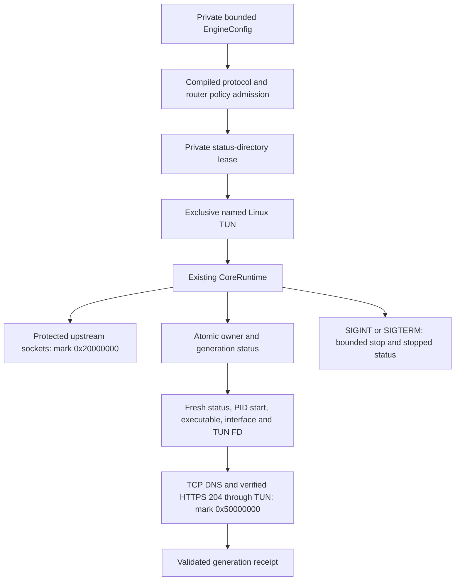

# Linux router runtime

`foxcore-cli` is a Linux adapter for the existing `CoreRuntime`.
Its Cargo features select the actual compiled protocols; direct, Tor and I2P profiles are
refused. The build helper accepts individual VPN flags, `--wg`, `--hy2` and `--all`; no
flags selects Hysteria2 (`crates/foxcore-cli/Cargo.toml:12`;
`crates/foxcore-cli/src/protocols.rs:3`, `:50`; `scripts/build-cli.sh:22`).

## Process and file ownership

Configuration is a regular, owner-only file, at most 1 MiB. Nonblocking/no-follow opening
prevents FIFO waits and final symlink traversal. The CLI refuses local guard, loopback
listeners, direct DNS/default routing, Android application policy and direct route rules.
Country/site/device bypass belongs to the router policy outside this TUN, so those rules
cannot silently turn a tunnel proof into direct egress
(`crates/foxcore-cli/src/config.rs:9`, `:22`, `:56`).

The status directory must be owner-only. A held advisory lock admits one process for each
status path. TUN creation uses `IFF_TUN_EXCL`, atomically refusing another interface with
the same name. The owned descriptor remains in CoreRuntime's existing release discipline;
Linux TUN descriptors are close-on-exec
(`crates/foxcore-cli/src/status.rs:115`, `:136`;
`crates/foxcore-cli/src/run.rs:14`, `:27`, `:74`;
`crates/foxcore-tun/src/device.rs:126`, `:138`).

Status is an atomic private JSON document updated each second. `running` means an owned
runtime, not a validated connection. The CLI exits on a fatal Core error or lost TUN owner.
SIGINT/SIGTERM stop the runtime; a stop timeout invokes the existing force-kill path
(`crates/foxcore-cli/src/run.rs:84`, `:98`; `crates/foxcore-cli/src/status.rs:81`).

`import --profile FILE --out FILE` converts a single supported share link, Clash YAML node, SIP008/standard Outline JSON node, WireGuard text
or admitted EngineConfig into an atomic owner-only configuration file. It refuses multiple
links and unapplied link options; credentials are not command-line parameters or printed
results. Serialized input/output buffers are zeroized, and the same compiled-protocol and
router-policy admission is applied before publication
(`crates/foxcore-cli/src/import.rs:5`; `crates/foxcore-cli/src/args.rs:17`).

## Bootstrap and proof

The Linux endpoint resolver uses bounded TCP DNS with upstream-marked sockets before
connect, querying A/AAAA records through Cloudflare's public resolvers. It never falls back
to the system resolver. `with_host_resolver` separates that ownership from Android's
existing `with_resolver`, which still requires a nonzero selected Android Network handle
(`crates/foxcore-cli/src/bootstrap.rs:8`, `:34`, `:68`;
`crates/foxcore-dialer/src/lib.rs:60`, `:72`, `:139`).

`probe` requires a status no older than five seconds, the recorded process start tick,
the same executable inode, interface index and TUN descriptor. Before connecting it marks
and binds every proof socket to that TUN. TCP DNS validates the exact transaction/question
and accepts only related A answers to the fixed proof host; private, reserved, mapped and
IPv6 answers cannot redirect this IPv4 proof. HTTPS uses WebPKI verification for the fixed
host and requires a complete HTTP header with status 204. The whole operation has a
40-second deadline, with no direct-network retry. Ownership and generation are rechecked
after success (`crates/foxcore-cli/src/status.rs:34`, `:180`;
`crates/foxcore-cli/src/probe.rs:10`, `:27`, `:66`, `:137`;
`crates/foxcore-dns/src/wire.rs:145`).

The proof has its own extra mark bit (`0x10000000`) in addition to the tunnel bit.
The router can therefore keep ordinary client traffic blocked while admitting only the
owned proof into its temporary TUN route; validation must precede normal policy activation.
The CLI sets loose reverse-path filtering only on its newly owned TUN, leaving WAN and
other interface settings unchanged
(`crates/foxcore-cli/src/args.rs:5`; `crates/foxcore-cli/src/linux.rs:47`).

## Authenticated compatibility bridge

`bridge --state FILE --auth FILE` provides an authenticated SOCKS5 loopback
adapter for router services, including packet WireGuard profiles. The owner-only
credential file carries independent 256-bit hexadecimal username/password values
and an IPv4 loopback listener. Anonymous SOCKS methods are refused. Every outbound
TCP/UDP socket is marked with the normal tunnel mark and bound to the exact owned
TUN before use. Domain resolution uses validated TCP DNS through that TUN, with
no system or direct resolver fallback
(`crates/foxcore-cli/src/bridge.rs:36`, `:124`, `:233`).

The bridge captures the current process/TUN generation and rechecks it every
250 ms. Owner loss or generation change aborts all sessions. There are at most
64 active sessions, 64 destinations per UDP association, and a 30-second bounded
association-local DNS cache. UDP fragmentation is refused; empty datagrams are
admitted. IPv6 sockets are created on demand so an IPv4-only kernel can retain
IPv4 associations. A TCP control connection owns the UDP relay lifetime
(`crates/foxcore-cli/src/bridge.rs:15`, `:59`, `:346`, `:464`).

The bridge uses the normal tunnel mark, never the separate proof mark.
The router explicitly drops normal-marked packets during bootstrap: a bound
TUN socket can bypass a policy-table prohibit, so the prohibit alone is not
the admission gate. It is an adapter for existing router HY2
inbound servers, not a native HY2 server implementation. Its unit/build checks
do not replace actual SOCKS/TUN routing and owner-loss acceptance.

## OpenWrt consumer contract

The router distinguishes saved Core servers (`engine: core`, native
`schema_version: 1` configuration) from unchanged legacy Hysteria servers.
Core admission invokes `foxcore-cli import` with protected input/output files;
URI credentials are never process arguments. Activation checks the imported
configuration against the installed protocol feature set. Gecko, BBR and other
legacy options are not rewritten into unsupported Core settings
(`foxhole-openwrt-client/package/foxhole-openwrt-client/root/usr/share/foxhole/core-adapter.uc:17`).

The supervisor starts Core with private configuration/status files, initially
prohibits normal VPN-marked traffic, and admits the separate proof mark to table
202. Only a successful generation-owned probe permits normal table-201 routing.
The compatibility bridge serves the existing HY2 inbound process; losing its
Core owner cannot choose direct egress for a still-selected Core upstream with
client rules enabled. An explicit manual Stop remains a separate routing choice
(`foxhole-openwrt-client/package/foxhole-openwrt-client/root/usr/libexec/foxhole-runtime`;
`foxhole-openwrt-client/package/foxhole-openwrt-client/root/usr/libexec/foxhole-supervisor`;
`foxhole-openwrt-client/package/foxhole-openwrt-client/root/usr/share/foxhole/inbound.uc`).

`owner` verifies fresh status, process identity and the owned TUN. Owner/probe
receipts include a fixed-width hexadecimal `generation_key`: the phone/ucode
boundary does not round an arbitrary 64-bit JSON integer. A phone proof also
requires the current normal-mark kernel route, the same normalized installed
nftables chains, matching active routing state, and a VPN-bound proof no older
than five seconds measured by router uptime. Traffic counters are excluded from
the policy identity; changing rules, route, owner or generation invalidates it.
Actual firmware routing acceptance is required before enabling automatic phone
VPN pauses. Legacy connected JSON fields alone never authorize a pause
(`crates/foxcore-cli/src/main.rs`; `crates/foxcore-cli/src/probe.rs`;
`foxhole-openwrt-client/package/foxhole-openwrt-client/root/usr/share/rpcd/ucode/foxhole.uc`).

The phone service binds the live private IPv4 LAN on port 8443. Its persistent
public leaf is `/etc/foxhole/mobile.crt`; the private key is never a protocol
field. PIN authorization creates an independent revocable pairing credential.
Phone provisioning validates the real CGI peer address and current LAN MAC,
journals intent before state, and keeps client IDs/credentials stable across
lost replies. LAN registration and remote HY2 creation are independent choices;
remote creation uses the separate Go HY2 server. With an actual public IPv4
WAN, the paired request can create a separate P-256 TLS identity and a pinned
per-client server template; existing templates are preserved. Creating a profile
does not imply externally reachable UDP. The APK feature remains disabled until its
transport, package and firmware gates pass.

Authenticated `client.get` returns the complete portable remote profile.
Incoming-client deletion stops the owned procd listener and confirms the captured
process/start identity is gone before removing state. Only that case returns
`clientRevocation.applied=true,targetRevoked=true`; failure preserves the record.
Legacy shared-profile deletion returns `targetRevoked=false` because it cannot
revoke an external provider credential. A lost reply or state absence alone does
not prove runtime revocation. Management unpair removes the phone credential and
its leases; remote VPN clients must be deleted separately. These source contracts
still require live old-auth rejection and procd lifecycle acceptance
(`foxhole-openwrt-client/package/foxhole-openwrt-client/root/usr/share/rpcd/ucode/foxhole.uc:768`, `:865`, `:1061`;
`foxhole-openwrt-client/package/foxhole-openwrt-client/root/usr/libexec/foxhole-inbound-revoke`).

### Phone provider handoff

The paired `phone.handoff` method admits only a registered, MAC-bound phone and
one to eight literal public provider endpoints. Each tuple fixes transport and
port; the kernel timeout is at most 60 seconds. A reserved ingress mark exempts
those sockets while ordinary phone traffic retains router VPN rules. The journal
is fenced by pairing credential, router boot ID and claim ID. Replacement claims
retire prior claims; release tombstones reject delayed renewal after a reply was
lost. PIN reset and revocation remove owned leases before changing credentials.

`phone.status.handoff` is explicitly null only after confirming no active lease.
Unknown NFT state or a receipt/journal mismatch omits the field, so consumers
must not infer absence. Request timestamps use authenticated router monotonic
time with a five-second freshness deadline; the CGI queue has the same bound.
A non-null value requires actual NFT table/element readback with remaining kernel
lifetime. Router handoff release additionally checks the exact owned generation,
server, policy and fresh VPN-bound proof before and after deleting the exemption.
`phone.resolve` provides a rate-limited authenticated HTTPS DNS bootstrap for
uncached provider hostnames and refuses non-public answers. It does not grant
general DNS or WAN bypass. These endpoints have source model checks; actual
firmware/packet acceptance is still pending, so `homeProof`, `phoneHandoff` and
`providerResolve` remain false.
(`foxhole-openwrt-client/package/foxhole-openwrt-client/root/usr/share/foxhole/handoff.uc:144`;
`foxhole-openwrt-client/package/foxhole-openwrt-client/root/usr/share/foxhole/handoff-adapter.uc:160`;
`foxhole-openwrt-client/package/foxhole-openwrt-client/root/usr/share/rpcd/ucode/foxhole.uc`).

## Installation and native package contract

The installer defaults to Hysteria2 alone. Individual protocol flags combine;
`--all` requests the exact twelve-protocol feature set. The release catalog
admits only an actual native producer/capability pair and its exact firmware
version, SDK target and package architecture. It does not infer that every
ARM64 board accepts an `aarch64_generic` build
(`foxhole-openwrt-client/install.sh:12`;
`foxhole-openwrt-client/tools/package-catalog.py:41`;
`foxhole-openwrt-client/tools/install-plan.uc:22`).

Budget generation uses real APK metadata, indexed authentication, the native
dependency solver and APK payload extraction. The installed flash binary or
volatile RAM payload must match the native producer digest. Complete flash/RAM
requirements include the dependency closure, staging, explicit runtime memory
evidence or conservative policy, and reserves. Existing kernel ABI must match;
the installer never upgrades a kernel to satisfy an incompatible module. Flash
is persistent; RAM redownloads the same pinned producer after reboot
(`foxhole-openwrt-client/tools/package-budget.py:31`, `:191`;
`foxhole-openwrt-client/tools/install-plan-model.uc:137`).

OpenWrt 25.12 authenticates upstream packages through original signed indexes;
individual signatures are required separately for FoxHole APKs. The Core
`canonical-apk-and-upstream-index-v1` contract retains each original index,
its HTTPS provenance and role-specific public keys, plus every signed package
identity. Whole-archive SHA-256 remains a distinct release-asset binding.
Native offline fetch into a fresh empty directory verifies the signed identities;
an existing equal-size destination or `--link` would skip that verification.
The installer applies indexed roots only after the full closure, live package DB
and exact existing kernel checks. It never installs a kernel or re-signs upstream
packages. Root selectors include the authenticated package checksum because a
version-only request can retain a different feature build with the same version.
The full signed identity and archive digest remain independent checks. Staging
counts two archive copies, two index copies, public keys,
installed/volatile sizes; runtime memory and reserves are added once.
These source checks do not themselves establish a complete authenticated bundle
or successful firmware installation
(`foxhole-openwrt-client/tools/indexed-auth.py:91`, `:198`;
`foxhole-openwrt-client/tools/install-plan-model.uc:30`;
`foxhole-openwrt-client/tools/install-core.sh:172`, `:182`, `:220`).

The trusted SSH setup invokes the root-only bootstrap helper without arguments.
It preserves a changed PIN and paired clients. Fresh setup returns a transient,
one-use four-digit PIN with a five-minute deadline bound to router uptime and
boot ID. Successful locked unlock consumes it while retaining mandatory user
PIN replacement. Restart invalidates previous setup sessions; an interrupted
unlock can reissue bootstrap only while the PIN remains unchanged. No PIN or
root password is a command-line argument or installed manifest field
(`foxhole-openwrt-client/package/foxhole-openwrt-client/root/usr/libexec/foxhole-bootstrap-enroll:12`, `:50`;
`foxhole-openwrt-client/package/foxhole-openwrt-client/root/usr/share/rpcd/ucode/foxhole.uc:186`, `:957`).

The installed public receipt records the selected catalog variant, protocols,
mode, target/version and exact producer/capability/binary/package hashes.
Its publication requires actual installed producer, binary/RAM-cache and
capability readback; a retained different same-version binary fails setup.
The phone compares it against the authenticated release proposal before pairing.
Source-only schemas and temporary laboratory signatures are not production
package signing or firmware acceptance
(`foxhole-openwrt-client/tools/install-plan.uc:27`;
`foxhole-openwrt-client/tools/install-core.sh:221`).

The forthcoming 1.0 package variant includes a separate dormant Hysteria server
APK. RAM budgets retain `volatileBinary` for Core and account for the server in
`volatileDependencies`; each extra payload binds an actual producer file/hash,
binary digest and byte count. The installer stages both verified caches before
package post-install services start. Incoming services remain off until explicit
remote-client creation. Go producer records include compiled dependency licenses
and the runtime license, not only the repository's top-level MIT license.
The server uses Go 1.26.10 and the pinned x/net 0.60 dependency repair; its producer
preserves the upstream archive identity and records modified source, the exact
combined patch and effective source hashes. The UDP session-close repair rejects
new sends and subsequent fragments with `net.ErrClosed`; already admitted I/O
may complete without holding a mutex across transport writes. Producer admission
also binds the compiled Go runtime and a fresh complete-suite receipt on the
modified source. That retained source suite used Go 1.26.9; the current compiler
qualification and target-runtime evidence have separate identities.
Physical package logs and the separate whole integration run
must be validated before building; older passes and diagnostic copies cannot
qualify it. Package admission rejects old toolchains or missing repair evidence
(`foxhole-openwrt-client/tools/hysteria_provenance.py:34`).
(`foxhole-openwrt-client/tools/package-budget.py`;
`foxhole-openwrt-client/tools/package-catalog.py`;
`foxhole-openwrt-client/tools/record-hysteria-producer.py:65`;
`foxhole-openwrt-client/tools/install-core.sh:192`).

## First-setup license contract

Both Android clients start a fresh router setup with `licenseAccepted: false` and show the
package agreement separately from the automatic-update policy. Read-only SSH host-key discovery
remains available. Authenticated SSH inspection and installation require the explicit choice;
the accepted setup adds `--accept-license` to the installer's `--apply` command.

First-PIN `unlock` can declare `licenseRequired: true` and `licenseVersion: 1`.
`pin.change` sends a plain Boolean `licenseAccepted` and integer `licenseVersion`.
The first-PIN contract requires `true, 1`; existing paired routers keep their recorded policy and
need no retroactive agreement. A late checkbox callback is bound to its wizard generation and
cannot approve a new setup. Closing the wizard clears its transient choice.

Phone contracts are mirrored in Guard and VPN: `router/RouterSetupLicense.kt`,
`router/RouterWizardCoordinator.kt`, `router/WifiRouterSetupService.kt`,
`router/RouterPanelApi.kt` and `router/RouterInstallCommand.kt`. This changes the app/router
setup contract without changing the Core JNI surface or native producer identity.

## Inconsistencies and verification boundaries

- A CLI status or local unit test does not prove routing, provider interoperability, a
  signed OpenWrt package or successful router installation. Those require their own
  current-artifact acceptance.
- OpenWrt's supervisor/package migration, restricted phone pairing API and Android
  router controls are separate consumers; their integration is not implied by this CLI.
- The build helper initially selects Linux ARM64/x86_64 musl targets. It does not claim
  support for a router architecture before a real target build and runtime test.
- Android FoxHole VPN remains the reference for a future desktop GUI; desktop software
  is not implemented by this router adapter.
