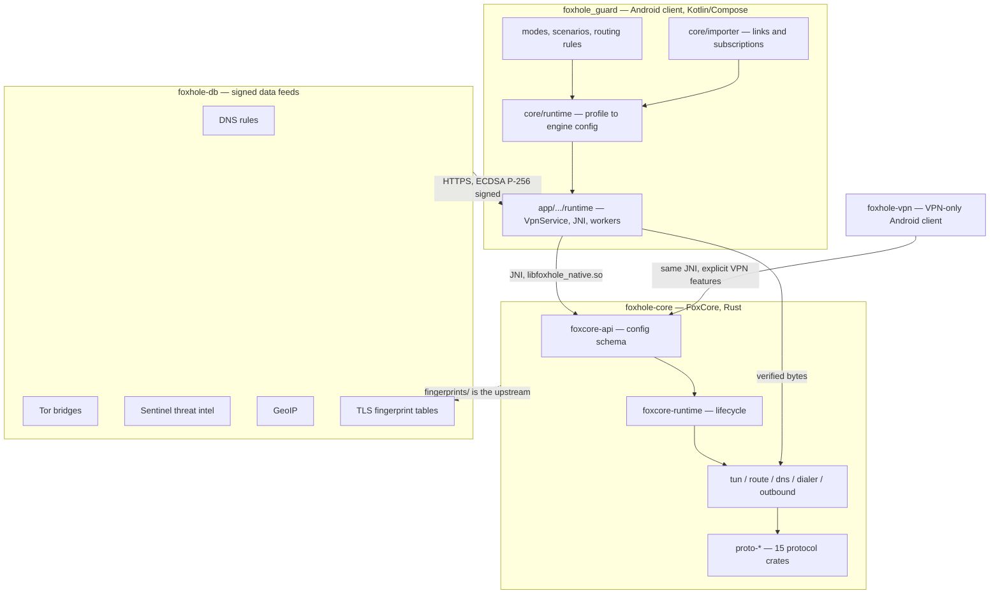
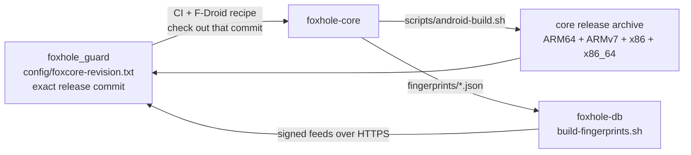

# FoxHole Core architecture

FoxHole Guard spans the core, Android client and data repositories. FoxHole VPN is a separate,
smaller Android consumer of the same core. Minimum prose, maximum diagrams — read the pictures, use the text
only for what a picture cannot say.

---

## The documents

| # | Document | Covers |
|---|---|---|
| 1 | [Protocols](01-protocols.md) | every outbound, its carrier, its security layer, where it terminates, UDP support, and every fail-closed path with the reason for it |
| 2 | [Cryptography](02-cryptography.md) | per-protocol auth and KEX, the ML-KEM-768 hybrid and the ML-DSA-in-fingerprints story, REALITY's derivation step by step, and the full pinning table |
| 3 | [Updates and data delivery](03-updates-and-data-delivery.md) | all five published signed feeds, manifest + detached signature, the pinned key, rollback protection, when each document takes effect, and the APK update channel |
| 4 | [App ↔ core boundary](04-app-core-boundary.md) | profile → engine config, the JNI surface, what crosses the FFI in what form, and the VPN connect/disconnect sequences |
| 5 | [Data repository](05-data-repository.md) | what each feed is built from, by which script, and what the client checks on receipt |
| 6 | [VPN-only client](06-vpn-client.md) | app/network ownership, safe profile adding while connected, QR/portable transfer, confirmed protocol changes, subscription metadata, encryption, cartographic globe/callout state, widget home refresh, safe 12h subscriptions, separate signed-table and APK updates, and connection proof |
| 7 | [Linux router runtime](07-router-runtime.md) | selected protocol builds, protected bootstrap, exclusive TUN and process ownership, private status and forced-tunnel connection proof |

---

## How the repositories are bound together

| Binding | Mechanism |
|---|---|
| Client → core, source | Gradle resolves the sibling folder `foxhole-core`; override with `-Pfoxhole.foxCoreSourceRoot` or `FOXCORE_SOURCE_ROOT` |
| Client → core, revision | `config/foxcore-revision.txt` — CI/F-Droid check out that commit; local Gradle compares the sibling's Git HEAD (`app/build.gradle.kts:268-327`), refuses a mismatch for release tasks and prints an error banner for other tasks |
| Core → client, native artifact | `scripts/android-build.sh:67-98` applies stable virtual prefixes to Rust source locations; `scripts/android-elf-gate.sh:138-166,222-225` refuses host build paths in `libfoxhole_native.so` |
| Core → DB | `build-fingerprints.sh` sparse-checks out `foxhole-core/fingerprints/` at a pinned revision |
| DB → client | five feeds and nine published manifests with one pinned ECDSA P-256 key; categorized DNS resolves four variant paths for the official DNS URL (`foxhole-db/.github/published-files.txt:11-26`; `foxhole_guard/app/src/main/kotlin/com/foxhole/guard/runtime/CategorizedDnsSelection.kt:24-29`) |
| Release order | Core verified asset → DB with that actual Core asset pin → Android apps, OpenWrt and private variants; owner review precedes publication |
| F-Droid → core | Guard recipe reads `config/foxcore-revision.txt`, accepts only a full SHA, fetches and checks out that commit inside the `FoxHoleCore` srclib, then checks HEAD; the fixed srclib bootstrap revision need not change between app versions (`foxhole_guard/metadata/com.foxhole.guard.yml:27-34,42-47`) |

FoxHole VPN pins its own Core revision/source manifest and explicit VPN feature list. It consumes
only the signed TLS fingerprint feed, while Guard consumes the broader feed set. The Android clients
also share a bounded Kotlin profile import/export contract without routing those operations through
native link JNI. VPN checks signed tables by default every 24 hours and refreshes all saved
subscription sources every 12 hours; automatic publication defers active configuration changes. Its
separate GitHub APK updater checks every 24 hours and hands a verified newer release to Android's installer; it adds no native update contract.
IP refresh is foreground/event owned. These are app schedules, not new Core background tasks
(`foxhole-vpn/config/foxcore-revision.txt:1`; `foxhole-vpn/config/foxcore-features.txt:1`;
`foxhole-vpn/app/src/main/kotlin/com/foxhole/vpn/updates/FingerprintHttpSource.kt:28`;
`foxhole_guard/core/importer/src/main/kotlin/com/foxhole/core/importer/ProfileImportParser.kt:18`;
`foxhole_guard/core/importer/src/main/kotlin/com/foxhole/core/importer/PortableProfileExport.kt:16`;
`foxhole-vpn/app/src/main/kotlin/com/foxhole/vpn/VpnContracts.kt:23-26`;
`foxhole-vpn/app/src/main/kotlin/com/foxhole/vpn/refresh/VpnRefreshWork.kt:55`;
`foxhole-vpn/app/src/main/kotlin/com/foxhole/vpn/refresh/ForegroundIpRefresh.kt:9`).

The current Android release contract is `android4`: `arm64-v8a`, `armeabi-v7a`, `x86`
and `x86_64`. The delivery configuration and LAB scope require matching JNI artifacts,
capabilities origins and ELF checks for each ABI (`config/foxcore-android-delivery.json:3-15`;
`scripts/lab-release-required-scope.json`, `androidReleaseDefinition`). Guard's Gradle default
selects all four; an explicit `foxhole.abis` invocation may narrow a diagnostic artifact,
whose inventory determines its actual contents (`foxhole_guard/app/build.gradle.kts:391-401`).
The GitHub release workflow verifies an owner-signed LAB handoff and publishes the exact
verified bytes without compiling (`.github/workflows/release.yml:46-74`).

FoxHole VPN also has an explicit per-invocation ABI selection connected to its Gradle filters
and native validation. The current release requires all four Android ABIs; every requested Core
library must exist in the verified producer receipt. A diagnostic subset does not establish
acceptance of an omitted ABI (`foxhole-vpn/app/build.gradle.kts`;
`foxhole-vpn/scripts/verify-native-payload.py`).

---

## Reading conventions

- Every `file:line` citation is relative to its repository root: `foxhole-core/`, the client
  checkout, or `foxhole-db/`.
- Claims are taken from code, not from the repositories' own READMEs. Where a README or a code
  comment disagrees with the code, the document says so in its final section rather than repeating
  the claim.
- File citations are source-checked against the current tree. Runtime claims still require the
  repository gates and device evidence; documentation is not treated as test proof.

### Where the drift lists are

Each document ends with the inconsistencies found while writing it:

| Document | Section |
|---|---|
| 1 — Protocols | 1.8 — no open inconsistencies after the smoltcp/UDP contract pass |
| 2 — Cryptography | 2.7 — no open inconsistencies after the current pass |
| 3 — Updates | 3.7 — inline vs shared verifiers and permissive Kotlin vs strict Rust JSON parsing; stale DNS/updater activation claims were closed in this pass |
| 4 — Boundary | 4.7 — compatibility-only link/continuity ABI, DNS activation, divergent link parsers, and the path-independent native build contract |
| 5 — Data repository | 5.7 — no open inconsistencies after the five-feed publication pass; source-info files remain audit-only by design |

| 6 — VPN client | Inconsistencies and verification boundaries — clipboard JSON/import mismatch and subscription naming/refresh ownership and fresh candidate restoration closed; provider, camera, device and performance acceptance remain separate |
| 7 — Router runtime | Inconsistencies and verification boundaries — Linux CLI source and runtime checks are distinct from OpenWrt/package/phone pairing acceptance |
